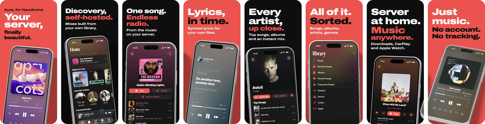

<div align="center">


# Aura

**Dein Musikserver, auf deinem iPhone, iPad, deiner Apple Watch, deinem Mac und Apple TV.** Ein nativer Player für Navidrome und Subsonic:
verlustfreies Streaming, Songtexte, die Wort für Wort aufleuchten, Mixe aus dem, was du wirklich hörst, und deine ganze Bibliothek offline.

<a href="https://apps.apple.com/app/apple-store/id6818241470?pt=129146420&mt=8&ct=github"></a>&nbsp;&nbsp;
<a href="https://ko-fi.com/adrbn"></a>
<br><br>
<a href="https://github.com/adrbn/aura/releases/latest"></a>&nbsp;
<a href="https://github.com/adrbn/aura/releases/tag/mac-v1.8.0-build.620"></a>
<br>
<a href="#was-aura-kann"></a>&nbsp;
<a href="#aus-dem-quellcode-bauen"></a>
<br><br>
<picture>
  <source media="(prefers-color-scheme: light)" srcset="docs/assets/aura-hero-light.svg">
  
</picture>
<br><br>

[](#aura-herunterladen)
[](#aura-herunterladen)
[](#aura-herunterladen)
[](#aura-herunterladen)
[](#aura-herunterladen)
[](https://www.navidrome.org/apps/)
[](#datenschutz)
[](https://github.com/adrbn/aura/releases/latest)
[](LICENSE)

<sub><a href="https://apps.apple.com/app/apple-store/id6818241470?pt=129146420&mt=8&ct=github">Im App Store</a> als <b>Aura: Self-Hosted Music</b> · Kostenlos und Open Source · Mit deinem eigenen Server</sub>

[English](README.md) · [Français](README.fr.md) · [Español](README.es.md) · Deutsch · [Italiano](README.it.md) · [Português (Brasil)](README.pt-BR.md) · [日本語](README.ja.md) · [简体中文](README.zh-Hans.md) · [한국어](README.ko.md) · [Русский](README.ru.md)

</div>

---

Aura spielt die Musik auf deinem eigenen Server. Verbinde es mit Navidrome oder einem anderen Server, der die
Subsonic-API spricht, und deine Bibliothek ist auf deinem iPhone, deinem iPad, deiner Apple Watch, in CarPlay, auf
deinem Mac und auf deinem Apple TV: in Originalqualität gestreamt, mit zeitgenauen Songtexten, Mixen aus dem, was du wirklich spielst, einem
Radar mit neuen Veröffentlichungen deiner Interpreten, und alles, was du herunterlädst, bleibt auch ohne Empfang da.

> **Aura ist ein Client, kein Musikdienst.** Verbinde es mit einem Navidrome- oder Subsonic-kompatiblen Server, der dir
> gehört oder auf den du Zugriff hast. Es spielt deine Bibliothek; es hostet, liefert oder sucht keine Musik für dich.

## Was Aura kann

<table>
  <tr>
    <td align="center" valign="top" width="33%"><br><b>Verlustfrei, mit einem echten Equalizer</b><br><sub>FLAC und ALAC bleiben verlustfrei, oder 128, 192 oder 320 kbit/s bei langsamer Verbindung. Fünf Bänder von 60 Hz bis 14 kHz, eine Kurve zum Ziehen, 15 Voreinstellungen, ReplayGain.</sub></td>
    <td align="center" valign="top" width="33%"><br><b>Zeitgenaue Songtexte</b><br><sub>Wort für Wort, wenn dein Server Zeitangaben pro Wort hat, sonst Zeile für Zeile. Zuerst von deinem Server, dann von <a href="https://lrclib.net">LRCLIB</a>. Tippe auf eine Zeile, um dorthin zu springen.</sub></td>
    <td align="center" valign="top" width="33%"><br><b>Für dich gemacht</b><br><sub>Mixe nach Tageszeit, Stimmung und Genre, jeder mit eigenem Cover, und Nonstop, ein endloser Mix aus Titeln, die dir gefallen, aus deiner Nähe und noch nicht gehörten. Instant-Mix startet ein Radio von jedem Titel oder Interpreten aus. Wrapped erzählt dein Jahr als Story, mit einer Zusammenfassung zum Teilen.</sub></td>
  </tr>
  <tr>
    <td align="center" valign="top"><br><b>Radar</b><br><sub>Die Veröffentlichungen dieses Monats von den Interpreten, die du am meisten hörst. Was dein Server hat, läuft ganz; der Rest als 30-Sekunden-Vorschau.</sub></td>
    <td align="center" valign="top"><br><b>Alles offline</b><br><sub>Lade einen Titel, ein Album, eine Playlist oder die ganze Bibliothek herunter, jeweils in eigener Qualität. Ohne Empfang funktionieren Bibliothek, Suche und Wiedergabe weiter.</sub></td>
    <td align="center" valign="top"><br><b>Apple Watch und CarPlay</b><br><sub>Wird gerade wiedergegeben, Songtexte, Als Nächstes und die Bibliothek am Handgelenk, die Digital Crown für die Lautstärke. CarPlay in der App-Store-Version.</sub></td>
  </tr>
</table>

**Hören**

- **Eine Warteliste, in der du siehst, was kommt**, anstelle des Covers: als Nächstes abspielen, ans Ende anhängen, zum Umsortieren ziehen. Wenn ein Album oder eine Playlist endet, macht die automatische Wiedergabe mit ähnlichen Titeln weiter.
- **Lückenlose Wiedergabe** oder Überblenden von 1 bis 12 Sekunden, Zufall, einen oder alle wiederholen, und ein Einschlaftimer, der nach einer festen Zeit oder am Ende des Titels stoppt.
- **Jedes Format auf deinem Server**: WMA, APE, WavPack, DSD und andere wandelt dein Server in MP3 um. Eine eigene Qualität für Mobilfunk und ein Stream-Cache bis zur Größe, die du festlegst.
- **Für dich gemacht, wie du willst**: jeder Mix ein oder aus, die Genres der Genre-Mixe, und 25, 50 oder 100 Titel pro Mix.
- **Tonhöhe**, Halbton für Halbton, wie am Plattenspieler. **SharePlay** über FaceTime, alle streamen vom selben Server.

**Songtexte**

- **Rechtzeitig bereit**: Der Songtext des nächsten Titels wird geladen, bevor er beginnt. Bei einem Duett, einem Remix oder einer anderen Version prüft Aura, ob er zur laufenden Version passt.
- **Selbst korrigierbar**: Verschiebe das Timing, wenn deine Bluetooth-Kopfhörer verzögern, setze die Zeiten eines Songtexts selbst mit einem Tippen pro Zeile, oder lass Aura sie nach Gehör setzen: Es hört den Titel auf dem iPhone und platziert jede Zeile und jedes Wort, auch bei Texten ohne Zeitangaben.
- **Übersetzung**, optional, unter jeder Zeile, mit Googles Gemini und deinem eigenen kostenlosen API-Schlüssel. Gesendet wird nur der Titel, bei dem du auf Übersetzen tippst: seine Zeilen, sein Titel und sein Interpret.

**Deine Bibliothek**

- **Eine Suche** über Titel, Alben, Interpreten und Playlists, die Tippfehler verzeiht, auf dem iPhone über deine ganze Bibliothek ausgeführt, mit `artist:`, `album:`, `genre:` und `year:` nur einen Tipp entfernt. Füge den Link zu einem Titel aus einem anderen Dienst ein, um ihn hier zu finden, und filtere die Titellisten nach der Sprache der Musik. Auch eine Zeile aus dem Songtext findet ihren Titel.
- **Playlists nach deinem Geschmack**: als Raster oder Liste, Filter, Cover aus deinen Fotos, Ordner mit Namen wie `Ordner/Name`, ein Bereich Vorschläge sowie Titel hinzufügen, Rückgängig und Duplikate entfernen, das die erste Kopie jedes Titels behält. Speichere jedes Radio als Playlist; Änderungen gehen an deinen Server.
- **Bewertungen, Scrobbling und Playlist-Änderungen** gehen an deinen Server und warten auf dem iPhone, solange du offline bist, Favoriten ebenso. Halte eine Playlist heruntergeladen: Ihre neuen Titel laden sich von selbst herunter.
- **Mehrere Server**, jeder mit optionaler Adresse fürs Heimnetz und eigenen Headern, und mehrere Musikordner gleichzeitig.
- **Seiten in der Farbe ihres Covers**, animierte Cover, Alben mit mehreren CDs, Sortier-Tags und Sortierungen, die bleiben.

**Rund ums iPhone**

- **iPad**: für den großen Bildschirm angelegt, im Querformat mit Songtext oder Warteliste neben dem Cover, und auch mit dem Widget.
- **Sperrbildschirm, Kontrollzentrum, Dynamic Island und AirPlay**, und ein Widget für den Home-Bildschirm, das zeigt, was gerade läuft.
- **Siri und Kurzbefehle**: einen Interpreten, ein Album, einen Titel, eine Playlist oder ein Genre per Name abspielen, einreihen, liken, überspringen. **`aura://`-Links** für Kurzbefehle.
- **iPhone, Mac und Apple TV spielen aufeinander ab**, im selben WLAN: schicke die Musik von einem zum anderen, steuere sie von jedem aus (Steuerung, Warteliste, Lautstärke) und sieh in einem zweiten Mini-Player, was das andere spielt. Deine AirPods bleiben beim Gerät, das spielt.
- **Links zum Teilen**, die einen Titel in anderen Diensten öffnen.
- **Nach deinem Geschmack**: hell oder dunkel, jede Akzentfarbe, Tabs und Bereiche von Start in deiner Reihenfolge, eine Uhr im Querformat und Layouts für das iPhone Duo.
- **25 Sprachen**: Englisch, Französisch, Italienisch, Spanisch, Katalanisch, Deutsch, Niederländisch, Portugiesisch (Portugal und Brasilien), Schwedisch, Norwegisch, Dänisch, Finnisch, Polnisch, Tschechisch, Rumänisch, Ukrainisch, Russisch, Griechisch, Türkisch, Thailändisch, Japanisch, Koreanisch und Chinesisch (vereinfacht und traditionell).

## Auf jedem Gerät

**iPhone**

<p align="center">
  
</p>

**Apple Watch**

<p align="center">
  
</p>

**CarPlay** (App-Store-Version): Start mit den Mixen und dem Radar, Alben als Cover-Raster, deine Playlists, alle
Interpreten von A bis Z, die Internetradiosender deines Servers, ein Tab Heruntergeladen und deine Offline-Playlists, die
ohne Verbindung laufen, und eine Radio-Taste, die den Titel mit ähnlicher Musik fortsetzt.

**Mac** (macOS 26): aus demselben Code wie die iPhone-App. Die ganze Bibliothek in einem Fenster mit
Seitenleiste; Als Nächstes als Seitenbereich, den du per Ziehen umsortierst, mit Rechtsklick für Als Nächstes abspielen,
Radio starten, Bewertung und Download; Songtexte im Vollbild; Radar, Wrapped, Downloads, der Equalizer und ein Player in der
Menüleiste.

<p align="center">
  
  
</p>
<p align="center"><sub>Die Mac-Aufnahmen nutzen den öffentlichen Demo-Server von Navidrome.</sub></p>

**Apple TV** (tvOS 26, im App Store): Start mit den Mixen, die Mediathek mit Sortierungen und Filtern, die Suche, Album- und Interpretenseiten und Wird gerade wiedergegeben im Vollbild über dem unscharfen Cover, mit dem Songtext im Takt des Songs. Fünf Sekunden ohne Fernbedienung, und die Steuerung blendet aus: Es bleiben nur Cover, Song und Songtext, der sich vom Fernseher, vom iPhone oder vom Mac aus größer stellen lässt.

<p align="center">
  
  <br>
  
  
</p>

**iPhone Duo**: Aufgeklappt hält Wird gerade wiedergegeben den Player links, mit Songtext oder Warteliste daneben.

<p align="center">
  
</p>

## Aura herunterladen

Alles kostenlos, ohne Konto und ohne In-App-Käufe.

| | App Store | IPA (Sideload) | Mac (Vorschau) |
|---|---|---|---|
| Läuft auf | iPhone, iPad, Apple Watch, CarPlay, Apple TV | iPhone, iPad, Apple Watch | Mac |
| Benötigt | iOS 26, iPadOS 26, watchOS 26, tvOS 26 | iOS 26, iPadOS 26, watchOS 26, ein Sideloading-Tool | macOS 26, Apple Silicon oder Intel |
| CarPlay | Ja | Nein: Das Neusignieren entfernt Apples CarPlay-Berechtigung | – |
| Get It (Soulseek über dein eigenes [slskd](https://github.com/slskd/slskd)) | Nein | Optional, Einstellungen → Developer Options | Optional, Einstellungen → Developer |
| NetEase-Prüfung der Songtext-Zeiten | Nein | Ja | Ja |
| Download | [App Store](https://apps.apple.com/app/apple-store/id6818241470?pt=129146420&mt=8&ct=github) | [Neueste IPA](https://github.com/adrbn/aura/releases/latest) | [Mac-DMG](https://github.com/adrbn/aura/releases/download/mac-v1.8.0-build.620/Aura-mac-1.8.0-build.620.dmg) |

Jede Version braucht einen [Navidrome](https://www.navidrome.org)-Server oder einen anderen Server, der die
Subsonic-API 1.16.1 spricht (OpenSubsonic-Erweiterungen werden genutzt, wenn er sie anbietet). Noch kein Server?
Probier die öffentliche Demo von Navidrome: `https://demo.navidrome.org`, Benutzer `demo`, Passwort `demo`.

<details>
<summary><b>Die IPA installieren</b></summary>

1. Installiere ein Sideloading-Tool auf deinem iPhone: [AltStore](https://altstore.io), [SideStore](https://sidestore.io) oder Feather.
2. Lade `Aura-v<version>-build.<number>.ipa` aus dem [neuesten Release](https://github.com/adrbn/aura/releases/latest) herunter. Jedes Release nennt seine SHA-256-Prüfsumme.
3. Öffne die IPA in deinem Sideloading-Tool und installiere sie.
4. Beim ersten Start blockiert iOS die App: Gehe zu **Einstellungen → Allgemein → VPN und Geräteverwaltung** und vertraue dem Entwicklerprofil.
5. Öffne Aura und gib die Adresse deines Servers, deinen Benutzernamen und dein Passwort ein.

Eine neue IPA über einer früheren Sideload-Installation behält deine Server, Passwörter, Downloads und Pins. Mit einer
kostenlosen Apple-ID läuft die Signatur nach 7 Tagen ab und das Sideloading-Tool muss sie erneuern; das ist eine Grenze
von iOS, nicht von Aura.

</details>

<details>
<summary><b>Die Mac-App installieren</b></summary>

1. Lade [`Aura-mac-1.8.0-build.620.dmg`](https://github.com/adrbn/aura/releases/download/mac-v1.8.0-build.620/Aura-mac-1.8.0-build.620.dmg) aus dem [Mac-Release](https://github.com/adrbn/aura/releases/tag/mac-v1.8.0-build.620) herunter, das seine SHA-256-Prüfsumme nennt, und öffne sie.
2. Ziehe **Aura** auf **Programme**.
3. Öffne Aura. Die App ist mit einer Developer ID signiert und von Apple notarisiert, sie öffnet sich also wie jede andere App.
4. Gib die Adresse deines Servers, deinen Benutzernamen und dein Passwort ein.

Die Mac-App ist eine Vorschau: Die iPhone-App ist die, die jeden Tag getestet wird.

</details>

<details>
<summary><b>Was Get It und die NetEase-Prüfung machen</b></summary>

**Get It** holt, was deiner Bibliothek fehlt: eine Veröffentlichung aus dem Radar, ein Deezer-Ergebnis in der Suche, die
fehlenden Titel eines Albums, das du nur teilweise hast (einzeln oder mit Alle holen), oder das Herz bei einer Vorschau
in Wird gerade wiedergegeben. Aura findet die Veröffentlichung auf Soulseek über dein slskd, lädt sie herunter und
wartet, bis dein Server sie aufnimmt, wobei jeder Schritt auf dem Bildschirm zu sehen ist. Nichts läuft über den Server
von jemand anderem. Lade nur Musik herunter, an der du die Rechte hast.

Die **NetEase-Prüfung** fragt den Katalog von NetEase nach Titel, Interpret und Länge nach Songtexten, die auf die
genaue Aufnahme abgestimmt sind, denn Songtext-Quellen legen einen Remix oft mit den Zeiten des Originals ab.

Die Sideload-Versionen können außerdem einer SoulSync-Watchlist aus dem Radar folgen und Songtexte, die du von Hand
timst, als `.lrc`-Dateien über File Browser auf deinen Server schreiben.

</details>

## Aus dem Quellcode bauen

<details>
<summary><b>Klonen, signieren, ein Schema wählen</b></summary>

```bash
git clone https://github.com/adrbn/aura
cd aura
open Aura/Aura.xcodeproj
```

- Xcode 26 oder neuer (App-Store-Archive werden mit Xcode 27 erstellt).
- Wähle unter Signing & Capabilities dein eigenes Team und setze die Build-Einstellung `AURA_BUNDLE_BASE` auf Projektebene auf eine Bundle-ID, die dir gehört. Die Targets für Widget, Watch-App und Mac leiten ihre davon ab.
- Schemata und Konfigurationen:
  - **Aura**, mit `Debug` und `Release`: die Sideload-Version, mit Get It und der NetEase-Prüfung.
  - **Aura-AppStore**, mit `Release-AppStore`: gebaut mit dem Flag `APPSTORE_BUILD`, das die Sideload-Funktionen herauskompiliert.
  - **Aura-mac**: die Mac-App.
  - **Aura-tv**: die Apple-TV-App.
- CarPlay braucht Apples Berechtigung `carplay-audio` für dein eigenes Team.
- `scripts/watch-screenshots.sh` zeichnet die Seiten der Watch-App auf einem Mac, ohne Watch und ohne Simulator.

Die Schriften (Vavin und Archivo, beide unter SIL OFL 1.1) liegen im Repository, ein frischer Klon baut also, ohne dass
etwas fehlt.

Die Grafiken auf dieser Seite erzeugt [`docs/assets/make_svgs.py`](docs/assets/make_svgs.py) (Python, nur
Standardbibliothek): `python3 docs/assets/make_svgs.py` erzeugt alle SVGs neu aus den echten Aufnahmen, die verkleinert
in `docs/assets/readme-src/` liegen.

</details>

## Datenschutz

Aura hat kein Konto und keine Analysen und sendet nichts an den Entwickler. Server-Passwörter liegen im Schlüsselbund.
Die App spricht mit deinem Server und mit den öffentlichen Diensten, die in der
[Datenschutzerklärung](https://aura.adrbn.dev/privacy.html) aufgeführt sind; dort steht genau, was jeder
davon erhält.

## Wie KI eingesetzt wurde

Aura ist ein Ein-Personen-Projekt, gebaut mit Claude Code, dem Programmierassistenten von Anthropic, der den Großteil
des Codes nach meinen Beschreibungen geschrieben hat. Ich habe entschieden, was Aura macht und wie es aussieht, die
Änderungen gelesen und die Versionen auf meinem eigenen iPhone mit meiner eigenen Bibliothek getestet. Jede Änderung
steht in der Commit-Historie, mit einer Nachricht, die sagt, was sie tut und warum.

## Mitmachen und unterstützen

Fehler und Funktionswünsche: [Issues](https://github.com/adrbn/aura/issues); sie erreichen einen Menschen. Pull Requests
sind willkommen, und das [Änderungsprotokoll](CHANGELOG.md) (auf Englisch) sagt, was sich geändert hat und warum. Aura
ist kostenlos und bleibt es. Wenn es sich einen Platz auf deinem Home-Bildschirm verdient:

<a href="https://ko-fi.com/adrbn"></a>

Ein Stern für das Repository hilft auch anderen, es zu finden.

### Danke

An die Menschen, deren Meldungen und Ideen Aura geprägt haben:

- [willvebert](https://github.com/willvebert): die Tasten und die Zurück-Navigation in CarPlay, die Siri-Suche, ausgeschlossene Genres in Mixen
- [dominak3](https://github.com/dominak3): automatischer Serverwechsel, anpassbare Player-Tasten, Downloads der Favoriten, der Mini-Player, der der Wischgeste folgt, Tschechisch und viele Fehlermeldungen
- [eibhei](https://github.com/eibhei): den laufenden Song aus dem Widget und vom Sperrbildschirm favorisieren
- [nClarke0101](https://github.com/nClarke0101): eigene HTTP-Header, Downloads auf die Apple Watch
- [DMcWetty](https://github.com/DMcWetty): mehrere Musikordner gleichzeitig
- [Dedeham](https://github.com/Dedeham): Titelfilter, die bleiben, wenn du zurückkommst

Und an die Menschen, deren Kaffees auf [Ko-fi](https://ko-fi.com/adrbn) Aura am Laufen halten: Greg und DummyHead.

## Lizenz

[GPL-3.0](LICENSE) © 2026 adrbn. Du darfst Aura unter derselben Lizenz weitergeben und verändern; eine veränderte
Version, die du verbreitest, muss unter GPL-3.0 offen bleiben.

<details>
<summary><b>Danksagungen</b></summary>

- [LRCLIB](https://lrclib.net) für Songtexte, [MusicBrainz](https://musicbrainz.org) für Mitwirkende, der öffentliche Katalog von [Deezer](https://www.deezer.com) für Cover, Interpretenfotos, den Radar, Vorschauen und Links zum Teilen, und die iTunes Search API ebenfalls für Links zum Teilen.
- Optional, mit deinem eigenen Schlüssel: [Google Gemini](https://ai.google.dev) für die Übersetzung von Songtexten und [Last.fm](https://www.last.fm) für Hörstatistiken.
- Schriften: [Archivo](https://github.com/Omnibus-Type/Archivo) und Vavin, beide unter der SIL Open Font License 1.1.
- Die Bilder von iPhone, Watch und Duo sind echte Aufnahmen der App mit der Bibliothek des Entwicklers; die Mac-Aufnahmen nutzen den öffentlichen Demo-Server von Navidrome.

</details>

<sub>Aura steht in keiner Verbindung zu Navidrome, Subsonic oder Apple. Alle Marken gehören ihren jeweiligen Inhabern.</sub>
