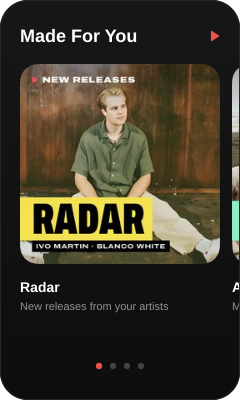
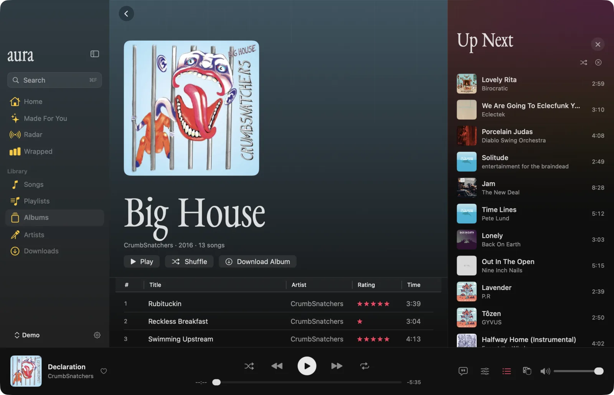

<div align="center">


# Aura

**Tu servidor de música, en tu iPhone, iPad, Apple Watch, Mac y Apple TV.** Un reproductor nativo para Navidrome y Subsonic:
streaming sin pérdida, letras que se iluminan palabra por palabra, mixes hechos con lo que escuchas de verdad y toda tu biblioteca sin conexión.

<a href="https://apps.apple.com/app/apple-store/id6818241470?pt=129146420&mt=8&ct=github"></a>&nbsp;&nbsp;
<a href="https://ko-fi.com/adrbn"></a>
<br><br>
<a href="https://github.com/adrbn/aura/releases/latest"></a>&nbsp;
<a href="https://github.com/adrbn/aura/releases/tag/mac-v1.8.0-build.620"></a>
<br>
<a href="#qué-hace"></a>&nbsp;
<a href="#compilar-desde-el-código"></a>
<br><br>
<picture>
  <source media="(prefers-color-scheme: light)" srcset="docs/assets/aura-hero-light.svg">
  
</picture>
<br><br>

[](#consigue-aura)
[](#consigue-aura)
[](#consigue-aura)
[](#consigue-aura)
[](#consigue-aura)
[](https://www.navidrome.org/apps/)
[](#privacidad)
[](https://github.com/adrbn/aura/releases/latest)
[](LICENSE)

<sub><a href="https://apps.apple.com/app/apple-store/id6818241470?pt=129146420&mt=8&ct=github">En el App Store</a> como <b>Aura: Self-Hosted Music</b> · Gratis y de código abierto · Usa tu propio servidor</sub>

[English](README.md) · [Français](README.fr.md) · Español · [Deutsch](README.de.md) · [Italiano](README.it.md) · [Português (Brasil)](README.pt-BR.md) · [日本語](README.ja.md) · [简体中文](README.zh-Hans.md) · [한국어](README.ko.md) · [Русский](README.ru.md)

</div>

---

Aura reproduce la música de tu propio servidor. Conéctalo a Navidrome, o a cualquier servidor que hable la API de
Subsonic, y tu biblioteca estará en tu iPhone, tu iPad, tu Apple Watch, en CarPlay, en tu Mac y en tu Apple TV: en su calidad original,
con letras a tiempo, mixes hechos con lo que de verdad escuchas, un Radar de los lanzamientos de tus artistas, y todo lo
que descargues sigue ahí aunque no haya cobertura.

> **Aura es un cliente, no un servicio de música.** Se conecta a un servidor Navidrome o compatible con Subsonic que sea
> tuyo o al que tengas acceso. Reproduce tu biblioteca; no aloja, no proporciona ni busca música por ti.

## Qué hace

<table>
  <tr>
    <td align="center" valign="top" width="33%"><br><b>Sin pérdida, con un ecualizador de verdad</b><br><sub>FLAC y ALAC se quedan sin pérdida, o a 128, 192 o 320 kbps con una conexión lenta. Cinco bandas de 60 Hz a 14 kHz, una sola curva que arrastras, 15 preajustes, ReplayGain.</sub></td>
    <td align="center" valign="top" width="33%"><br><b>Letras a tiempo</b><br><sub>Palabra por palabra cuando tu servidor tiene el tiempo de cada palabra, línea por línea si no. Primero de tu servidor, luego de <a href="https://lrclib.net">LRCLIB</a>. Toca una línea para saltar a ella.</sub></td>
    <td align="center" valign="top" width="33%"><br><b>Hecho para ti</b><br><sub>Mixes según la hora del día, el estado de ánimo y el género, cada uno con su portada, y Nonstop, un mix sin fin de canciones que te gustan, cercanas y aún sin escuchar. Mix instantáneo inicia una radio desde cualquier canción o artista. Wrapped hace el resumen de tu año.</sub></td>
  </tr>
  <tr>
    <td align="center" valign="top"><br><b>Radar</b><br><sub>Los lanzamientos del mes de los artistas que más escuchas. Lo que tiene tu servidor suena completo; el resto, en fragmentos de 30 segundos.</sub></td>
    <td align="center" valign="top"><br><b>Todo, sin conexión</b><br><sub>Descarga una canción, un álbum, una lista o toda la biblioteca, cada uno en su calidad. Sin cobertura, la biblioteca, la búsqueda y la reproducción siguen funcionando.</sub></td>
    <td align="center" valign="top"><br><b>Apple Watch y CarPlay</b><br><sub>Reproduciendo, letras, A continuación y la biblioteca en tu muñeca, con la Digital Crown en el volumen. CarPlay en la versión del App Store.</sub></td>
  </tr>
</table>

**Escuchar**

- **Una cola en la que ves lo que viene**, en lugar de la portada: reproducir a continuación, añadir al final, arrastrar para reordenar. Cuando termina un álbum o una lista, la reproducción automática sigue con canciones parecidas.
- **Reproducción sin pausas** o un fundido de 1 a 12 segundos, aleatorio, repetir una o todas, y un temporizador que para tras un tiempo fijado o al final de la canción.
- **Cualquier formato de tu servidor**: WMA, APE, WavPack, DSD y otros los convierte tu servidor a MP3. Una calidad aparte para datos móviles, y una caché de streaming del tamaño que elijas.
- **Hecho para ti, a tu manera**: cada mix activado o no, los géneros que usan los mixes por género, y 25, 50 o 100 canciones por mix.
- **Tono**, semitono a semitono, como en un tocadiscos. **SharePlay** por FaceTime, todos escuchando desde el mismo servidor.

**Letras**

- **Listas a tiempo**: la letra de la siguiente canción se busca antes de que empiece. Para un dúo, un remix u otra versión, Aura comprueba que coincide con la versión que suena.
- **Tuyas para corregir**: ajusta el tiempo si tus auriculares Bluetooth van con retraso, sincroniza tú mismo la letra de una canción con un toque por línea, o deja que Aura la sincronice de oído: escucha la canción en el iPhone y coloca cada línea y cada palabra, incluso en letras que no tenían tiempos.
- **Traducción**, opcional, bajo cada línea, con Gemini de Google y una clave de API gratuita tuya. Solo se envía la canción en la que tocas traducir: sus líneas, título y artista.

**Tu biblioteca**

- **Una sola búsqueda** en canciones, álbumes, artistas y listas que perdona las erratas, hecha en el iPhone sobre toda tu biblioteca, con `artist:`, `album:`, `genre:` y `year:` a un toque. Pega el enlace de una canción de otro servicio para encontrarla aquí, y filtra las listas de canciones por el idioma de la música.
- **Listas a tu manera**: en cuadrícula o en lista, filtros, portadas con tus fotos, carpetas con nombres como `Carpeta/Nombre`, una sección Sugerencias y Añadir canciones, Deshacer y Quitar duplicados, que conserva la primera copia de cada canción. Guarda cualquier radio como lista; los cambios van a tu servidor.
- **Valoraciones, scrobbling y cambios en las listas** van a tu servidor, y esperan en el iPhone mientras estás sin conexión, los favoritos también. Mantén una lista descargada: sus canciones nuevas se descargan solas.
- **Varios servidores**, cada uno con una dirección opcional para la red de casa y cabeceras personalizadas, y varias carpetas de música a la vez.
- **Páginas del color de su portada**, portadas animadas, álbumes de varios discos, etiquetas de orden, y órdenes que se mantienen.

**Alrededor del iPhone**

- **iPad**: pensado para la pantalla grande, con la letra o la cola junto a la portada en horizontal, y el widget también.
- **Pantalla bloqueada, Centro de control, Dynamic Island y AirPlay**, y un widget Reproduciendo para la pantalla de inicio.
- **Siri y Atajos**: reproduce un artista, álbum, canción, lista o género por su nombre, añade a la cola, marca como favorito, salta. **Enlaces `aura://`** para Atajos.
- **iPhone, Mac y Apple TV reproducen unos en otros** en la misma Wi-Fi: envía la música de uno a otro, contrólala desde cualquiera (controles, cola, volumen) y ve lo que suena en el otro en un segundo minirreproductor. Tus AirPods se quedan con el dispositivo que suena.
- **Enlaces para compartir** que abren una canción en otros servicios.
- **A tu gusto**: claro u oscuro, cualquier color de acento, pestañas y secciones de Inicio en tu orden, un reloj en horizontal y diseños para el iPhone Duo.
- **25 idiomas**: inglés, francés, italiano, español, catalán, alemán, neerlandés, portugués (Portugal y Brasil), sueco, noruego, danés, finés, polaco, checo, rumano, ucraniano, ruso, griego, turco, tailandés, japonés, coreano y chino (simplificado y tradicional).

## En cada dispositivo

**iPhone**

<p align="center">
  
</p>

**Apple Watch**

<p align="center">
  
</p>

**CarPlay** (versión del App Store): Inicio con los mixes y el Radar, álbumes en cuadrículas de portadas, tus listas,
todos los artistas de la A a la Z, las emisoras de radio por internet de tu servidor, una pestaña Descargado y tus
listas sin conexión que suenan sin cobertura, y un botón Radio que sigue la canción con música parecida.

**Mac** (macOS 26): hecho con el mismo código que la app del iPhone. Toda la biblioteca en una ventana con
barra lateral; A continuación como panel lateral que reordenas arrastrando, con clic derecho para Reproducir a
continuación, Iniciar radio, valorar y descargar; letras a pantalla completa; Radar, Wrapped, descargas, el ecualizador y un
reproductor en la barra de menús.

<p align="center">
  
  
</p>
<p align="center"><sub>Las capturas del Mac usan el servidor de demostración público de Navidrome.</sub></p>

**Apple TV** (tvOS 26, en el App Store desde la 1.8, y en [TestFlight](https://testflight.apple.com/join/pEUEBUbm) hasta entonces): Inicio con los mixes, la Biblioteca con sus orden y filtros, la Búsqueda, las páginas de álbum y de artista, y Reproduciendo a pantalla completa sobre la portada difuminada, con la letra siguiendo la canción. Tras cinco segundos sin tocar el mando, los controles se desvanecen y la pantalla deja solo la portada, la canción y la letra, que se puede agrandar desde la tele, el iPhone o el Mac.

<p align="center">
  
  <br>
  
  
</p>

**iPhone Duo**: abierto, Reproduciendo mantiene el reproductor a la izquierda con la letra o la cola al lado.

<p align="center">
  
</p>

## Consigue Aura

Todo gratis, sin cuenta y sin compras dentro de la app.

| | App Store | IPA (sideload) | Mac (vista previa) |
|---|---|---|---|
| Funciona en | iPhone, iPad, Apple Watch, CarPlay, Apple TV (desde la 1.8) | iPhone, iPad, Apple Watch | Mac |
| Requiere | iOS 26, iPadOS 26, watchOS 26, tvOS 26 | iOS 26, iPadOS 26, watchOS 26, una herramienta de sideload | macOS 26, Apple silicon o Intel |
| CarPlay | Sí | No: volver a firmar elimina el permiso de CarPlay de Apple | – |
| Get It (Soulseek con tu propio [slskd](https://github.com/slskd/slskd)) | No | Opcional, Ajustes → Developer Options | Opcional, Ajustes → Developer |
| Comprobación de tiempos de letras con NetEase | No | Sí | Sí |
| Descarga | [App Store](https://apps.apple.com/app/apple-store/id6818241470?pt=129146420&mt=8&ct=github) | [Último IPA](https://github.com/adrbn/aura/releases/latest) | [DMG para Mac](https://github.com/adrbn/aura/releases/download/mac-v1.8.0-build.620/Aura-mac-1.8.0-build.620.dmg) |

Todas las versiones necesitan un servidor [Navidrome](https://www.navidrome.org), o cualquier servidor que hable la API
de Subsonic 1.16.1 (se usan las extensiones de OpenSubsonic cuando las ofrece). ¿Aún no tienes servidor? Prueba la demo
pública de Navidrome: `https://demo.navidrome.org`, usuario `demo`, contraseña `demo`.

<details>
<summary><b>Instalar el IPA</b></summary>

1. Instala una herramienta de sideload en tu iPhone: [AltStore](https://altstore.io), [SideStore](https://sidestore.io) o Feather.
2. Descarga `Aura-v<version>-build.<number>.ipa` desde la [última versión](https://github.com/adrbn/aura/releases/latest). Cada versión indica su suma de comprobación SHA-256.
3. Abre el IPA en tu herramienta de sideload e instálalo.
4. En el primer arranque iOS bloquea la app: ve a **Ajustes → General → VPN y gestión de dispositivos** y confía en el perfil del desarrollador.
5. Abre Aura e introduce la dirección de tu servidor, tu usuario y tu contraseña.

Instalar un IPA nuevo encima de uno anterior conserva tus servidores, contraseñas, descargas y fijados. Con un Apple ID
gratuito, la firma caduca a los 7 días y la herramienta de sideload tiene que renovarla; es un límite de iOS, no de Aura.

</details>

<details>
<summary><b>Instalar la app para Mac</b></summary>

1. Descarga [`Aura-mac-1.8.0-build.620.dmg`](https://github.com/adrbn/aura/releases/download/mac-v1.8.0-build.620/Aura-mac-1.8.0-build.620.dmg) desde la [versión para Mac](https://github.com/adrbn/aura/releases/tag/mac-v1.8.0-build.620), que indica su suma SHA-256, y ábrelo.
2. Arrastra **Aura** a **Aplicaciones**.
3. Abre Aura. La app está firmada con un Developer ID y notarizada por Apple, así que se abre como cualquier otra app.
4. Introduce la dirección de tu servidor, tu usuario y tu contraseña.

La app para Mac es una vista previa: la app del iPhone es la que se prueba cada día.

</details>

<details>
<summary><b>Qué hacen Get It y la comprobación de NetEase</b></summary>

**Get It** consigue lo que le falta a tu biblioteca: un lanzamiento del Radar, un resultado de Deezer en Buscar, las
canciones que faltan de un álbum que solo tienes en parte (una a una, o con Conseguir todo), o el corazón en un
fragmento en Reproduciendo. Aura encuentra el lanzamiento en Soulseek a través de tu slskd, lo descarga y espera a que
tu servidor lo añada, mostrando cada paso en pantalla. Nada pasa por el servidor de nadie más. Descarga solo música
sobre la que tengas derechos.

La **comprobación de NetEase** pide al catálogo de NetEase, por título, artista y duración, letras sincronizadas con la
grabación exacta, porque las fuentes de letras a menudo guardan un remix con los tiempos del original.

Las versiones de sideload también pueden seguir una lista de seguimiento de SoulSync desde el Radar, y escribir en tu
servidor las letras que sincronizas a mano como archivos `.lrc` mediante File Browser.

</details>

## Compilar desde el código

<details>
<summary><b>Clonar, firmar, elegir un esquema</b></summary>

```bash
git clone https://github.com/adrbn/aura
cd aura
open Aura/Aura.xcodeproj
```

- Xcode 26 o posterior (los archivos para el App Store se hacen con Xcode 27).
- Elige tu propio equipo en Signing & Capabilities, y pon en el ajuste de compilación `AURA_BUNDLE_BASE`, a nivel de proyecto, un identificador de bundle que sea tuyo. Los targets del widget, de la app del reloj y del Mac derivan el suyo de él.
- Esquemas y configuraciones:
  - **Aura**, con `Debug` y `Release`: la versión de sideload, con Get It y la comprobación de NetEase.
  - **Aura-AppStore**, con `Release-AppStore`: compilada con el indicador `APPSTORE_BUILD`, que deja fuera las funciones exclusivas del sideload.
  - **Aura-mac**: la app para Mac.
  - **Aura-tv**: la app para Apple TV.
- CarPlay necesita el permiso `carplay-audio` de Apple en tu propio equipo.
- `scripts/watch-screenshots.sh` dibuja las pantallas de la app del reloj en un Mac sin reloj ni simulador.

Las fuentes (Vavin y Archivo, ambas con licencia SIL OFL 1.1) están en el repositorio, así que un clon recién hecho
compila sin añadir nada.

Las imágenes de esta página las genera [`docs/assets/make_svgs.py`](docs/assets/make_svgs.py) (Python, solo la
biblioteca estándar): `python3 docs/assets/make_svgs.py` vuelve a generar todos los SVG a partir de las capturas reales
guardadas en pequeño en `docs/assets/readme-src/`.

</details>

## Privacidad

Aura no tiene cuenta ni analíticas, y no envía nada al desarrollador. Las contraseñas de los servidores se guardan en el
Llavero. La app habla con tu servidor y con los servicios públicos que figuran en la
[política de privacidad](https://aura.adrbn.dev/privacy.html), que dice exactamente qué recibe cada uno.

## Cómo se usó la IA

Aura es un proyecto de una sola persona, hecho con Claude Code, el asistente de programación de Anthropic, que escribió
la mayor parte del código a partir de mis descripciones. Yo decidí qué hace Aura y cómo se ve, revisé los cambios y probé
las versiones en mi propio iPhone, con mi propia biblioteca. Cada cambio está en el historial de commits, con un mensaje
que dice qué hace y por qué.

## Contribuir y apoyar

Errores y peticiones de funciones: [issues](https://github.com/adrbn/aura/issues); los lee una persona. Las pull requests
son bienvenidas, y el [registro de cambios](CHANGELOG.md) (en inglés) dice qué cambió y por qué. Aura es gratis, y
seguirá siéndolo. Si se gana un sitio en tu pantalla de inicio:

<a href="https://ko-fi.com/adrbn"></a>

Una estrella en el repositorio también ayuda a que otras personas lo encuentren.

### Gracias

A las personas cuyos informes e ideas dieron forma a Aura:

- [willvebert](https://github.com/willvebert): los botones y la navegación hacia atrás de CarPlay, la búsqueda con Siri, los géneros excluidos de los mixes
- [dominak3](https://github.com/dominak3): el cambio automático de servidor, los botones personalizables del reproductor, las descargas de Favoritos, el checo y muchos informes de errores
- [nClarke0101](https://github.com/nClarke0101): las cabeceras HTTP personalizadas, las descargas en el Apple Watch
- [DMcWetty](https://github.com/DMcWetty): varias carpetas de música a la vez
- [Dedeham](https://github.com/Dedeham): filtros de canciones que se mantienen al volver

Y a las personas cuyos cafés en [Ko-fi](https://ko-fi.com/adrbn) mantienen vivo Aura: Greg y DummyHead.

## Licencia

[GPL-3.0](LICENSE) © 2026 adrbn. Puedes compartir y modificar Aura bajo la misma licencia; una versión modificada que
distribuyas debe seguir abierta bajo GPL-3.0.

<details>
<summary><b>Créditos</b></summary>

- [LRCLIB](https://lrclib.net) para las letras, [MusicBrainz](https://musicbrainz.org) para los créditos de las canciones, el catálogo público de [Deezer](https://www.deezer.com) para portadas, fotos de artistas, el Radar, los fragmentos y los enlaces para compartir, y la API iTunes Search también para los enlaces para compartir.
- Opcional, con tu propia clave: [Google Gemini](https://ai.google.dev) para traducir letras y [Last.fm](https://www.last.fm) para las estadísticas de escucha.
- Fuentes: [Archivo](https://github.com/Omnibus-Type/Archivo) y Vavin, ambas con la SIL Open Font License 1.1.
- Las imágenes del iPhone, el reloj y el Duo son capturas reales de la app reproduciendo la biblioteca del desarrollador; las capturas del Mac usan el servidor de demostración público de Navidrome.

</details>

<sub>Aura no está afiliada a Navidrome, Subsonic ni Apple. Todas las marcas pertenecen a sus respectivos propietarios.</sub>
