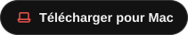

<div align="center">


# Aura

**Votre serveur de musique, sur votre iPhone, votre Apple Watch et votre Mac.** Un lecteur natif pour Navidrome et Subsonic :
streaming sans perte, paroles qui s'allument mot à mot, mix tirés de ce que vous écoutez vraiment, et toute votre bibliothèque hors ligne.

<a href="https://apps.apple.com/app/apple-store/id6818241470?pt=129146420&mt=8&ct=github"></a>
<br><br>
<a href="https://github.com/adrbn/aura/releases/latest"></a>&nbsp;
<a href="https://github.com/adrbn/aura/releases/tag/mac-v1.4.0-build.363"></a>
<br>
<a href="#ce-que-fait-aura"></a>&nbsp;
<a href="#compiler-depuis-les-sources"></a>
<br><br>
<picture>
  <source media="(prefers-color-scheme: light)" srcset="docs/assets/aura-hero-light.svg">
  
</picture>
<br><br>
<a href="https://ko-fi.com/adrbn"></a><br><br>

[](#obtenir-aura)
[](#obtenir-aura)
[](#obtenir-aura)
[](#obtenir-aura)
[](#confidentialit%C3%A9)
[](https://github.com/adrbn/aura/releases/latest)
[](LICENSE)

<sub><a href="https://apps.apple.com/app/apple-store/id6818241470?pt=129146420&mt=8&ct=github">Sur l'App Store</a> sous le nom <b>Aura: Self-Hosted Music</b> · Gratuit et libre · Apportez votre serveur</sub>

[English](README.md) · Français

</div>

---

Aura lit la musique de votre propre serveur. Branchez-le sur Navidrome, ou sur n'importe quel serveur qui parle l'API
Subsonic, et votre bibliothèque est dans votre iPhone, sur votre Apple Watch, dans CarPlay et sur votre Mac : en
qualité d'origine, avec les paroles en rythme, des mix tirés de ce que vous écoutez vraiment, un Radar des sorties de
vos artistes, et tout ce que vous avez téléchargé toujours là quand le réseau tombe.

> **Aura est un client, pas un service de musique.** Il se branche sur un serveur Navidrome ou compatible Subsonic qui
> est à vous, ou auquel vous avez accès. Il lit votre bibliothèque ; il n'héberge pas de musique, n'en fournit pas et
> n'en cherche pas pour vous.

## Ce que fait Aura

<table>
  <tr>
    <td align="center" valign="top" width="33%"><br><b>Sans perte, avec un vrai égaliseur</b><br><sub>Le FLAC et l'ALAC restent sans perte, ou en 128, 192 ou 320 kbit/s sur une connexion lente. Cinq bandes de 60 Hz à 14 kHz, une seule courbe à tirer, 15 préréglages, ReplayGain.</sub></td>
    <td align="center" valign="top" width="33%"><br><b>Les paroles en rythme</b><br><sub>Mot à mot quand votre serveur a le minutage de chaque mot, ligne par ligne sinon. D'abord votre serveur, puis <a href="https://lrclib.net">LRCLIB</a>. Touchez une ligne pour y sauter.</sub></td>
    <td align="center" valign="top" width="33%"><br><b>Pour vous</b><br><sub>Des mix selon l'heure, l'humeur et le genre, chacun avec sa pochette. Le Mix instantané lance une radio depuis n'importe quel morceau ou artiste. Le Wrapped fait le bilan de votre année, calculé sur l'iPhone.</sub></td>
  </tr>
  <tr>
    <td align="center" valign="top"><br><b>Radar</b><br><sub>Les sorties du mois des artistes que vous écoutez le plus. Ce que votre serveur a se lit en entier ; le reste, en extraits de 30 secondes.</sub></td>
    <td align="center" valign="top"><br><b>Tout, hors ligne</b><br><sub>Téléchargez un morceau, un album, une playlist ou toute la bibliothèque, chacun dans sa qualité. Sans réseau, la bibliothèque, la recherche et la lecture continuent.</sub></td>
    <td align="center" valign="top"><br><b>Apple Watch et CarPlay</b><br><sub>En cours de lecture, les paroles, la file d'attente et la bibliothèque au poignet, la Digital Crown sur le volume. CarPlay dans la version App Store.</sub></td>
  </tr>
</table>

<sub>Marqué <b>1.4</b> : déjà dans l'IPA bêta 1.4 et l'app Mac, sur l'App Store à la prochaine mise à jour.</sub>

**L'écoute**

- **Une file d'attente qui montre la suite**, à la place de la pochette : lire ensuite, ajouter à la fin, glisser pour réordonner. Quand un album ou une playlist se termine, la lecture automatique enchaîne des morceaux proches.
- **Lecture sans blanc**, aléatoire, répétition d'un morceau ou de tout, et un minuteur de veille qui coupe après un temps donné ou à la fin du morceau.
- **Tous les formats de votre serveur** : WMA, APE, WavPack, DSD et les autres sont convertis en MP3 par votre serveur. Une qualité à part pour le réseau cellulaire, et un cache de streaming jusqu'à la taille que vous fixez.
- **Pour vous, à votre goût** <sup>1.4</sup> : chaque mix activé ou non, les genres des mix par genre, et 25, 50 ou 100 morceaux par mix.
- **La tonalité** <sup>1.4</sup>, un demi-ton à la fois, comme sur une platine. **SharePlay** <sup>1.4</sup> sur FaceTime, chacun écoutant depuis le même serveur.

**Les paroles**

- **Prêtes à temps** : les paroles du morceau suivant sont cherchées avant qu'il commence. Pour un duo, un remix ou une autre version, Aura vérifie qu'elles correspondent à la version qui joue.
- **À corriger vous-même** : décalez le minutage si votre casque Bluetooth est en retard, ou calez vous-même les paroles d'un morceau, un geste par ligne.
- **La traduction**, en option, sous chaque ligne, par Gemini de Google avec votre propre clé d'API gratuite. Seul le morceau que vous traduisez est envoyé : ses lignes, son titre et son artiste.

**Votre bibliothèque**

- **Une seule recherche** dans les morceaux, albums, artistes et playlists, qui pardonne les fautes de frappe.
- **Des playlists à votre façon** : en grille ou en liste, des filtres, des pochettes tirées de vos photos, des dossiers nommés `Dossier/Nom` <sup>1.4</sup>, une section Suggestions et Ajouter des morceaux <sup>1.4</sup>, et Annuler <sup>1.4</sup>. Enregistrez n'importe quelle radio comme playlist ; les changements partent sur votre serveur.
- **Les notes et le scrobbling** partent sur votre serveur, et attendent sur l'iPhone quand vous êtes hors ligne. Une playlist gardée téléchargée <sup>1.4</sup> télécharge ses nouveaux morceaux toute seule.
- **Plusieurs serveurs**, chacun avec une adresse de la maison en option, et plusieurs dossiers de musique à la fois <sup>1.4</sup>.
- **Des pages aux couleurs de leur pochette**, des pochettes animées <sup>1.4</sup>, les albums à plusieurs disques <sup>1.4</sup>, les tags de tri, et des tris qui restent <sup>1.4</sup>.

**Autour de l'iPhone**

- **Écran verrouillé, Centre de contrôle, Dynamic Island et AirPlay**, et un widget En cours de lecture pour l'écran d'accueil.
- **Siri et Raccourcis** : lancer un artiste, un album, un morceau, une playlist ou un genre par son nom, mettre en file, aimer, passer. Des **liens `aura://`** <sup>1.4</sup> pour Raccourcis.
- **Des liens de partage** qui ouvrent un morceau sur d'autres services.
- **À votre goût** : clair ou sombre, la couleur d'accent de votre choix, onglets et sections de l'accueil dans votre ordre, une horloge en paysage, et des mises en page pour l'iPhone Duo.
- **Neuf langues** : français, anglais, italien, espagnol, allemand, catalan, néerlandais, plus le chinois et le russe <sup>1.4</sup>.

## Sur chaque appareil

**iPhone**

<p align="center">
  
</p>

**Apple Watch** : En cours de lecture, les paroles, la file d'attente et la bibliothèque au poignet, la Digital Crown sur le volume.

<p align="center">
  
</p>

**CarPlay** (version App Store) : l'accueil avec les mix et le Radar, vos playlists, les derniers albums, vos artistes,
un onglet Téléchargé qui joue sans connexion, et un bouton Radio qui enchaîne une musique proche du morceau.

**Mac** (aperçu, macOS 26) : fait du même code que l'app iPhone. Toute la bibliothèque dans une fenêtre avec une barre
latérale ; À suivre dans un panneau latéral à réordonner en glissant, avec un clic droit pour Lire ensuite, Lancer la
radio, la note et le téléchargement ; les paroles en plein écran ; les téléchargements, l'égaliseur et un lecteur dans la
barre des menus. Lisez sur l'iPhone depuis le Mac, ou l'inverse, sur le même Wi-Fi : lecture, file d'attente et volume
passent d'un appareil à l'autre, et vos AirPods restent sur celui qui joue.

<p align="center">
  
  
</p>
<p align="center"><sub>Les captures Mac viennent du serveur de démo public de Navidrome.</sub></p>

**iPhone Duo** : ouvert, En cours de lecture garde le lecteur à gauche avec les paroles ou la file d'attente à côté.

<p align="center">
  
</p>

## Obtenir Aura

Tout est gratuit, sans compte et sans achats intégrés.

| | App Store | IPA (à installer soi-même) | Mac (aperçu) |
|---|---|---|---|
| Fonctionne sur | iPhone, Apple Watch, CarPlay | iPhone, Apple Watch | Mac |
| Demande | iOS 26, watchOS 26 | iOS 26, watchOS 26, un outil de sideload | macOS 26, Apple silicon ou Intel |
| CarPlay | Oui | Non : re-signer fait perdre l'autorisation CarPlay d'Apple | – |
| Get It (Soulseek via votre propre [slskd](https://github.com/slskd/slskd)) | Non | À activer, Réglages → Developer Options | À activer, Réglages → Developer |
| Vérification NetEase du minutage des paroles | Non | Oui | Oui |
| Télécharger | [App Store](https://apps.apple.com/app/apple-store/id6818241470?pt=129146420&mt=8&ct=github) | [Dernier IPA](https://github.com/adrbn/aura/releases/latest) | [Zip Mac](https://github.com/adrbn/aura/releases/download/mac-v1.4.0-build.363/Aura-mac-1.4.0-build.363.zip) |

Chaque version demande un serveur [Navidrome](https://www.navidrome.org), ou n'importe quel serveur qui parle l'API
Subsonic 1.16.1 (les extensions OpenSubsonic sont utilisées quand il les propose). Pas encore de serveur ? Essayez la
démo publique de Navidrome : `https://demo.navidrome.org`, utilisateur `demo`, mot de passe `demo`.

<details>
<summary><b>Installer l'IPA</b></summary>

1. Installez un outil de sideload sur votre iPhone : [AltStore](https://altstore.io), [SideStore](https://sidestore.io) ou Feather.
2. Téléchargez `Aura-v<version>-build.<numéro>.ipa` depuis la [dernière version](https://github.com/adrbn/aura/releases/latest). Chaque version indique sa somme de contrôle SHA-256.
3. Ouvrez l'IPA dans votre outil de sideload et installez-le.
4. Au premier lancement, iOS bloque l'app : allez dans **Réglages → Général → VPN et gestion de l'appareil** et faites confiance au profil du développeur.
5. Ouvrez Aura et saisissez l'adresse de votre serveur, votre nom d'utilisateur et votre mot de passe.

Installer un nouvel IPA par-dessus un ancien garde vos serveurs, mots de passe, téléchargements et épingles. Avec un
identifiant Apple gratuit, la signature expire au bout de 7 jours et l'outil de sideload doit la renouveler ; c'est une
limite d'iOS, pas d'Aura.

</details>

<details>
<summary><b>Installer l'app Mac</b></summary>

1. Téléchargez [`Aura-mac-1.4.0-build.363.zip`](https://github.com/adrbn/aura/releases/download/mac-v1.4.0-build.363/Aura-mac-1.4.0-build.363.zip) depuis la [version Mac](https://github.com/adrbn/aura/releases/tag/mac-v1.4.0-build.363), qui indique sa somme SHA-256, et ouvrez-le.
2. Glissez **Aura.app** dans **Applications**.
3. Ouvrez Aura. L'app est signée avec un Developer ID mais pas encore notariée, donc macOS bloque le premier lancement : allez dans **Réglages Système → Confidentialité et sécurité**, cliquez sur **Ouvrir quand même** à côté d'Aura, puis confirmez.
4. Saisissez l'adresse de votre serveur, votre nom d'utilisateur et votre mot de passe.

L'app Mac est un aperçu : c'est l'app iPhone qui est testée tous les jours.

</details>

<details>
<summary><b>Ce que font Get It et la vérification NetEase</b></summary>

**Get It** va chercher ce qui manque à votre bibliothèque : une sortie du Radar, un résultat Deezer dans la recherche,
les morceaux manquants d'un album que vous n'avez qu'en partie (un par un, ou avec Tout récupérer), ou le cœur sur un
extrait dans En cours de lecture. Aura trouve la sortie sur Soulseek via votre slskd, la télécharge et attend que votre
serveur l'ajoute, en suivant chaque étape à l'écran. Rien ne passe par le serveur de quelqu'un d'autre. Ne téléchargez
que la musique que vous avez le droit d'avoir.

La **vérification NetEase** demande au catalogue de NetEase, par titre, artiste et durée, des paroles minutées sur
l'enregistrement exact, parce que les sources de paroles rangent souvent un remix sous le minutage de l'original.

Les versions hors App Store peuvent aussi suivre une liste de suivi SoulSync depuis le Radar, et écrire sur votre
serveur, en fichiers `.lrc` via File Browser, les paroles que vous avez calées à la main.

</details>

## Compiler depuis les sources

<details>
<summary><b>Cloner, signer, choisir un schéma</b></summary>

```bash
git clone https://github.com/adrbn/aura
cd aura
open Aura/Aura.xcodeproj
```

- Xcode 26 ou plus récent (les archives App Store sont faites avec Xcode 27).
- Choisissez votre propre équipe dans Signing & Capabilities, et donnez au réglage de build `AURA_BUNDLE_BASE`, au niveau du projet, un identifiant de bundle qui vous appartient. Le widget, l'app de la montre et les cibles Mac en tirent le leur.
- Schémas et configurations :
  - **Aura**, avec `Debug` et `Release` : la version à installer soi-même, avec Get It et la vérification NetEase.
  - **Aura-AppStore**, avec `Release-AppStore` : compilée avec le drapeau `APPSTORE_BUILD`, qui retire les fonctions réservées au sideload.
  - **Aura-mac** : l'app Mac, en aperçu ; seul l'iPhone est testé au quotidien.
- CarPlay demande l'autorisation `carplay-audio` d'Apple sur votre propre équipe.
- `scripts/watch-screenshots.sh` dessine les pages de l'app de la montre sur un Mac, sans montre ni simulateur.

Les polices (Vavin et Archivo, toutes deux sous SIL OFL 1.1) sont dans le dépôt : un clone tout neuf compile sans rien
ajouter.

Les illustrations de cette page sont faites par [`docs/assets/make_svgs.py`](docs/assets/make_svgs.py) (Python,
bibliothèque standard seulement) : `python3 docs/assets/make_svgs.py` régénère tous les SVG à partir des vraies
captures gardées en petit dans `docs/assets/readme-src/`.

</details>

## Confidentialité

Aura n'a pas de compte ni de statistiques d'usage, et n'envoie rien au développeur. Les mots de passe des serveurs sont
gardés dans le trousseau. L'app parle à votre serveur et aux services publics listés dans la
[politique de confidentialité](https://adrbn.github.io/aura-site/privacy.html), qui dit exactement ce que chacun reçoit.

## Comment l'IA a servi

Aura est le projet d'une seule personne, construit avec Claude Code, l'assistant de programmation d'Anthropic, qui a
écrit l'essentiel du code à partir de mes descriptions. J'ai décidé de ce que fait Aura et de son allure, relu les
changements, et testé les versions sur mon propre iPhone, avec ma propre bibliothèque. Chaque changement est dans
l'historique des commits, avec un message qui dit ce qu'il fait et pourquoi.

## Contribuer et soutenir

Bugs et demandes de fonctions : [issues](https://github.com/adrbn/aura/issues) ; ils arrivent à une personne. Les pull
requests sont les bienvenues, et le [journal des modifications](CHANGELOG.md) (en anglais) dit ce qui a changé et
pourquoi. Aura est gratuit, et le restera. S'il mérite sa place sur votre écran d'accueil :

<a href="https://ko-fi.com/adrbn"></a>

Une étoile sur le dépôt aide aussi d'autres personnes à le trouver.

## Licence

[GPL-3.0](LICENSE) © 2026 adrbn. Vous pouvez partager et modifier Aura sous la même licence ; une version modifiée que
vous distribuez doit rester ouverte, sous GPL-3.0.

<details>
<summary><b>Crédits</b></summary>

- [LRCLIB](https://lrclib.net) pour les paroles, [MusicBrainz](https://musicbrainz.org) pour les crédits des morceaux, le catalogue public de [Deezer](https://www.deezer.com) pour les pochettes, les photos d'artistes, le Radar, les extraits et les liens de partage, et l'API iTunes Search pour les liens de partage aussi.
- En option, avec votre propre clé : [Google Gemini](https://ai.google.dev) pour la traduction des paroles et [Last.fm](https://www.last.fm) pour les statistiques d'écoute.
- Polices : [Archivo](https://github.com/Omnibus-Type/Archivo) et Vavin, toutes deux sous SIL Open Font License 1.1.
- Les images iPhone, montre et Duo sont de vraies captures de l'app sur la bibliothèque du développeur ; les captures Mac viennent du serveur de démo public de Navidrome.

</details>

<sub>Aura n'est affilié ni à Navidrome, ni à Subsonic, ni à Apple. Toutes les marques appartiennent à leurs propriétaires respectifs.</sub>
