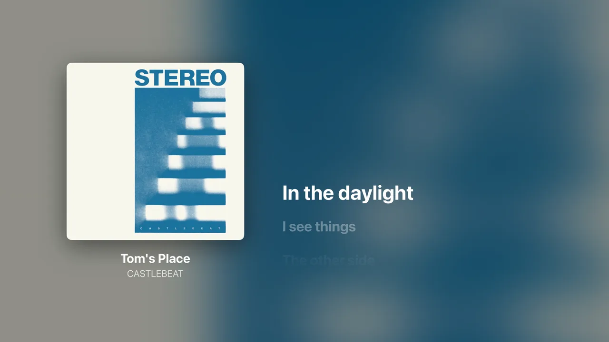
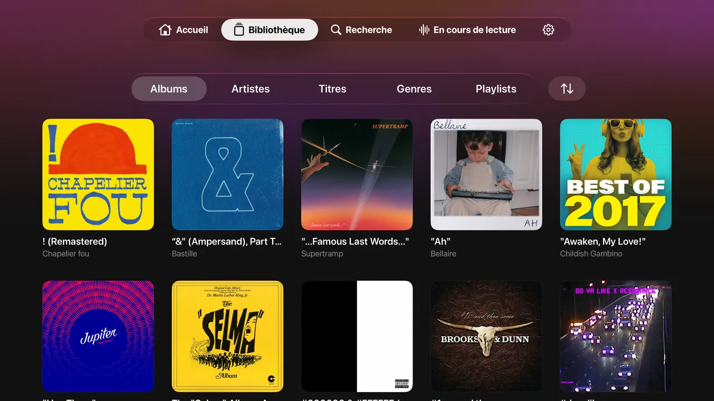

<div align="center">


# Aura

**Il tuo server musicale, sul tuo iPhone, iPad, Apple Watch, Mac e Apple TV.** Un player nativo per Navidrome e Subsonic:
streaming lossless, testi che si accendono parola per parola, mix creati da ciò che ascolti davvero e tutta la tua libreria offline.

<a href="https://apps.apple.com/app/apple-store/id6818241470?pt=129146420&mt=8&ct=github"></a>&nbsp;&nbsp;
<a href="https://ko-fi.com/adrbn"></a>
<br><br>
<a href="https://github.com/adrbn/aura/releases/latest"></a>&nbsp;
<a href="https://github.com/adrbn/aura/releases/tag/mac-v1.8.0-build.620"></a>
<br>
<a href="#cosa-fa"></a>&nbsp;
<a href="#compilare-dai-sorgenti"></a>
<br><br>
<picture>
  <source media="(prefers-color-scheme: light)" srcset="docs/assets/aura-hero-light.svg">
  
</picture>
<br><br>

[](#scarica-aura)
[](#scarica-aura)
[](#scarica-aura)
[](#scarica-aura)
[](#scarica-aura)
[](https://www.navidrome.org/apps/)
[](#privacy)
[](https://github.com/adrbn/aura/releases/latest)
[](LICENSE)

<sub><a href="https://apps.apple.com/app/apple-store/id6818241470?pt=129146420&mt=8&ct=github">Su App Store</a> come <b>Aura: Self-Hosted Music</b> · Gratuita e open source · Usa il tuo server</sub>

[English](README.md) · [Français](README.fr.md) · [Español](README.es.md) · [Deutsch](README.de.md) · Italiano · [Português (Brasil)](README.pt-BR.md) · [日本語](README.ja.md) · [简体中文](README.zh-Hans.md) · [한국어](README.ko.md) · [Русский](README.ru.md)

</div>

---

Aura riproduce la musica del tuo server. Collegala a Navidrome, o a qualsiasi server che parli l'API Subsonic, e la tua
libreria è sul tuo iPhone, sul tuo iPad, sul tuo Apple Watch, in CarPlay, sul tuo Mac e sulla tua Apple TV: in streaming nella qualità
originale, con i testi a tempo, mix creati da ciò che ascolti davvero, un Radar delle nuove uscite dei tuoi artisti, e
tutto ciò che scarichi resta lì anche senza segnale.

> **Aura è un client, non un servizio musicale.** Si collega a un server Navidrome o compatibile con Subsonic che è tuo
> o a cui hai accesso. Riproduce la tua libreria; non ospita, non fornisce e non cerca musica per te.

## Cosa fa

<table>
  <tr>
    <td align="center" valign="top" width="33%"><br><b>Lossless, con un vero equalizzatore</b><br><sub>FLAC e ALAC restano lossless, oppure 128, 192 o 320 kbps su una linea lenta. Cinque bande da 60 Hz a 14 kHz, una sola curva da trascinare, 15 preset, ReplayGain.</sub></td>
    <td align="center" valign="top" width="33%"><br><b>Testi a tempo</b><br><sub>Parola per parola quando il tuo server ha i tempi di ogni parola, riga per riga altrimenti. Prima dal tuo server, poi da <a href="https://lrclib.net">LRCLIB</a>. Tocca una riga per saltarci.</sub></td>
    <td align="center" valign="top" width="33%"><br><b>Fatto per te</b><br><sub>Mix per momento della giornata, umore e genere, ognuno con la sua copertina, e Nonstop, un mix senza fine di brani che ti piacciono, vicini a te e mai ascoltati. Mix istantaneo avvia una radio da qualsiasi brano o artista. Wrapped fa il bilancio del tuo anno.</sub></td>
  </tr>
  <tr>
    <td align="center" valign="top"><br><b>Radar</b><br><sub>Le uscite del mese degli artisti che ascolti di più. Ciò che ha il tuo server si ascolta per intero; il resto come anteprime di 30 secondi.</sub></td>
    <td align="center" valign="top"><br><b>Tutto offline</b><br><sub>Scarica un brano, un album, una playlist o l'intera libreria, ognuno nella sua qualità. Senza segnale, libreria, ricerca e riproduzione continuano a funzionare.</sub></td>
    <td align="center" valign="top"><br><b>Apple Watch e CarPlay</b><br><sub>In riproduzione, testi, A seguire e la libreria al polso, con la Digital Crown sul volume. CarPlay nella versione App Store.</sub></td>
  </tr>
</table>

**Ascolto**

- **Una coda in cui vedi cosa arriva**, al posto della copertina: riproduci successivo, aggiungi in fondo, trascina per riordinare. Quando un album o una playlist finisce, la riproduzione automatica continua con brani simili.
- **Riproduzione senza pause** o una dissolvenza incrociata da 1 a 12 secondi, casuale, ripeti uno o tutti, e un timer di spegnimento che si ferma dopo un tempo scelto o a fine brano.
- **Qualsiasi formato del tuo server**: WMA, APE, WavPack, DSD e altri vengono convertiti in MP3 dal tuo server. Una qualità a parte per la rete cellulare e una cache di streaming fino alla dimensione che scegli.
- **Fatto per te, a modo tuo**: ogni mix attivo o no, i generi usati dai mix per genere, e 25, 50 o 100 brani per mix.
- **Tonalità**, un semitono alla volta, come su un giradischi. **SharePlay** su FaceTime, tutti in streaming dallo stesso server.

**Testi**

- **Pronti in tempo**: il testo del brano successivo viene recuperato prima che inizi. Per un duetto, un remix o un'altra versione, Aura controlla che corrisponda alla versione in riproduzione.
- **Da correggere tu**: sposta i tempi se le cuffie Bluetooth sono in ritardo, sincronizza tu il testo di un brano con un tocco per riga, oppure lascia che Aura lo sincronizzi a orecchio: ascolta il brano sull'iPhone e colloca ogni riga e ogni parola, anche per testi senza tempi.
- **Traduzione**, facoltativa, sotto ogni riga, con Gemini di Google e una tua chiave API gratuita. Viene inviato solo il brano su cui tocchi traduci: le sue righe, il titolo e l'artista.

**La tua libreria**

- **Un'unica ricerca** tra brani, album, artisti e playlist che perdona gli errori di battitura, eseguita sull'iPhone su tutta la tua libreria, con `artist:`, `album:`, `genre:` e `year:` a un tocco. Incolla il link di un brano da un altro servizio per trovarlo qui, e filtra gli elenchi di brani per lingua della musica.
- **Playlist a modo tuo**: a griglia o a elenco, filtri, copertine dalle tue foto, cartelle con nomi come `Cartella/Nome`, una sezione Suggerimenti e Aggiungi brani, Annulla e Rimuovi duplicati, che tiene la prima copia di ogni brano. Salva qualsiasi radio come playlist; le modifiche vanno al tuo server.
- **Valutazioni, scrobbling e modifiche alle playlist** vanno al tuo server, e aspettano sull'iPhone mentre sei offline, anche i preferiti. Tieni una playlist scaricata: i suoi nuovi brani si scaricano da soli.
- **Più server**, ognuno con un indirizzo facoltativo per la rete di casa e intestazioni personalizzate, e più cartelle musicali insieme.
- **Pagine nel colore della loro copertina**, copertine animate, album su più dischi, tag di ordinamento, e ordinamenti che restano.

**Intorno all'iPhone**

- **iPad**: pensata per lo schermo grande, con il testo o la coda accanto alla copertina in orizzontale, e anche il widget.
- **Schermata di blocco, Centro di Controllo, Dynamic Island e AirPlay**, e un widget In riproduzione per la schermata Home.
- **Siri e Comandi Rapidi**: riproduci un artista, un album, un brano, una playlist o un genere per nome, metti in coda, metti mi piace, salta. **Link `aura://`** per Comandi Rapidi.
- **iPhone, Mac e Apple TV riproducono l'uno sull'altro** sulla stessa Wi-Fi: manda la musica da uno all'altro, controllala da qualsiasi di essi (controlli, coda, volume) e vedi cosa suona l'altro in un secondo mini player. I tuoi AirPods restano con il dispositivo che suona.
- **Link di condivisione** che aprono un brano su altri servizi.
- **A modo tuo**: chiaro o scuro, qualsiasi colore di accento, pannelli e sezioni della Home nel tuo ordine, un orologio in orizzontale e layout per l'iPhone Duo.
- **25 lingue**: inglese, francese, italiano, spagnolo, catalano, tedesco, olandese, portoghese (Portogallo e Brasile), svedese, norvegese, danese, finlandese, polacco, ceco, rumeno, ucraino, russo, greco, turco, thailandese, giapponese, coreano e cinese (semplificato e tradizionale).

## Su ogni dispositivo

**iPhone**

<p align="center">
  
</p>

**Apple Watch**

<p align="center">
  
</p>

**CarPlay** (versione App Store): Home con i mix e il Radar, album a griglia di copertine, le tue playlist, tutti gli
artisti dalla A alla Z, le stazioni radio internet del tuo server, un pannello Scaricato e le tue playlist offline che
suonano senza connessione, e un pulsante Radio che prosegue il brano con musica simile.

**Mac** (macOS 26): dallo stesso codice dell'app per iPhone. Tutta la libreria in una finestra con barra
laterale; A seguire come pannello laterale da riordinare trascinando, con il clic destro per Riproduci successivo, Avvia
radio, valutazione e download; testi a schermo intero; Radar, Wrapped, download, l'equalizzatore e un player nella barra dei menu.

<p align="center">
  
  
</p>
<p align="center"><sub>Le schermate del Mac usano il server demo pubblico di Navidrome.</sub></p>

**Apple TV** (tvOS 26, su App Store): Home con i mix, la Libreria con ordinamenti e filtri, la Ricerca, le pagine di album e artista, e In riproduzione a schermo intero sulla copertina sfocata, con il testo che segue il brano. Dopo cinque secondi senza telecomando i controlli svaniscono e restano solo copertina, brano e testo, che si può ingrandire dalla TV, dall'iPhone o dal Mac.

<p align="center">
  
  <br>
  
  
</p>

**iPhone Duo**: aperto, In riproduzione tiene il player a sinistra con il testo o la coda accanto.

<p align="center">
  
</p>

## Scarica Aura

Tutto gratuito, senza account e senza acquisti in-app.

| | App Store | IPA (sideload) | Mac (anteprima) |
|---|---|---|---|
| Funziona su | iPhone, iPad, Apple Watch, CarPlay, Apple TV | iPhone, iPad, Apple Watch | Mac |
| Richiede | iOS 26, iPadOS 26, watchOS 26, tvOS 26 | iOS 26, iPadOS 26, watchOS 26, uno strumento di sideload | macOS 26, Apple silicon o Intel |
| CarPlay | Sì | No: rifirmare toglie l'autorizzazione CarPlay di Apple | – |
| Get It (Soulseek tramite il tuo [slskd](https://github.com/slskd/slskd)) | No | Facoltativo, Impostazioni → Developer Options | Facoltativo, Impostazioni → Developer |
| Controllo NetEase dei tempi dei testi | No | Sì | Sì |
| Download | [App Store](https://apps.apple.com/app/apple-store/id6818241470?pt=129146420&mt=8&ct=github) | [Ultimo IPA](https://github.com/adrbn/aura/releases/latest) | [DMG per Mac](https://github.com/adrbn/aura/releases/download/mac-v1.8.0-build.620/Aura-mac-1.8.0-build.620.dmg) |

Ogni versione richiede un server [Navidrome](https://www.navidrome.org), o qualsiasi server che parli l'API Subsonic
1.16.1 (le estensioni OpenSubsonic vengono usate quando offerte). Non hai ancora un server? Prova la demo pubblica di
Navidrome: `https://demo.navidrome.org`, utente `demo`, password `demo`.

<details>
<summary><b>Installare l'IPA</b></summary>

1. Installa uno strumento di sideload sul tuo iPhone: [AltStore](https://altstore.io), [SideStore](https://sidestore.io) o Feather.
2. Scarica `Aura-v<version>-build.<number>.ipa` dall'[ultima release](https://github.com/adrbn/aura/releases/latest). Ogni release indica il suo checksum SHA-256.
3. Apri l'IPA nello strumento di sideload e installala.
4. Al primo avvio iOS blocca l'app: vai in **Impostazioni → Generali → VPN e gestione dispositivi** e autorizza il profilo sviluppatore.
5. Apri Aura e inserisci l'indirizzo del tuo server, il nome utente e la password.

Installare una nuova IPA sopra un sideload precedente mantiene server, password, download e fissati. Con un Apple ID
gratuito la firma scade dopo 7 giorni e lo strumento di sideload deve rinnovarla; è un limite di iOS, non di Aura.

</details>

<details>
<summary><b>Installare l'app per Mac</b></summary>

1. Scarica [`Aura-mac-1.8.0-build.620.dmg`](https://github.com/adrbn/aura/releases/download/mac-v1.8.0-build.620/Aura-mac-1.8.0-build.620.dmg) dalla [release per Mac](https://github.com/adrbn/aura/releases/tag/mac-v1.8.0-build.620), che indica il suo checksum SHA-256, e aprilo.
2. Trascina **Aura** su **Applicazioni**.
3. Apri Aura. L'app è firmata con un Developer ID e autenticata da Apple, quindi si apre come qualsiasi altra app.
4. Inserisci l'indirizzo del tuo server, il nome utente e la password.

L'app per Mac è un'anteprima: l'app per iPhone è quella testata ogni giorno.

</details>

<details>
<summary><b>Cosa fanno Get It e il controllo NetEase</b></summary>

**Get It** recupera ciò che manca alla tua libreria: un'uscita del Radar, un risultato Deezer in Cerca, i brani mancanti
di un album che hai solo in parte (uno alla volta, o con Recupera tutto), o il cuore su un'anteprima in In
riproduzione. Aura trova l'uscita su Soulseek tramite il tuo slskd, la scarica e aspetta che il tuo server la aggiunga,
mostrando ogni passaggio sullo schermo. Niente passa dal server di qualcun altro. Scarica solo musica di cui hai i
diritti.

Il **controllo NetEase** chiede al catalogo di NetEase, per titolo, artista e durata, testi sincronizzati sulla
registrazione esatta, perché le fonti di testi spesso archiviano un remix con i tempi dell'originale.

Le versioni sideload possono anche seguire una watchlist di SoulSync dal Radar, e scrivere sul tuo server i testi che
sincronizzi a mano come file `.lrc` tramite File Browser.

</details>

## Compilare dai sorgenti

<details>
<summary><b>Clonare, firmare, scegliere uno schema</b></summary>

```bash
git clone https://github.com/adrbn/aura
cd aura
open Aura/Aura.xcodeproj
```

- Xcode 26 o successivo (gli archivi per App Store sono fatti con Xcode 27).
- Scegli il tuo team in Signing & Capabilities, e imposta l'impostazione di build `AURA_BUNDLE_BASE`, a livello di progetto, su un bundle identifier tuo. I target di widget, app per Watch e Mac ne derivano il proprio.
- Schemi e configurazioni:
  - **Aura**, con `Debug` e `Release`: la versione sideload, con Get It e il controllo NetEase.
  - **Aura-AppStore**, con `Release-AppStore`: compilata con il flag `APPSTORE_BUILD`, che esclude le funzioni solo sideload.
  - **Aura-mac**: l'app per Mac.
  - **Aura-tv**: l'app per Apple TV.
- CarPlay richiede l'autorizzazione `carplay-audio` di Apple sul tuo team.
- `scripts/watch-screenshots.sh` disegna le pagine dell'app per Watch su un Mac, senza Watch né simulatore.

I font (Vavin e Archivo, entrambi con licenza SIL OFL 1.1) sono nel repository, quindi un clone appena fatto compila
senza aggiungere nulla.

Le immagini di questa pagina sono create da [`docs/assets/make_svgs.py`](docs/assets/make_svgs.py) (Python, solo
libreria standard): `python3 docs/assets/make_svgs.py` rigenera tutti gli SVG dalle schermate reali conservate in
piccolo in `docs/assets/readme-src/`.

</details>

## Privacy

Aura non ha account né analisi, e non invia nulla allo sviluppatore. Le password dei server sono conservate nel
Portachiavi. L'app parla con il tuo server e con i servizi pubblici elencati nella
[informativa sulla privacy](https://aura.adrbn.dev/privacy.html), che dice esattamente cosa riceve ciascuno.

## Come è stata usata l'IA

Aura è un progetto di una sola persona, costruito con Claude Code, l'assistente di programmazione di Anthropic, che ha
scritto la maggior parte del codice a partire dalle mie descrizioni. Ho deciso io cosa fa Aura e che aspetto ha, ho
letto le modifiche e ho testato le versioni sul mio iPhone, con la mia libreria. Ogni modifica è nella cronologia dei
commit, con un messaggio che dice cosa fa e perché.

## Contribuire e sostenere

Bug e richieste di funzioni: [issues](https://github.com/adrbn/aura/issues); le legge una persona. Le pull request sono
benvenute, e il [registro delle modifiche](CHANGELOG.md) (in inglese) dice cosa è cambiato e perché. Aura è gratuita, e
resterà gratuita. Se si guadagna un posto nella tua schermata Home:

<a href="https://ko-fi.com/adrbn"></a>

Una stella sul repository aiuta anche altre persone a trovarla.

### Grazie

Alle persone le cui segnalazioni e idee hanno dato forma ad Aura:

- [willvebert](https://github.com/willvebert): i pulsanti e la navigazione indietro di CarPlay, la ricerca con Siri, i generi esclusi dai mix
- [dominak3](https://github.com/dominak3): il cambio automatico di server, i pulsanti del player personalizzabili, i download dei Preferiti, il ceco e molte segnalazioni di bug
- [nClarke0101](https://github.com/nClarke0101): le intestazioni HTTP personalizzate, i download sull'Apple Watch
- [DMcWetty](https://github.com/DMcWetty): più cartelle musicali insieme
- [Dedeham](https://github.com/Dedeham): filtri dei brani che restano quando torni

E alle persone i cui caffè su [Ko-fi](https://ko-fi.com/adrbn) mandano avanti Aura: Greg e DummyHead.

## Licenza

[GPL-3.0](LICENSE) © 2026 adrbn. Puoi condividere e modificare Aura con la stessa licenza; una versione modificata che
distribuisci deve restare aperta sotto GPL-3.0.

<details>
<summary><b>Crediti</b></summary>

- [LRCLIB](https://lrclib.net) per i testi, [MusicBrainz](https://musicbrainz.org) per i crediti dei brani, il catalogo pubblico di [Deezer](https://www.deezer.com) per copertine, foto degli artisti, il Radar, le anteprime e i link di condivisione, e l'API iTunes Search anche per i link di condivisione.
- Facoltativi, con una tua chiave: [Google Gemini](https://ai.google.dev) per la traduzione dei testi e [Last.fm](https://www.last.fm) per le statistiche di ascolto.
- Font: [Archivo](https://github.com/Omnibus-Type/Archivo) e Vavin, entrambi con la SIL Open Font License 1.1.
- Le immagini di iPhone, Watch e Duo sono schermate reali dell'app con la libreria dello sviluppatore; le schermate del Mac usano il server demo pubblico di Navidrome.

</details>

<sub>Aura non è affiliata a Navidrome, Subsonic o Apple. Tutti i marchi appartengono ai rispettivi proprietari.</sub>
