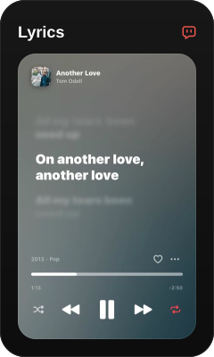

<div align="center">


# Aura

**あなたの音楽サーバを、iPhone、iPad、Apple Watch、Mac、Apple TV で。** Navidrome と Subsonic のためのネイティブプレーヤーです。
ロスレスのストリーミング、一語ずつ光る歌詞、実際に聴いている曲から作るミックス、そしてライブラリ全体をオフラインで。

<a href="https://apps.apple.com/app/apple-store/id6818241470?pt=129146420&mt=8&ct=github"></a>&nbsp;&nbsp;
<a href="https://ko-fi.com/adrbn"></a>
<br><br>
<a href="https://github.com/adrbn/aura/releases/latest"></a>&nbsp;
<a href="https://github.com/adrbn/aura/releases/tag/mac-v1.8.0-build.620"></a>
<br>
<a href="#できること"></a>&nbsp;
<a href="#ソースからビルド"></a>
<br><br>
<picture>
  <source media="(prefers-color-scheme: light)" srcset="docs/assets/aura-hero-light.svg">
  
</picture>
<br><br>

[](#aura-を入手)
[](#aura-を入手)
[](#aura-を入手)
[](https://testflight.apple.com/join/pEUEBUbm)
[](#aura-を入手)
[](https://www.navidrome.org/apps/)
[](#プライバシー)
[](https://github.com/adrbn/aura/releases/latest)
[](LICENSE)

<sub><a href="https://apps.apple.com/app/apple-store/id6818241470?pt=129146420&mt=8&ct=github">App Store で配信中</a>、名前は <b>Aura: Self-Hosted Music</b> · 無料でオープンソース · サーバはご自身で用意</sub>

[English](README.md) · [Français](README.fr.md) · [Español](README.es.md) · [Deutsch](README.de.md) · [Italiano](README.it.md) · [Português (Brasil)](README.pt-BR.md) · 日本語 · [简体中文](README.zh-Hans.md) · [한국어](README.ko.md) · [Русский](README.ru.md)

</div>

---

Aura はあなた自身のサーバにある音楽を再生します。Navidrome、または Subsonic API に対応したサーバを指定すれば、
ライブラリが iPhone、iPad、Apple Watch、CarPlay、Mac で使えます。元の音質のままストリーミングし、歌詞は曲に合わせて表示され、
実際に再生した曲からミックスを作り、Radar でお気に入りのアーティストの新作を知らせ、ダウンロードしたものは電波がなくても残ります。

> **Aura はクライアントであり、音楽サービスではありません。** ご自身が所有する、またはアクセス権のある Navidrome
> または Subsonic 互換サーバに接続します。ライブラリを再生するだけで、音楽をホストしたり、提供したり、探したりはしません。

## できること

<table>
  <tr>
    <td align="center" valign="top" width="33%"><br><b>ロスレス、本格的なイコライザ付き</b><br><sub>FLAC と ALAC はロスレスのまま、回線が遅いときは 128、192、320 kbps。60 Hz から 14 kHz までの 5 バンド、ドラッグで動かす 1 本のカーブ、15 のプリセット、ReplayGain。</sub></td>
    <td align="center" valign="top" width="33%"><br><b>曲に合わせた歌詞</b><br><sub>サーバに単語ごとのタイミングがあれば一語ずつ、なければ一行ずつ。まずサーバから、次に <a href="https://lrclib.net">LRCLIB</a> から取得します。行をタップするとそこへ移動します。</sub></td>
    <td align="center" valign="top" width="33%"><br><b>Made For You</b><br><sub>時間帯、気分、ジャンルごとのミックスに、それぞれ専用のカバー。クイックミックスはどの曲やアーティストからでもラジオを始めます。Wrapped は iPhone 上であなたの 1 年を集計します。</sub></td>
  </tr>
  <tr>
    <td align="center" valign="top"><br><b>Radar</b><br><sub>よく聴くアーティストの今月の新作。サーバにあるものはフルで、それ以外は 30 秒のプレビューで再生します。</sub></td>
    <td align="center" valign="top"><br><b>すべてをオフラインで</b><br><sub>曲、アルバム、プレイリスト、ライブラリ全体を、それぞれ好きな音質でダウンロード。電波がなくても、ライブラリ、検索、再生はそのまま使えます。</sub></td>
    <td align="center" valign="top"><br><b>Apple Watch と CarPlay</b><br><sub>再生中、歌詞、次はこちら、ライブラリを手首で。音量は Digital Crown で。CarPlay は App Store 版で使えます。</sub></td>
  </tr>
</table>

<sub><b>1.6</b> の印：1.6 の新機能で、App Store で配信中です。</sub>

**聴く**

- **先が見える再生待ち**をアートワークの代わりに表示：次に再生、最後に追加、ドラッグで並べ替え。アルバムやプレイリストが終わると、自動再生が似た曲を続けます。
- **ギャップレス再生**または 3 秒から 12 秒のクロスフェード <sup>1.6</sup>、シャッフル、1 曲リピートと全曲リピート、指定時間後または曲の終わりで止まるスリープタイマー。
- **サーバにあるあらゆる形式**：WMA、APE、WavPack、DSD などはサーバが MP3 に変換します。モバイル通信用の別の音質設定と、指定したサイズまでのストリームキャッシュ。
- **Made For You を自分好みに**：ミックスごとのオン・オフ、ジャンルミックスで使うジャンル、ミックスあたり 25、50、100 曲。
- **ピッチ**をターンテーブルのように半音ずつ。FaceTime での **SharePlay** では、全員が同じサーバからストリーミングします。

**歌詞**

- **時間どおりに準備**：次の曲の歌詞は始まる前に取得されます。デュエット、リミックス、別バージョンの場合は、再生中のバージョンと一致するかを Aura が確認します。
- **自分で直せる**：Bluetooth ヘッドホンが遅れるならタイミングをずらし、1 行に 1 回のタップで曲の歌詞を自分でタイミング付けし、または Aura に耳で合わせてもらえます。iPhone 上で曲を聴き、タイミングのなかった歌詞でも各行と各単語を配置します。
- **翻訳**はオプションで、各行の下に、ご自身の無料 API キーで Google の Gemini が表示します。送信されるのは翻訳をタップした曲だけで、その歌詞、タイトル、アーティストです。

**ライブラリ**

- **ひとつの検索**で曲、アルバム、アーティスト、プレイリストを横断し、入力ミスも許容します。検索は iPhone 上でライブラリ全体に対して行い、`artist:`、`album:`、`genre:`、`year:` をワンタップで使えます。他のサービスの曲のリンクを貼り付けるとここで見つけられ、曲のリストを音楽の言語で絞り込めます。
- **プレイリストを自分流に**：グリッドまたはリスト、フィルタ、写真から作るカバー、`フォルダ/名前` という名前のフォルダ、おすすめセクションと曲を追加、取り消す、そして各曲の最初のコピーを残す重複を削除。どのラジオもプレイリストとして保存でき、変更はサーバに送られます。
- **評価、Scrobble、プレイリストの編集**はサーバに送られ、オフラインの間は iPhone 上で待機します。お気に入りも同様です。ダウンロードしたままにしたプレイリストは、新しい曲が自動でダウンロードされます。
- **複数のサーバ**に、それぞれ自宅ネットワーク用のアドレスとカスタムヘッダを任意で設定でき、複数のミュージックフォルダを同時に使えます。
- **アートワークの色に染まるページ**、アニメーションするカバー、複数ディスクのアルバム、ソート用タグ、そのまま保たれる並び順。

**iPhone のまわり**

- **iPad** <sup>1.6</sup>：大きな画面向けのレイアウトで、横向きでは歌詞か再生待ちをアートワークの横に表示し、ウィジェットにも対応します。
- **ロック画面、コントロールセンター、Dynamic Island、AirPlay**、そしてホーム画面用の再生中ウィジェット。
- **Siri とショートカット**：アーティスト、アルバム、曲、プレイリスト、ジャンルを名前で再生、再生待ちに追加、お気に入り、スキップ。ショートカット用の **`aura://` リンク**。
- **iPhone と Mac** は同じ Wi-Fi 上で互いを操作できます。再生中から Mac で再生し、もう一方で再生中の内容を 2 つ目のミニプレーヤーで確認できます。
- **共有リンク**で他のサービスの曲を開けます。
- **好きなように配置**：ライトまたはダーク、好きなアクセントカラー、タブとホームのセクションを好きな順に、横向きの時計、iPhone Duo 用のレイアウト。
- **25 の言語**：英語、フランス語、イタリア語、スペイン語、カタルーニャ語、ドイツ語、オランダ語、ポルトガル語（ポルトガルとブラジル）、スウェーデン語、ノルウェー語、デンマーク語、フィンランド語、ポーランド語、チェコ語、ルーマニア語、ウクライナ語、ロシア語、ギリシャ語、トルコ語、タイ語、日本語、韓国語、中国語（簡体字と繁体字）。

## すべてのデバイスで

**iPhone**

<p align="center">
  
</p>

**Apple Watch**：再生中、歌詞、次はこちら、ライブラリを手首で。音量は Digital Crown で。

<p align="center">
  
</p>

**CarPlay**（App Store 版）：ミックスと Radar のあるホーム、カバーのグリッドで並ぶアルバム、プレイリスト、A から Z までの
すべてのアーティスト、サーバのインターネットラジオ局、ダウンロード済みタブと接続なしで再生できるオフラインのプレイリスト、
そして曲に続けて似た音楽を流すラジオボタン。

**Mac**（プレビュー、macOS 26）：iPhone アプリと同じコードから作られています。サイドバー付きの 1 つのウインドウにライブラリ全体。
次はこちらはドラッグで並べ替えられるサイドパネルで、右クリックで次に再生、ラジオを開始、評価、ダウンロード。歌詞のフルスクリーン表示、
ダウンロード、イコライザ、メニューバーのプレーヤー。同じ Wi-Fi 上で Mac から iPhone で再生したり、その逆もできます。
操作、再生待ち、音量が引き継がれ、AirPods は再生中のデバイスにつながったままです。

<p align="center">
  
  
</p>
<p align="center"><sub>Mac の画面は Navidrome の公開デモサーバを使っています。</sub></p>

**Apple TV**（[TestFlight](https://testflight.apple.com/join/pEUEBUbm) で公開ベータ、tvOS 26）：ミックスのあるホーム、並べ替えとフィルタのあるライブラリ、検索、そしてぼかしたジャケットの上に全画面で表示される再生中画面。歌詞は曲に合わせて進みます。リモコンに5秒触れないとコントロールが消え、ジャケット、曲名、歌詞だけが残ります。iPhone や Mac から再生して操作できます。

<p align="center">
  
  <br>
  
  
</p>

**iPhone Duo**：開くと、再生中はプレーヤーを左に置き、その横に歌詞か再生待ちを表示します。

<p align="center">
  
</p>

## Aura を入手

すべて無料で、アカウント不要、アプリ内課金もありません。

| | App Store | IPA（サイドロード） | Mac（プレビュー） |
|---|---|---|---|
| 対応デバイス | iPhone、iPad、Apple Watch、CarPlay | iPhone、iPad、Apple Watch | Mac |
| 必要なもの | iOS 26、iPadOS 26、watchOS 26 | iOS 26、iPadOS 26、watchOS 26、サイドロードツール | macOS 26、Apple シリコンまたは Intel |
| CarPlay | あり | なし：再署名すると Apple の CarPlay エンタイトルメントが外れます | – |
| Get It（ご自身の [slskd](https://github.com/slskd/slskd) 経由の Soulseek） | なし | オプトイン、設定 → Developer Options | オプトイン、設定 → Developer |
| NetEase による歌詞タイミングの確認 | なし | あり | あり |
| ダウンロード | [App Store](https://apps.apple.com/app/apple-store/id6818241470?pt=129146420&mt=8&ct=github) | [最新の IPA](https://github.com/adrbn/aura/releases/latest) | [Mac 用 DMG](https://github.com/adrbn/aura/releases/download/mac-v1.8.0-build.620/Aura-mac-1.8.0-build.620.dmg) |

どの版にも [Navidrome](https://www.navidrome.org) サーバ、または Subsonic API 1.16.1 に対応したサーバが必要です
（OpenSubsonic 拡張があれば使います）。まだサーバがない場合は Navidrome の公開デモを試せます：
`https://demo.navidrome.org`、ユーザ `demo`、パスワード `demo`。

<details>
<summary><b>IPA をインストール</b></summary>

1. iPhone にサイドロードツールをインストールします：[AltStore](https://altstore.io)、[SideStore](https://sidestore.io)、または Feather。
2. [最新リリース](https://github.com/adrbn/aura/releases/latest)から `Aura-v<version>-build.<number>.ipa` をダウンロードします。各リリースには SHA-256 チェックサムが記載されています。
3. サイドロードツールで IPA を開き、インストールします。
4. 初回起動時に iOS がアプリをブロックします。**設定 → 一般 → VPN とデバイス管理**で開発元のプロファイルを信頼してください。
5. Aura を開き、サーバのアドレス、ユーザ名、パスワードを入力します。

以前にサイドロードした版の上に新しい IPA をインストールしても、サーバ、パスワード、ダウンロード、ピンはそのまま残ります。
無料の Apple Account では署名が 7 日で切れ、サイドロードツールで更新する必要があります。これは iOS の制限で、Aura の制限ではありません。

</details>

<details>
<summary><b>Mac アプリをインストール</b></summary>

1. [Mac 版リリース](https://github.com/adrbn/aura/releases/tag/mac-v1.8.0-build.620)（SHA-256 チェックサム記載）から [`Aura-mac-1.8.0-build.620.dmg`](https://github.com/adrbn/aura/releases/download/mac-v1.8.0-build.620/Aura-mac-1.8.0-build.620.dmg) をダウンロードして開きます。
2. **Aura** を **アプリケーション** にドラッグします。
3. Aura を開きます。アプリは Developer ID で署名され、Apple の公証を受けているので、ほかのアプリと同じように開けます。
4. サーバのアドレス、ユーザ名、パスワードを入力します。

Mac アプリはプレビュー版です。毎日テストしているのは iPhone アプリです。

</details>

<details>
<summary><b>Get It と NetEase の確認がすること</b></summary>

**Get It** はライブラリに足りないものを取ってきます。Radar の新作、検索での Deezer の結果、一部しか持っていない
アルバムの足りない曲（1 曲ずつ、またはすべて入手で）、再生中のプレビューに付いたハートなどです。Aura はあなたの slskd
を通じて Soulseek でリリースを見つけ、ダウンロードし、サーバに追加されるのを待ち、各段階を画面に表示します。
他人のサーバを経由するものは何もありません。権利を持っている音楽だけをダウンロードしてください。

**NetEase の確認**は、タイトル、アーティスト、長さをもとに、その録音に正確に合わせた歌詞を NetEase のカタログに問い合わせます。
歌詞ソースはリミックスを原曲のタイミングで登録していることが多いためです。

サイドロード版では、Radar から SoulSync のウォッチリストをたどったり、手でタイミングを付けた歌詞を File Browser 経由で
`.lrc` ファイルとしてサーバに書き込んだりもできます。

</details>

## ソースからビルド

<details>
<summary><b>クローン、署名、スキームの選択</b></summary>

```bash
git clone https://github.com/adrbn/aura
cd aura
open Aura/Aura.xcodeproj
```

- Xcode 26 以降（App Store 用のアーカイブは Xcode 27 で作成しています）。
- Signing & Capabilities でご自身のチームを選び、プロジェクトレベルのビルド設定 `AURA_BUNDLE_BASE` にご自身のバンドル ID を設定します。ウィジェット、Watch アプリ、Mac のターゲットはそこから自分の ID を導きます。
- スキームと構成：
  - **Aura**（`Debug` と `Release`）：Get It と NetEase の確認を含むサイドロード版。
  - **Aura-AppStore**（`Release-AppStore`）：`APPSTORE_BUILD` フラグ付きでビルドされ、サイドロード専用の機能は除外されます。
  - **Aura-mac**：Mac アプリのプレビュー版。毎日テストしているのは iPhone だけです。
- CarPlay には、ご自身のチームで Apple の `carplay-audio` エンタイトルメントが必要です。
- `scripts/watch-screenshots.sh` は、Watch やシミュレータなしで Mac 上に Watch アプリの画面を描きます。

フォント（Vavin と Archivo、どちらも SIL OFL 1.1）はリポジトリに含まれているので、クローンしたばかりの状態で何も追加せずにビルドできます。

このページの画像は [`docs/assets/make_svgs.py`](docs/assets/make_svgs.py)（Python、標準ライブラリのみ）で作られています。
`python3 docs/assets/make_svgs.py` を実行すると、`docs/assets/readme-src/` に縮小して保存した実際のキャプチャからすべての SVG を作り直します。

</details>

## プライバシー

Aura にはアカウントも解析もなく、開発者には何も送信しません。サーバのパスワードはキーチェーンに保存されます。
通信先はあなたのサーバと、[プライバシーポリシー](https://adrbn.github.io/aura-site/privacy.html)に記載された公開サービスだけで、
ポリシーにはそれぞれが何を受け取るかが正確に書かれています。

## AI の使い方

Aura は一人で作っているプロジェクトで、Anthropic のコーディングアシスタント Claude Code を使って作られており、
コードの大部分は私の説明をもとに Claude Code が書きました。Aura が何をするか、どう見えるかは私が決め、変更を読み、
自分の iPhone で自分のライブラリを再生してビルドをテストしました。すべての変更はコミット履歴にあり、
それぞれのメッセージに何をなぜ変えたかが書かれています。

## 貢献とサポート

バグや機能のリクエスト：[issues](https://github.com/adrbn/aura/issues)。人が読んでいます。プルリクエストも歓迎です。
[変更履歴](CHANGELOG.md)（英語）に何がなぜ変わったかが書かれています。Aura は無料で、これからも無料です。
ホーム画面に置く価値があると思ったら：

<a href="https://ko-fi.com/adrbn"></a>

リポジトリにスターを付けると、ほかの人が見つけやすくなります。

### 謝辞

報告とアイデアで Aura を形作ってくれた方々へ：

- [willvebert](https://github.com/willvebert)：CarPlay のボタンと戻るナビゲーション、Siri 検索、ミックスからのジャンル除外
- [dominak3](https://github.com/dominak3)：サーバの自動切り替え、カスタマイズできるプレーヤーボタン、お気に入りのダウンロード、チェコ語、多数のバグ報告
- [nClarke0101](https://github.com/nClarke0101)：カスタム HTTP ヘッダ、Apple Watch へのダウンロード
- [DMcWetty](https://github.com/DMcWetty)：複数のミュージックフォルダの同時使用
- [Dedeham](https://github.com/Dedeham)：戻ってきても残る曲のフィルタ

そして [Ko-fi](https://ko-fi.com/adrbn) でのコーヒーで Aura を支えてくれている Greg さんと DummyHead さんへ。

## ライセンス

[GPL-3.0](LICENSE) © 2026 adrbn。同じライセンスのもとで Aura を共有、改変できます。改変版を配布する場合は、
GPL-3.0 のもとでオープンにしておく必要があります。

<details>
<summary><b>クレジット</b></summary>

- 歌詞は [LRCLIB](https://lrclib.net)、曲のクレジットは [MusicBrainz](https://musicbrainz.org)、カバー、アーティスト写真、Radar、プレビュー、共有リンクは [Deezer](https://www.deezer.com) の公開カタログ、共有リンクには iTunes Search API も使っています。
- オプション（ご自身のキーで）：歌詞の翻訳に [Google Gemini](https://ai.google.dev)、再生統計に [Last.fm](https://www.last.fm)。
- フォント：[Archivo](https://github.com/Omnibus-Type/Archivo) と Vavin、どちらも SIL Open Font License 1.1。
- iPhone、Watch、Duo の画像は、開発者自身のライブラリを再生しているアプリの実際のキャプチャです。Mac の画面は Navidrome の公開デモサーバを使っています。

</details>

<sub>Aura は Navidrome、Subsonic、Apple とは提携していません。すべての商標はそれぞれの所有者に帰属します。</sub>
