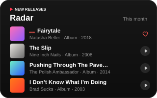
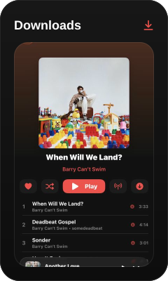
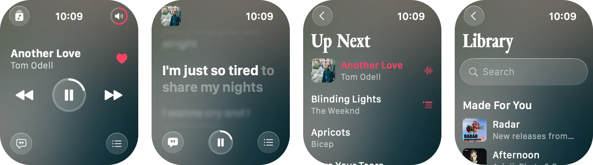
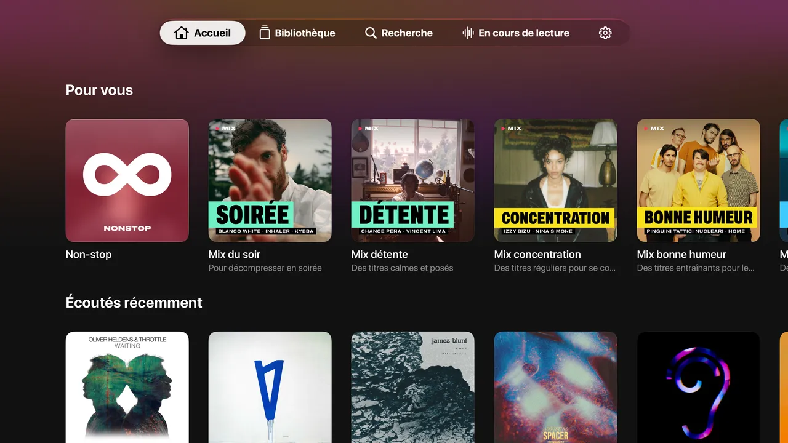

<div align="center">


# Aura

**내 음악 서버를 iPhone, iPad, Apple Watch, Mac, Apple TV에서.** Navidrome과 Subsonic을 위한 네이티브 플레이어예요.
무손실 스트리밍, 단어마다 밝아지는 가사, 실제로 듣는 음악으로 만드는 믹스, 그리고 보관함 전체를 오프라인으로.

<a href="https://apps.apple.com/app/apple-store/id6818241470?pt=129146420&mt=8&ct=github"></a>&nbsp;&nbsp;
<a href="https://ko-fi.com/adrbn"></a>
<br><br>
<a href="https://github.com/adrbn/aura/releases/latest"></a>&nbsp;
<a href="https://github.com/adrbn/aura/releases/tag/mac-v1.7.1-build.523"></a>
<br>
<a href="#주요-기능"></a>&nbsp;
<a href="#소스에서-빌드"></a>
<br><br>
<picture>
  <source media="(prefers-color-scheme: light)" srcset="docs/assets/aura-hero-light.svg">
  
</picture>
<br><br>

[](#aura-받기)
[](#aura-받기)
[](#aura-받기)
[](https://testflight.apple.com/join/pEUEBUbm)
[](#aura-받기)
[](https://www.navidrome.org/apps/)
[](#개인정보-보호)
[](https://github.com/adrbn/aura/releases/latest)
[](LICENSE)

<sub><a href="https://apps.apple.com/app/apple-store/id6818241470?pt=129146420&mt=8&ct=github">App Store에서</a> <b>Aura: Self-Hosted Music</b>(으)로 제공 · 무료 오픈 소스 · 서버는 직접 준비</sub>

[English](README.md) · [Français](README.fr.md) · [Español](README.es.md) · [Deutsch](README.de.md) · [Italiano](README.it.md) · [Português (Brasil)](README.pt-BR.md) · [日本語](README.ja.md) · [简体中文](README.zh-Hans.md) · 한국어 · [Русский](README.ru.md)

</div>

---

Aura는 내 서버에 있는 음악을 재생해요. Navidrome이나 Subsonic API를 지원하는 서버에 연결하면 보관함이 iPhone, iPad,
Apple Watch, CarPlay, Mac에 들어와요. 원래 음질 그대로 스트리밍하고, 가사는 곡에 맞춰 흐르고, 실제로 재생한 곡으로
믹스를 만들고, Radar가 내 아티스트의 신보를 알려 주며, 다운로드한 것은 신호가 없어도 그대로 남아 있어요.

> **Aura는 클라이언트이지 음악 서비스가 아니에요.** 직접 소유하거나 접근 권한이 있는 Navidrome 또는 Subsonic 호환
> 서버에 연결하세요. Aura는 보관함을 재생할 뿐, 음악을 호스팅하거나 제공하거나 대신 찾아 주지 않아요.

## 주요 기능

<table>
  <tr>
    <td align="center" valign="top" width="33%"><br><b>무손실, 제대로 된 이퀄라이저까지</b><br><sub>FLAC과 ALAC은 무손실 그대로, 느린 회선에서는 128, 192, 320kbps. 60Hz부터 14kHz까지 5개 밴드, 드래그하는 곡선 하나, 프리셋 15개, ReplayGain.</sub></td>
    <td align="center" valign="top" width="33%"><br><b>곡에 맞춘 가사</b><br><sub>서버에 단어별 타이밍이 있으면 단어 단위로, 없으면 줄 단위로. 먼저 내 서버에서, 그다음 <a href="https://lrclib.net">LRCLIB</a>에서 가져와요. 줄을 탭하면 그 부분으로 이동해요.</sub></td>
    <td align="center" valign="top" width="33%"><br><b>Made For You</b><br><sub>시간대, 분위기, 장르별 믹스마다 고유한 커버가 있어요. 인스턴트 믹스는 어떤 곡이나 아티스트에서든 라디오를 시작해요. Wrapped는 iPhone에서 나의 한 해를 집계해요.</sub></td>
  </tr>
  <tr>
    <td align="center" valign="top"><br><b>Radar</b><br><sub>가장 많이 듣는 아티스트의 이번 달 신보. 서버에 있는 곡은 전체를, 나머지는 30초 미리 듣기로 재생해요.</sub></td>
    <td align="center" valign="top"><br><b>전부 오프라인으로</b><br><sub>곡, 앨범, 재생목록 또는 보관함 전체를 각각 원하는 음질로 다운로드하세요. 신호가 없어도 보관함, 검색, 재생이 계속 작동해요.</sub></td>
    <td align="center" valign="top"><br><b>Apple Watch와 CarPlay</b><br><sub>지금 재생 중, 가사, 다음 재생, 보관함을 손목에서, 음량은 Digital Crown으로. CarPlay는 App Store 빌드에서 지원해요.</sub></td>
  </tr>
</table>

<sub><b>1.6</b> 표시: 1.6의 새 기능으로, 지금 App Store에 있어요.</sub>

**듣기**

- **앞으로 나올 곡이 보이는 대기열**을 아트워크 자리에: 다음에 재생, 맨 끝에 추가, 드래그로 순서 변경. 앨범이나 재생목록이 끝나면 자동 재생이 비슷한 곡으로 이어 가요.
- **끊김 없는 재생** 또는 3초에서 12초의 크로스페이드 <sup>1.6</sup>, 셔플, 한 곡 반복과 전체 반복, 정한 시간이 지나거나 곡이 끝나면 멈추는 취침 타이머.
- **서버에 있는 모든 형식**: WMA, APE, WavPack, DSD 등은 서버가 MP3로 변환해요. 셀룰러용 음질을 따로 정할 수 있고, 스트림 캐시는 정한 크기까지 사용해요.
- **Made For You를 내 방식대로**: 믹스별 켜기·끄기, 장르 믹스에 쓸 장르, 믹스당 25, 50, 100곡.
- **음높이**를 턴테이블처럼 반음씩. FaceTime으로 **SharePlay**를 하면 모두가 같은 서버에서 스트리밍해요.

**가사**

- **제때 준비**: 다음 곡의 가사는 곡이 시작되기 전에 가져와요. 듀엣, 리믹스, 다른 버전이라면 Aura가 재생 중인 버전과 맞는지 확인해요.
- **직접 고칠 수 있어요**: 블루투스 헤드폰이 늦으면 타이밍을 옮기고, 한 줄에 한 번 탭해서 곡의 가사 타이밍을 직접 맞추거나, Aura가 귀로 맞추게 할 수도 있어요. iPhone에서 곡을 듣고 각 줄과 각 단어를 배치하며, 타이밍이 없던 가사도 맞춰요.
- **번역**은 선택 사항이고, 각 줄 아래에 표시되며, 내 무료 API 키로 Google의 Gemini가 번역해요. 번역을 탭한 곡만 전송되고, 그 곡의 가사, 제목, 아티스트만 보내요.

**보관함**

- **하나의 검색**으로 곡, 앨범, 아티스트, 재생목록을 오타까지 감안해 찾아요. 검색은 iPhone에서 보관함 전체를 대상으로 실행되고, `artist:`, `album:`, `genre:`, `year:`를 한 번의 탭으로 쓸 수 있어요. 다른 서비스의 곡 링크를 붙여 넣으면 여기서 찾아 주고, 곡 목록을 음악의 언어로 필터링할 수 있어요.
- **내 방식대로 재생목록**: 그리드 또는 목록, 필터, 내 사진으로 만든 커버, `폴더/이름` 형식의 폴더, 추천 섹션과 곡 추가, 실행 취소, 그리고 곡마다 첫 번째 사본만 남기는 중복 항목 제거. 어떤 라디오든 재생목록으로 저장할 수 있고, 변경 사항은 서버로 가요.
- **평점, 스크로블, 재생목록 편집**은 서버로 전송되고, 오프라인일 때는 iPhone에서 기다려요. 즐겨찾기도 마찬가지예요. 재생목록을 다운로드된 상태로 두면 새로 추가된 곡도 알아서 다운로드돼요.
- **여러 서버**를 각각 선택적인 홈 네트워크 주소와 사용자 지정 헤더로 쓸 수 있고, 여러 음악 폴더를 동시에 사용할 수 있어요.
- **아트워크 색으로 물드는 페이지**, 움직이는 커버, 여러 디스크 앨범, 정렬 태그, 그리고 그대로 유지되는 정렬.

**iPhone 주변**

- **iPad** <sup>1.6</sup>: 큰 화면에 맞춘 레이아웃으로, 가로 모드에서는 가사나 대기열을 아트워크 옆에 보여 주고, 위젯도 지원해요.
- **잠금 화면, 제어 센터, Dynamic Island, AirPlay**, 그리고 홈 화면용 지금 재생 중 위젯.
- **Siri와 단축어**: 아티스트, 앨범, 곡, 재생목록, 장르를 이름으로 재생하고, 대기열에 추가하고, 좋아요를 누르고, 건너뛰어요. 단축어용 **`aura://` 링크**도 있어요.
- **iPhone과 Mac**은 같은 Wi-Fi에서 서로를 제어해요. 지금 재생 중에서 Mac으로 재생하고, 다른 기기에서 재생 중인 곡을 두 번째 미니 플레이어에서 확인하세요.
- **공유 링크**로 다른 서비스에서 곡을 열 수 있어요.
- **원하는 대로 배치**: 밝음 또는 어두움, 원하는 강조 색상, 탭과 홈 섹션을 원하는 순서로, 가로 모드 시계, iPhone Duo 레이아웃.
- **25개 언어**: 영어, 프랑스어, 이탈리아어, 스페인어, 카탈루냐어, 독일어, 네덜란드어, 포르투갈어(포르투갈 및 브라질), 스웨덴어, 노르웨이어, 덴마크어, 핀란드어, 폴란드어, 체코어, 루마니아어, 우크라이나어, 러시아어, 그리스어, 튀르키예어, 태국어, 일본어, 한국어, 중국어(간체 및 번체).

## 모든 기기에서

**iPhone**

<p align="center">
  
</p>

**Apple Watch**: 지금 재생 중, 가사, 다음 재생, 보관함을 손목에서, 음량은 Digital Crown으로.

<p align="center">
  
</p>

**CarPlay**(App Store 빌드): 믹스와 Radar가 있는 홈, 커버 그리드로 보이는 앨범, 내 재생목록, A부터 Z까지 모든 아티스트,
서버의 인터넷 라디오 방송국, 다운로드됨 탭과 연결 없이도 재생되는 오프라인 재생목록, 그리고 곡에 이어 비슷한 음악을
틀어 주는 라디오 버튼.

**Mac**(미리 보기, macOS 26): iPhone 앱과 같은 코드로 만들었어요. 사이드바가 있는 창 하나에 보관함 전체가 들어 있어요.
다음 재생은 드래그로 순서를 바꾸는 사이드 패널이고, 오른쪽 클릭으로 다음에 재생, 라디오 시작, 평점, 다운로드를 할 수
있어요. 전체 화면 가사, 다운로드, 이퀄라이저, 메뉴 막대 플레이어도 있어요. 같은 Wi-Fi에서 Mac으로 iPhone을 재생하거나
그 반대로도 할 수 있어요. 재생 제어, 대기열, 음량이 넘어가고, AirPods는 재생 중인 기기에 그대로 연결돼 있어요.

<p align="center">
  
  
</p>
<p align="center"><sub>Mac 캡처는 Navidrome의 공개 데모 서버를 사용했어요.</sub></p>

**Apple TV**([TestFlight](https://testflight.apple.com/join/pEUEBUbm) 공개 베타, tvOS 26): 믹스가 있는 홈, 정렬과 필터가 있는 보관함, 검색, 그리고 흐린 앨범 커버 위에 전체 화면으로 뜨는 지금 재생 중. 가사는 노래에 맞춰 흘러가요. 리모컨을 5초 동안 만지지 않으면 컨트롤이 사라지고 커버, 노래, 가사만 남아요. iPhone이나 Mac에서 재생하고 제어할 수 있어요.

<p align="center">
  
  <br>
  
  
</p>

**iPhone Duo**: 펼치면 지금 재생 중이 플레이어를 왼쪽에 두고 옆에 가사나 대기열을 보여 줘요.

<p align="center">
  
</p>

## Aura 받기

모두 무료이고, 계정도 앱 내 구입도 없어요.

| | App Store | IPA(사이드로드) | Mac(미리 보기) |
|---|---|---|---|
| 지원 기기 | iPhone, iPad, Apple Watch, CarPlay | iPhone, iPad, Apple Watch | Mac |
| 요구 사항 | iOS 26, iPadOS 26, watchOS 26 | iOS 26, iPadOS 26, watchOS 26, 사이드로드 도구 | macOS 26, Apple 실리콘 또는 Intel |
| CarPlay | 지원 | 미지원: 재서명하면 Apple의 CarPlay 권한이 빠져요 | – |
| Get It(내 [slskd](https://github.com/slskd/slskd)를 통한 Soulseek) | 미지원 | 선택 사용, 설정 → Developer Options | 선택 사용, 설정 → Developer |
| NetEase 가사 타이밍 확인 | 미지원 | 지원 | 지원 |
| 다운로드 | [App Store](https://apps.apple.com/app/apple-store/id6818241470?pt=129146420&mt=8&ct=github) | [최신 IPA](https://github.com/adrbn/aura/releases/latest) | [Mac DMG](https://github.com/adrbn/aura/releases/download/mac-v1.7.1-build.523/Aura-mac-1.7.1-build.523.dmg) |

모든 빌드에는 [Navidrome](https://www.navidrome.org) 서버나 Subsonic API 1.16.1을 지원하는 서버가 필요해요
(OpenSubsonic 확장을 제공하면 사용해요). 아직 서버가 없다면 Navidrome의 공개 데모를 써 보세요:
`https://demo.navidrome.org`, 사용자 `demo`, 암호 `demo`.

<details>
<summary><b>IPA 설치하기</b></summary>

1. iPhone에 사이드로드 도구를 설치하세요: [AltStore](https://altstore.io), [SideStore](https://sidestore.io) 또는 Feather.
2. [최신 릴리스](https://github.com/adrbn/aura/releases/latest)에서 `Aura-v<version>-build.<number>.ipa`를 다운로드하세요. 릴리스마다 SHA-256 체크섬이 적혀 있어요.
3. 사이드로드 도구에서 IPA를 열고 설치하세요.
4. 처음 실행하면 iOS가 앱을 차단해요. **설정 → 일반 → VPN 및 기기 관리**에서 개발자 프로필을 신뢰하세요.
5. Aura를 열고 서버 주소, 사용자 이름, 암호를 입력하세요.

이전에 사이드로드한 버전 위에 새 IPA를 설치해도 서버, 암호, 다운로드, 고정 항목은 그대로 남아요. 무료 Apple 계정으로는
서명이 7일 뒤 만료되어 사이드로드 도구로 갱신해야 해요. 이는 iOS의 제한이지 Aura의 제한이 아니에요.

</details>

<details>
<summary><b>Mac 앱 설치하기</b></summary>

1. [Mac 릴리스](https://github.com/adrbn/aura/releases/tag/mac-v1.7.1-build.523)(SHA-256 체크섬 포함)에서 [`Aura-mac-1.7.1-build.523.dmg`](https://github.com/adrbn/aura/releases/download/mac-v1.7.1-build.523/Aura-mac-1.7.1-build.523.dmg)를 다운로드해 여세요.
2. **Aura**를 **응용 프로그램**으로 드래그하세요.
3. Aura를 여세요. 앱은 Developer ID로 서명되고 Apple의 공증을 받았기 때문에 다른 앱처럼 열려요.
4. 서버 주소, 사용자 이름, 암호를 입력하세요.

Mac 앱은 미리 보기 버전이에요. 매일 테스트하는 것은 iPhone 앱이에요.

</details>

<details>
<summary><b>Get It과 NetEase 확인이 하는 일</b></summary>

**Get It**은 보관함에 없는 것을 가져와요. Radar의 신보, 검색의 Deezer 결과, 일부만 가진 앨범의 빠진 곡(하나씩, 또는
모두 받기로), 지금 재생 중에서 미리 듣기에 누른 하트 등이에요. Aura는 내 slskd를 통해 Soulseek에서 릴리스를 찾아
다운로드하고, 서버가 추가할 때까지 기다리며, 각 단계를 화면에 보여 줘요. 다른 사람의 서버를 거치는 것은 없어요.
권리가 있는 음악만 다운로드하세요.

**NetEase 확인**은 제목, 아티스트, 길이를 기준으로 정확한 녹음에 맞춘 가사를 NetEase 카탈로그에 요청해요.
가사 소스는 리믹스를 원곡의 타이밍으로 등록해 두는 경우가 많기 때문이에요.

사이드로드 빌드는 Radar에서 SoulSync 관심 목록을 따라가고, 직접 타이밍을 맞춘 가사를 File Browser를 통해 `.lrc`
파일로 서버에 쓸 수도 있어요.

</details>

## 소스에서 빌드

<details>
<summary><b>클론, 서명, 스킴 선택</b></summary>

```bash
git clone https://github.com/adrbn/aura
cd aura
open Aura/Aura.xcodeproj
```

- Xcode 26 이상(App Store 아카이브는 Xcode 27로 만들어요).
- Signing & Capabilities에서 내 팀을 선택하고, 프로젝트 수준의 빌드 설정 `AURA_BUNDLE_BASE`를 내가 소유한 번들 식별자로 지정하세요. 위젯, Watch 앱, Mac 타깃은 여기서 각자의 식별자를 만들어요.
- 스킴과 구성:
  - **Aura**(`Debug`, `Release`): Get It과 NetEase 확인이 포함된 사이드로드 빌드.
  - **Aura-AppStore**(`Release-AppStore`): `APPSTORE_BUILD` 플래그로 빌드되어 사이드로드 전용 기능이 컴파일에서 빠져요.
  - **Aura-mac**: Mac 앱, 미리 보기 버전이에요. 매일 테스트하는 것은 iPhone뿐이에요.
- CarPlay에는 내 팀에 Apple의 `carplay-audio` 권한이 필요해요.
- `scripts/watch-screenshots.sh`는 Watch나 시뮬레이터 없이 Mac에서 Watch 앱 화면을 그려요.

글꼴(Vavin과 Archivo, 둘 다 SIL OFL 1.1)은 저장소에 들어 있어서, 새로 클론해도 아무것도 추가하지 않고 빌드돼요.

이 페이지의 그림은 [`docs/assets/make_svgs.py`](docs/assets/make_svgs.py)(Python, 표준 라이브러리만 사용)로 만들어요.
`python3 docs/assets/make_svgs.py`를 실행하면 `docs/assets/readme-src/`에 작게 보관한 실제 캡처로 모든 SVG를 다시 만들어요.

</details>

## 개인정보 보호

Aura에는 계정도 분석도 없고, 개발자에게 아무것도 보내지 않아요. 서버 암호는 키체인에 보관돼요.
Aura는 내 서버, 그리고 [개인정보 처리방침](https://adrbn.github.io/aura-site/privacy.html)에 나열된 공개 서비스와만
통신하며, 처리방침에는 각 서비스가 무엇을 받는지 정확히 적혀 있어요.

## AI 활용 방식

Aura는 한 사람이 만드는 프로젝트로, Anthropic의 코딩 어시스턴트인 Claude Code로 만들었고, 코드 대부분은 제 설명을
바탕으로 Claude Code가 작성했어요. Aura가 무엇을 하고 어떻게 보일지는 제가 정했고, 변경 사항을 읽고, 제 iPhone에서
제 보관함을 재생하며 빌드를 테스트했어요. 모든 변경은 커밋 기록에 있고, 무엇을 왜 바꿨는지 메시지에 적혀 있어요.

## 기여와 후원

버그와 기능 요청: [issues](https://github.com/adrbn/aura/issues). 사람이 직접 읽어요. 풀 리퀘스트도 환영하며,
[변경 기록](CHANGELOG.md)(영어)에 무엇이 왜 바뀌었는지 적혀 있어요. Aura는 무료이고, 앞으로도 무료예요.
홈 화면에 둘 만하다고 느끼셨다면:

<a href="https://ko-fi.com/adrbn"></a>

저장소에 별을 눌러 주시면 다른 사람들도 찾기 쉬워져요.

### 감사의 말

보고와 아이디어로 Aura를 만들어 준 분들께:

- [willvebert](https://github.com/willvebert): CarPlay의 버튼과 뒤로 가기 탐색, Siri 검색, 믹스의 장르 제외
- [dominak3](https://github.com/dominak3): 자동 서버 전환, 사용자 지정 플레이어 버튼, 즐겨찾기 다운로드, 체코어, 그리고 많은 버그 보고
- [nClarke0101](https://github.com/nClarke0101): 사용자 지정 HTTP 헤더, Apple Watch로 다운로드
- [DMcWetty](https://github.com/DMcWetty): 여러 음악 폴더 동시 사용
- [Dedeham](https://github.com/Dedeham): 돌아와도 유지되는 곡 필터

그리고 [Ko-fi](https://ko-fi.com/adrbn)에서 커피로 Aura를 지탱해 주는 Greg 님과 DummyHead 님께.

## 라이선스

[GPL-3.0](LICENSE) © 2026 adrbn. 같은 라이선스로 Aura를 공유하고 수정할 수 있어요. 수정한 버전을 배포한다면
GPL-3.0으로 공개 상태를 유지해야 해요.

<details>
<summary><b>크레딧</b></summary>

- 가사는 [LRCLIB](https://lrclib.net), 곡 크레딧은 [MusicBrainz](https://musicbrainz.org), 커버, 아티스트 사진, Radar, 미리 듣기, 공유 링크는 [Deezer](https://www.deezer.com)의 공개 카탈로그, 공유 링크에는 iTunes Search API도 사용해요.
- 선택 사항(내 키 사용): 가사 번역에 [Google Gemini](https://ai.google.dev), 감상 통계에 [Last.fm](https://www.last.fm).
- 글꼴: [Archivo](https://github.com/Omnibus-Type/Archivo)와 Vavin, 둘 다 SIL Open Font License 1.1.
- iPhone, Watch, Duo 이미지는 개발자 본인의 보관함을 재생하는 앱의 실제 캡처이고, Mac 캡처는 Navidrome의 공개 데모 서버를 사용했어요.

</details>

<sub>Aura는 Navidrome, Subsonic, Apple과 제휴 관계가 없어요. 모든 상표는 각 소유자에게 있어요.</sub>
