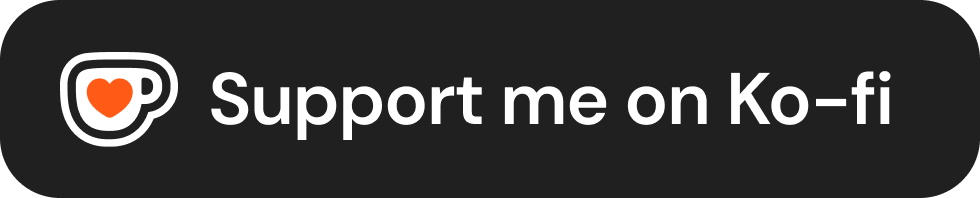

<div align="center">


# Aura

**Your music server, on your iPhone, Apple Watch and Mac.** A native player for Navidrome and Subsonic:
lossless streaming, lyrics that light up word by word, mixes built from your own listening, and your whole library offline.

<a href="https://apps.apple.com/app/apple-store/id6818241470?pt=129146420&mt=8&ct=github"></a>&nbsp;&nbsp;
<a href="https://ko-fi.com/adrbn"></a>
<br><br>
<a href="https://github.com/adrbn/aura/releases/latest"></a>&nbsp;
<a href="https://github.com/adrbn/aura/releases/tag/mac-v1.4.0-build.447"></a>
<br>
<a href="#what-it-does"></a>&nbsp;
<a href="#build-from-source"></a>
<br><br>
<picture>
  <source media="(prefers-color-scheme: light)" srcset="docs/assets/aura-hero-light.svg">
  
</picture>
<br><br>

[](#get-aura)
[](#get-aura)
[](#get-aura)
[](#get-aura)
[](#privacy)
[](https://github.com/adrbn/aura/releases/latest)
[](LICENSE)

<sub><a href="https://apps.apple.com/app/apple-store/id6818241470?pt=129146420&mt=8&ct=github">On the App Store</a> as <b>Aura: Self-Hosted Music</b> · Free and open source · Bring your own server</sub>

English · [Français](README.fr.md)

</div>

---

Aura plays the music on your own server. Point it at Navidrome, or any server that speaks the Subsonic API, and your
library is on your iPhone, your Apple Watch, in CarPlay and on your Mac: streamed in its original quality, with lyrics
in time, mixes built from what you actually play, a Radar of new releases from your artists, and everything you
download still there with no signal.

> **Aura is a client, not a music service.** Point it at a Navidrome or Subsonic-compatible server you own or have
> access to. It plays your library; it doesn't host, provide or find music for you.

## What it does

<table>
  <tr>
    <td align="center" valign="top" width="33%"><br><b>Lossless, with a real equalizer</b><br><sub>FLAC and ALAC stay lossless, or 128, 192 or 320 kbps on a slow line. Five bands from 60 Hz to 14 kHz, one curve you drag, 15 presets, ReplayGain.</sub></td>
    <td align="center" valign="top" width="33%"><br><b>Lyrics in time</b><br><sub>Word by word when your server has per-word timing, line by line otherwise. From your server first, then <a href="https://lrclib.net">LRCLIB</a>. Tap a line to jump to it.</sub></td>
    <td align="center" valign="top" width="33%"><br><b>Made For You</b><br><sub>Mixes by time of day, mood and genre, each with its own cover. Instant Mix starts a radio from any song or artist. Year Wrapped counts your year on the iPhone.</sub></td>
  </tr>
  <tr>
    <td align="center" valign="top"><br><b>Radar</b><br><sub>This month's releases from the artists you play most. What your server has plays in full; the rest plays as 30-second previews.</sub></td>
    <td align="center" valign="top"><br><b>Offline, all of it</b><br><sub>Download a song, an album, a playlist or the whole library, each at its own quality. With no signal, the library, search and playback keep working.</sub></td>
    <td align="center" valign="top"><br><b>Apple Watch and CarPlay</b><br><sub>Now Playing, lyrics, Up Next and the library on your wrist, the Digital Crown on the volume. CarPlay in the App Store build.</sub></td>
  </tr>
</table>

<sub>Marked <b>1.4</b>: new in 1.4, on the App Store now.</sub>

**Listening**

- **A queue you can see ahead in**, in place of the artwork: play next, add to the end, drag to reorder. When an album or playlist ends, autoplay carries on with similar songs.
- **Gapless playback**, shuffle, repeat one or all, and a sleep timer that stops after a set time or at the end of the song.
- **Any format your server holds**: WMA, APE, WavPack, DSD and others are turned into MP3 by your server. A separate quality for cellular, and a stream cache up to the size you set.
- **Made For You, your way** <sup>1.4</sup>: each mix on or off, the genres its genre mixes use, and 25, 50 or 100 songs per mix.
- **Pitch** <sup>1.4</sup>, a semitone at a time, as on a turntable. **SharePlay** <sup>1.4</sup> over FaceTime, everyone streaming from the same server.

**Lyrics**

- **Ready on time**: the next song's lyrics are fetched before it starts. For a duet, a remix or another version, Aura checks they match the version playing.
- **Yours to fix**: shift the timing if your Bluetooth headphones lag, or time a song's lyrics yourself with one tap per line.
- **Translation**, optional, under each line, by Google's Gemini with a free API key of your own. Only the song you tap translate on is sent: its lines, title and artist.

**Your library**

- **One search** across songs, albums, artists and playlists that forgives typos, run on the iPhone over your whole library <sup>1.4</sup>, with `artist:`, `album:`, `genre:` and `year:` one tap away <sup>1.4</sup>.
- **Playlists your way**: a grid or a list, filters, covers from your photos, folders named `Folder/Name` <sup>1.4</sup>, a Suggestions section and Add Songs <sup>1.4</sup>, and Undo <sup>1.4</sup>. Save any radio as a playlist; changes go to your server.
- **Ratings and scrobbling** go to your server, and wait on the iPhone while you're offline. Keep a playlist downloaded <sup>1.4</sup>: its new songs download on their own.
- **Several servers**, each with an optional home-network address and custom headers <sup>1.4</sup>, and several music folders at once <sup>1.4</sup>.
- **Pages in the colour of their artwork**, animated covers <sup>1.4</sup>, multi-disc albums <sup>1.4</sup>, sort tags, and sorts that stay put <sup>1.4</sup>.

**Around the iPhone**

- **Lock Screen, Control Center, Dynamic Island and AirPlay**, and a Now Playing widget for the Home Screen.
- **Siri and Shortcuts**: play an artist, album, song, playlist or genre by name, queue, like, skip. **`aura://` links** <sup>1.4</sup> for Shortcuts.
- **Your iPhone and your Mac** <sup>1.4</sup> control each other on the same Wi-Fi: play on the Mac from Now Playing, and see what the other plays in a second mini player.
- **Share links** that open a song on other services.
- **Yours to arrange**: light or dark, any accent colour, tabs and Home sections in your order, a landscape clock, and iPhone Duo layouts.
- **Nine languages**: English, French, Italian, Spanish, German, Catalan, Dutch, plus Chinese and Russian <sup>1.4</sup>.

## Every device

**iPhone**

<p align="center">
  
</p>

**Apple Watch**: Now Playing, lyrics, Up Next and the library on your wrist, with the Digital Crown on the volume.

<p align="center">
  
</p>

**CarPlay** (App Store build): Home with the mixes and the Radar, your playlists, the newest albums, your artists, a
Downloaded tab that plays without a connection, and a Radio button that follows the song with similar music.

**Mac** (preview, macOS 26): from the same code as the iPhone app. The whole library in one window with a sidebar;
Up Next as a side pane you drag to reorder, with a right-click for Play Next, Start Radio, rating and download; lyrics
full screen; downloads, the equaliser and a menu bar player. Play on your iPhone from the Mac, or the other way round,
over the same Wi-Fi: transport, queue and volume go across, and your AirPods stay with the device that plays.

<p align="center">
  
  
</p>
<p align="center"><sub>The Mac captures use Navidrome's public demo server.</sub></p>

**iPhone Duo**: open, Now Playing keeps the player on the left with the lyrics or the queue beside it.

<p align="center">
  
</p>

## Get Aura

All free, with no account and no in-app purchases.

| | App Store | IPA (sideload) | Mac (preview) |
|---|---|---|---|
| Runs on | iPhone, Apple Watch, CarPlay | iPhone, Apple Watch | Mac |
| Needs | iOS 26, watchOS 26 | iOS 26, watchOS 26, a sideloading tool | macOS 26, Apple silicon or Intel |
| CarPlay | Yes | No: re-signing drops Apple's CarPlay entitlement | – |
| Get It (Soulseek via your own [slskd](https://github.com/slskd/slskd)) | No | Opt-in, Settings → Developer Options | Opt-in, Settings → Developer |
| NetEase lyrics-timing check | No | Yes | Yes |
| Download | [App Store](https://apps.apple.com/app/apple-store/id6818241470?pt=129146420&mt=8&ct=github) | [Latest IPA](https://github.com/adrbn/aura/releases/latest) | [Mac zip](https://github.com/adrbn/aura/releases/download/mac-v1.4.0-build.447/Aura-mac-1.4.0-build.447.zip) |

Every build needs a [Navidrome](https://www.navidrome.org) server, or any server speaking Subsonic API 1.16.1
(OpenSubsonic extensions are used when offered). No server yet? Try Navidrome's public demo:
`https://demo.navidrome.org`, user `demo`, password `demo`.

<details>
<summary><b>Install the IPA</b></summary>

1. Install a sideloading tool on your iPhone: [AltStore](https://altstore.io), [SideStore](https://sidestore.io) or Feather.
2. Download `Aura-v<version>-build.<number>.ipa` from the [latest release](https://github.com/adrbn/aura/releases/latest). Each release lists its SHA-256 checksum.
3. Open the IPA in your sideloading tool and install it.
4. On first launch iOS blocks the app: go to **Settings → General → VPN & Device Management** and trust the developer profile.
5. Open Aura and enter your server's address, username and password.

Installing a new IPA over an earlier sideload keeps your servers, passwords, downloads and pins. With a free Apple ID,
the signature expires after 7 days and the sideloading tool has to refresh it; that's an iOS limit, not Aura's.

</details>

<details>
<summary><b>Install the Mac app</b></summary>

1. Download [`Aura-mac-1.4.0-build.447.zip`](https://github.com/adrbn/aura/releases/download/mac-v1.4.0-build.447/Aura-mac-1.4.0-build.447.zip) from the [Mac release](https://github.com/adrbn/aura/releases/tag/mac-v1.4.0-build.447), which lists its SHA-256 checksum, and open it.
2. Drag **Aura.app** into **Applications**.
3. Open Aura. The app is signed with a Developer ID and notarized by Apple, so it opens like any other app.
4. Enter your server's address, username and password.

The Mac app is a preview: the iPhone app is the one tested every day.

</details>

<details>
<summary><b>What Get It and the NetEase check do</b></summary>

**Get It** fetches what your library is missing: a Radar release, a Deezer result in Search, the missing songs of an
album you have only part of (one by one, or with Get All), or the heart on a preview in Now Playing. Aura finds the
release on Soulseek through your slskd, downloads it, and waits for your server to add it, following each step on
screen. Nothing goes through anyone else's server. Only download music you have the right to.

The **NetEase check** asks NetEase's catalogue, by title, artist and length, for lyrics timed to the exact recording,
since lyrics sources often file a remix under the original's timing.

The sideload builds can also follow a SoulSync watchlist from the Radar, and write lyrics you time by hand to your
server as `.lrc` files through File Browser.

</details>

## Build from source

<details>
<summary><b>Clone, sign, pick a scheme</b></summary>

```bash
git clone https://github.com/adrbn/aura
cd aura
open Aura/Aura.xcodeproj
```

- Xcode 26 or later (App Store archives are made with Xcode 27).
- Select your own team under Signing & Capabilities, and set the `AURA_BUNDLE_BASE` build setting at the project level to a bundle identifier you own. The widget, watch app and Mac targets derive theirs from it.
- Schemes and configurations:
  - **Aura**, with `Debug` and `Release`: the sideload build, with Get It and the NetEase check.
  - **Aura-AppStore**, with `Release-AppStore`: built with the `APPSTORE_BUILD` flag, which compiles the sideload-only features out.
  - **Aura-mac**: the Mac app, a preview; only the iPhone is tested daily.
- CarPlay needs Apple's `carplay-audio` entitlement on your own team.
- `scripts/watch-screenshots.sh` draws the watch app's pages on a Mac without a watch or simulator.

The fonts (Vavin and Archivo, both SIL OFL 1.1) are in the repository, so a fresh clone builds with nothing to add.

The art on this page is made by [`docs/assets/make_svgs.py`](docs/assets/make_svgs.py) (Python, standard library
only): `python3 docs/assets/make_svgs.py` regenerates every SVG from the real captures kept small in
`docs/assets/readme-src/`.

</details>

## Privacy

Aura has no account and no analytics, and sends nothing to the developer. Server passwords are kept in the Keychain.
It talks to your server and to the public services listed in the
[privacy policy](https://adrbn.github.io/aura-site/privacy.html), which says exactly what each one receives.

## How AI was used

Aura is a one-person project, built with Claude Code, Anthropic's coding assistant, which wrote most of the code from
my descriptions. I decided what Aura does and how it looks, read the changes, and tested the builds on my own iPhone,
playing my own library. Every change is in the commit history, with a message that says what it does and why.

## Contributing and support

Bugs and feature requests: [issues](https://github.com/adrbn/aura/issues); they reach a person. Pull requests are
welcome, and the [changelog](CHANGELOG.md) says what changed and why. Aura is free, and stays free. If it earns a
place on your home screen:

<a href="https://ko-fi.com/adrbn"></a>

A star on the repo helps other people find it too.

## License

[GPL-3.0](LICENSE) © 2026 adrbn. You may share and change Aura under the same license; a modified version you
distribute must stay open under GPL-3.0.

<details>
<summary><b>Credits</b></summary>

- [LRCLIB](https://lrclib.net) for lyrics, [MusicBrainz](https://musicbrainz.org) for song credits, [Deezer](https://www.deezer.com)'s public catalogue for covers, artist photos, the Radar, previews and share links, and the iTunes Search API for share links too.
- Optional, with your own key: [Google Gemini](https://ai.google.dev) for lyrics translation and [Last.fm](https://www.last.fm) for listening statistics.
- Fonts: [Archivo](https://github.com/Omnibus-Type/Archivo) and Vavin, both under the SIL Open Font License 1.1.
- The iPhone, Watch and Duo pictures are real captures of the app playing the developer's own library; the Mac captures use Navidrome's public demo server.

</details>

<sub>Aura is not affiliated with Navidrome, Subsonic or Apple. All trademarks belong to their respective owners.</sub>
