<div align="center">

<picture>
  <source media="(prefers-color-scheme: light)" srcset="docs/assets/aura-hero-light.svg">
  
</picture>

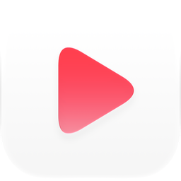

# Aura

**Your music server, on your iPhone.** A native iPhone, Apple Watch and Mac player for Navidrome and Subsonic:
lossless streaming, lyrics that light up word by word, mixes built from your own listening, and your whole library offline.

<a href="https://apps.apple.com/app/apple-store/id6818241470?pt=129146420&mt=8&ct=github"></a>
<br><br>
<a href="https://github.com/adrbn/aura/releases/latest"></a>&nbsp;
<a href="#mac-preview"></a>
<br>
<a href="#what-it-does"></a>&nbsp;
<a href="#two-builds">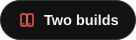</a>&nbsp;
<a href="#build-from-source">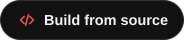</a>
<br><br>
<a href="https://ko-fi.com/adrbn"></a>

<br>

[](#requirements)
[](#mac-preview)
[](#requirements)
[](#requirements)
[](#privacy)
[](https://github.com/adrbn/aura/releases/latest)
[](LICENSE)

<sub><a href="https://apps.apple.com/app/apple-store/id6818241470?pt=129146420&mt=8&ct=github">On the App Store</a> as <b>Aura: Self-Hosted Music</b> · Free and open source · Bring your own server</sub>

English · [Français](README.fr.md)

</div>

---

Aura plays the music on your own server. Point it at Navidrome, or any server that speaks the Subsonic API, and your
library is on your iPhone: streamed in its original quality, with lyrics in time, mixes built from what you actually
play, a Radar of new releases from your artists, and everything you download still there with no signal. The Apple
Watch app is a remote and a library on your wrist; in the car, CarPlay lays it all out again.

> **Aura is a client, not a music service.** Point it at a Navidrome or Subsonic-compatible server you own or have
> access to. It plays your library; it doesn't host, provide or find music for you.

## What it does

<table>
  <tr>
    <td align="center" valign="top" width="33%"><br><b>Lossless, with a real equalizer</b><br><sub>FLAC and ALAC stay lossless, or 128, 192 or 320 kbps on a slow line. Five bands from 60 Hz to 14 kHz, one curve you drag, 15 presets, ReplayGain.</sub></td>
    <td align="center" valign="top" width="33%">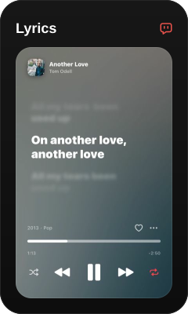<br><b>Lyrics in time</b><br><sub>Word by word when your server has per-word timing, line by line otherwise. From your server first, then <a href="https://lrclib.net">LRCLIB</a>. Tap a line to jump to it.</sub></td>
    <td align="center" valign="top" width="33%">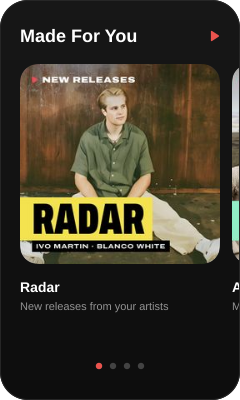<br><b>Made For You</b><br><sub>Mixes by time of day, mood and genre, each with its own cover. Instant Mix starts a radio from any song or artist. Year Wrapped counts your year on the iPhone.</sub></td>
  </tr>
  <tr>
    <td align="center" valign="top">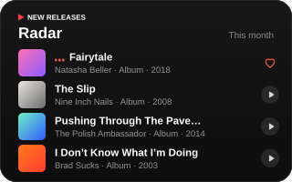<br><b>Radar</b><br><sub>This month's releases from the artists you play most. What your server has plays in full; the rest plays as 30-second previews.</sub></td>
    <td align="center" valign="top">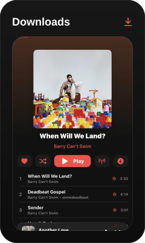<br><b>Offline, all of it</b><br><sub>Download a song, an album, a playlist or the whole library, each at its own quality. With no signal, the library, search and playback keep working.</sub></td>
    <td align="center" valign="top"><br><b>Apple Watch and CarPlay</b><br><sub>Now Playing, lyrics, Up Next and the library on your wrist, the Digital Crown on the volume. CarPlay in the App Store build.</sub></td>
  </tr>
</table>

**And also**

- **A queue you can see ahead in.** It opens in place of the artwork, with shuffle and repeat at its head. Play next, add to the end, drag to reorder. As soon as an album, playlist or artist plays, autoplay lines up similar songs under its own heading, so the music doesn't stop at the last track.
- **Gapless playback.** The next song is lined up behind the one playing, so live albums and DJ mixes run on without a gap.
- **Shuffle, repeat one or all, and a sleep timer** that stops after a set time or at the end of the song.
- **Ratings.** Rate a song from one to five stars in its Song Info; the rating goes to your server, and waits on the iPhone while you're offline.
- **Scrobbling.** Plays go to your server, and are held on the iPhone while you're offline.
- **Lyrics ready on time.** The next song's lyrics are fetched once the one playing passes 80%, so they show the moment it starts.
- **Lyrics you can fix.** Shift the timing if your Bluetooth headphones lag, or put a song's lyrics in time yourself: tap *Now* as each marked line starts. Your timing stays on the iPhone and wins over every other source. For a duet, a remix or another version, Aura checks that the lyrics match the version playing.
- **Lyrics translation**, optional, under each line, by Google's Gemini with a free API key of your own (Settings → Lyrics → Translation). A song is sent only when you tap translate, and only its lines, title and artist. Translations are kept for offline use.
- **Save a radio as a playlist** on your server, and its cover goes with it.
- **One search** across songs, albums, artists and playlists that forgives typos, with a Recently Searched list of what you played.
- **Playlists your way.** A grid or a list, filtered to pinned, radios, mixes, yours, shared or downloaded. Create them, reorder them and give them a cover from your photos; changes go to your server.
- **Pages in the colour of their artwork.** When your server has no cover for an album, Aura finds it in Deezer's catalogue.
- **Any format your server holds.** WMA, APE, WavPack, DSD and other files the iPhone can't read are turned into MP3 by your server, at every quality, for streaming and downloads.
- **A stream cache.** What you stream is kept as it plays, up to a size you set, and an offline mode you switch on stays on across launches.
- **Several servers**, switched from the Home title, and libraries split across music folders. A server can have a second, home-network address, used whenever it answers.
- **A quality for cellular**, apart from the one on Wi-Fi, and the queue saved on your server when you leave the app, for another client to pick up.
- **In seven languages:** English, French, Italian, Spanish, German, Catalan and Dutch.
- **On the Lock Screen**, in Control Center and in the Dynamic Island, with AirPlay.
- **CarPlay** (App Store build): Home with the mixes and the Radar, your playlists, the newest albums, an Artists list, a Downloaded tab that plays without a connection, and a Radio button in Now Playing that follows the song with similar music.
- **Siri and Shortcuts** in the app's seven languages: play an artist, album, song, playlist or genre by name, play your favourites, queue a song next or later, like the song playing, and pause, skip, go back, shuffle or repeat.
- **Share links.** Share a song as links that open it on other services.
- **A Now Playing widget** for the Home Screen: the song and its cover, with previous, play-pause and next in the medium size.
- **Yours to arrange.** Light or dark, any accent colour, and tabs and Home sections in the order you choose.
- **A landscape clock.** Switch it on in Settings and turn the phone sideways while music plays: the time large, the song beside it, and a tap on the cover for the lyrics, one line at a time.
- **Ready for iPhone Duo.** Open, Aura turns with the device: Now Playing keeps the player on the left with the lyrics or the queue beside it, and album, playlist, mix and radio pages stand their cover at the left with the title and buttons next to it. Folded, the player keeps a phone's proportions on the short screens.

**Coming in 1.4** (being tested)

- **Pitch.** Up or down a semitone at a time from Now Playing's menu, as on a turntable: the speed goes with it. The next song starts back at 0.
- **Playlist folders.** Name playlists `Folder/Name` and they sit in a folder on the Playlists tab; swipe right to come back out, long-press one to pin, rename, select or delete what's in it. Deleting a folder can keep its playlists, moved up a level.
- **New playlist, done properly.** One sheet to create or edit a playlist: its cover, its name, a description, and a folder picker that moves it or makes a new folder at any level.
- **A playlist that fills itself up.** An empty playlist offers Add Songs: a search that adds one tap at a time and opens on suggestions. Every playlist ends with a Suggestions section of similar songs, each one a tap away.
- **Undo, at the top.** Deleting a playlist or removing a song says so in the toast at the top of the screen, with an Undo button.
- **Pins, in place.** Hold a pinned playlist and drag it to reorder, and a menu switch puts pins back in the list without unpinning them.
- **Multi-disc albums** list each disc under its own heading, and artists and titles sort by their sort tags.
- **Sorts that stay put.** The order you pick for Songs, Favourites, Albums, Artists or Playlists is still there when you come back.
- **Several music folders at once.** Tick any of your server's folders in Settings → Music Folders, and the whole app follows: Home, the Library, search, favourites and mixes (Navidrome 0.58 or later for more than one).
- **Made For You, your way.** Settings → Made For You switches each mix on or off, picks the genres the genre mixes come from, and sets 25, 50 or 100 songs per mix.
- **A better Songs list.** Search inside it, its song count, Favourites in the order you liked them, and Recently and Frequently Played listing the songs you actually played, by last play and play count.
- **Keep a playlist downloaded**: its new songs download whenever Aura opens with your server in reach.
- **Animated covers**, WebP or GIF, on Now Playing and the album page.
- **SharePlay** over FaceTime, everyone streaming from the same server; **`aura://` links** for Shortcuts; and **Chinese and Russian**.

## Aura for Mac

A preview for macOS 26, from the same code as the iPhone app: [download it](https://github.com/adrbn/aura/releases/tag/mac-v1.4.0-build.360) ([install steps](#mac-preview)) or build the `Aura-mac` scheme.

- **The whole library in one window**: a sidebar with Home, Made For You, the Radar, Wrapped, Songs, Playlists, Albums, Artists, Downloads and your pinned playlists, and the player across the bottom.
- **Up Next as a side pane** that slides in from the right: drag to reorder, shuffle or clear, and a right-click for Play Next, Go to Album, Start Radio, rating and download.
- **Lyrics full screen**, word by word, with the cover beside them, both sized to the window.
- **Play on your iPhone from the Mac**, or on the Mac from the iPhone, over the same Wi-Fi: transport, queue edits and volume go across, and your AirPods stay with the device that plays.
- **Downloads, the equaliser and a menu bar player**, and album pages that list what the release is missing with Get All (opt-in Get It, under Settings → Developer).

<p align="center">
  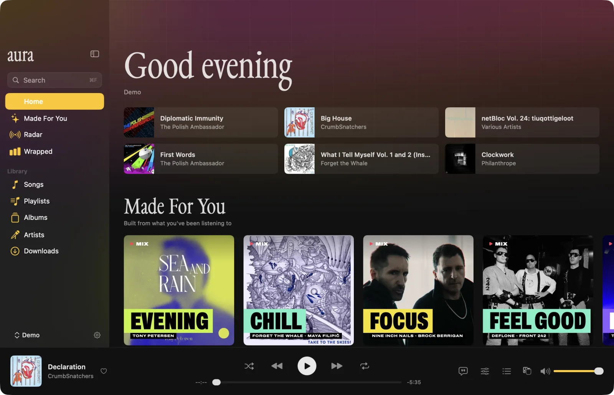
  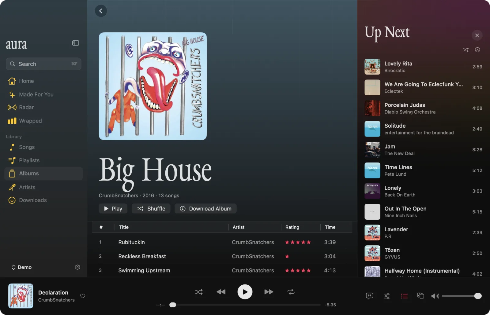
</p>
<p align="center"><sub>These captures use Navidrome's public demo server.</sub></p>

## Screenshots

<p align="center">
  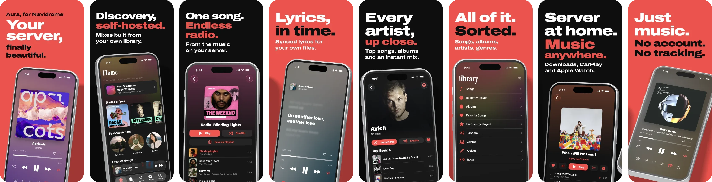
</p>
<p align="center">
  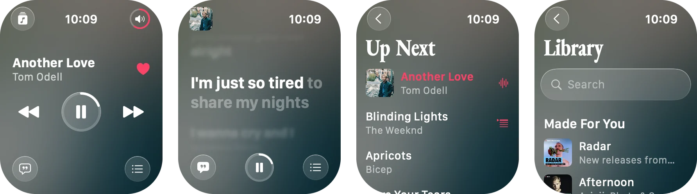
</p>
<p align="center">
  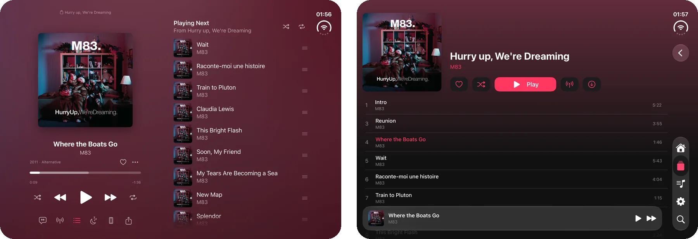
</p>

## Two builds

Both are free, and everything not listed here is the same in both.

| | App Store build | Sideload IPA |
|---|---|---|
| CarPlay | Yes | No: re-signing the IPA drops Apple's CarPlay entitlement |
| Get It (Soulseek via your own [slskd](https://github.com/slskd/slskd)) | No | Opt-in, under Settings → Developer Options |
| NetEase lyrics-timing check for remixes and edits | No | Yes |

**Get It** fetches what your library is missing: a Radar release, a Deezer result in Search, the missing songs of an
album you have only part of (one by one, or with Get All), or the heart on a preview in Now Playing. Aura finds the
release on Soulseek through your slskd, downloads it, and waits for your server to add it, with a card above the mini
player and a Live Activity following each step. Nothing goes through anyone else's server. Only download music you
have the right to.

The **NetEase check** asks NetEase's catalogue, by title, artist and length, for lyrics timed to the exact recording,
since lyrics sources often file a remix under the original's timing.

The sideload build can also follow a SoulSync watchlist from the Radar, and write lyrics you time by hand to your
server as `.lrc` files through File Browser.

## Install

### Sideload the IPA

1. Install a sideloading tool on your iPhone: [AltStore](https://altstore.io), [SideStore](https://sidestore.io) or Feather.
2. Download `Aura-v<version>-build.<number>.ipa` from the [latest release](https://github.com/adrbn/aura/releases/latest). Each release lists its SHA-256 checksum.
3. Open the IPA in your sideloading tool and install it.
4. On first launch iOS blocks the app: go to **Settings → General → VPN & Device Management** and trust the developer profile.
5. Open Aura and enter your server's address, username and password.

Installing a new IPA over an earlier sideload keeps your servers, passwords, downloads and pins. With a free Apple ID,
the signature expires after 7 days and the sideloading tool has to refresh it; that's an iOS limit, not Aura's.

### App Store

[Get **Aura: Self-Hosted Music** on the App Store](https://apps.apple.com/app/apple-store/id6818241470?pt=129146420&mt=8&ct=github). Free, with no in-app purchases.

### Mac (preview)

1. Download [`Aura-mac-1.4.0-build.360.zip`](https://github.com/adrbn/aura/releases/download/mac-v1.4.0-build.360/Aura-mac-1.4.0-build.360.zip) from the [Mac release](https://github.com/adrbn/aura/releases/tag/mac-v1.4.0-build.360), which lists its SHA-256 checksum, and open it.
2. Drag **Aura.app** into **Applications**.
3. Open Aura. The app is signed with a Developer ID but not notarized yet, so macOS blocks the first launch: go to **System Settings → Privacy & Security**, click **Open Anyway** next to Aura, and confirm.
4. Enter your server's address, username and password.

The Mac app is a preview: the iPhone app is the one tested every day.

## Requirements

- iPhone with iOS 26 or later.
- Apple Watch with watchOS 26 or later, for the watch app.
- Mac with macOS 26 or later, Apple silicon or Intel, for the Mac preview.
- A [Navidrome](https://www.navidrome.org) server, or any server speaking Subsonic API 1.16.1. OpenSubsonic extensions are used when the server offers them.

No server yet? Try Aura against Navidrome's public demo: `https://demo.navidrome.org`, user `demo`, password `demo`.

## Build from source

```bash
git clone https://github.com/adrbn/aura
cd aura
open Aura/Aura.xcodeproj
```

- Xcode 26 or later (App Store archives are made with Xcode 27).
- Select your own team under Signing & Capabilities, and set the `AURA_BUNDLE_BASE` build setting at the project level to a bundle identifier you own. The widget, watch app and Mac targets derive theirs from it.
- Schemes and configurations:
  - **Aura**, with `Debug` and `Release`: the sideload build, with Get It and the NetEase check.
  - **Aura-AppStore**, with `Release-AppStore`: built with the `APPSTORE_BUILD` flag, which compiles the sideload-only features out.
  - **Aura-mac**: the Mac app, a preview; only the iPhone is tested daily.
- CarPlay needs Apple's `carplay-audio` entitlement on your own team.
- `scripts/watch-screenshots.sh` draws the watch app's pages on a Mac without a watch or simulator.

The fonts (Vavin and Archivo, both SIL OFL 1.1) are in the repository, so a fresh clone builds with nothing to add.

The art on this page is made by [`docs/assets/make_svgs.py`](docs/assets/make_svgs.py) (Python, standard library
only): `python3 docs/assets/make_svgs.py` regenerates every SVG. Every picture embeds real captures
of the app, kept small in `docs/assets/readme-src/`.

## Privacy

Aura has no account and no analytics, and sends nothing to the developer. Server passwords are kept in the iOS
Keychain. It talks to your server and to the public services listed in the
[privacy policy](https://adrbn.github.io/aura-site/privacy.html), which says exactly what each one receives: lyrics,
credits, covers, artist photos, the Radar and share links.

## How AI was used

Aura is a one-person project, built with Claude Code, Anthropic's coding assistant, which wrote most of the code from
my descriptions. I decided what Aura does and how it looks, read the changes, and tested the builds on my own iPhone,
playing my own library. Every change is in the commit history, with a message that says what it
does and why. Bug reports are welcome: they reach a person.

## Contributing

Bugs and feature requests: [github.com/adrbn/aura/issues](https://github.com/adrbn/aura/issues). Pull requests are
welcome. The [changelog](CHANGELOG.md) describes what changed and why.

## Support

Aura is free, and stays free. If it earns a place on your home screen:

<a href="https://ko-fi.com/adrbn"></a>

A star on the repo helps other people find it too.

## License

[GPL-3.0](LICENSE) © 2026 adrbn. You may share and change Aura under the same license; a modified version you
distribute must stay open under GPL-3.0.

## Credits

- [LRCLIB](https://lrclib.net) for lyrics, [MusicBrainz](https://musicbrainz.org) for song credits, [Deezer](https://www.deezer.com)'s public catalogue for covers, artist photos, the Radar, previews and share links, and the iTunes Search API for share links too.
- Optional, with your own key: [Google Gemini](https://ai.google.dev) for lyrics translation and [Last.fm](https://www.last.fm) for listening statistics.
- Fonts: [Archivo](https://github.com/Omnibus-Type/Archivo) and Vavin, both under the SIL Open Font License 1.1.
- Every picture on this page is a real capture of the app, playing the developer's own library.

<sub>Aura is not affiliated with Navidrome, Subsonic or Apple. All trademarks belong to their respective owners.</sub>
