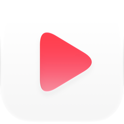
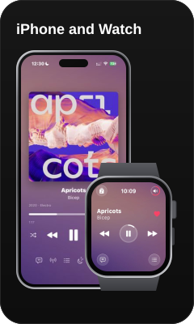
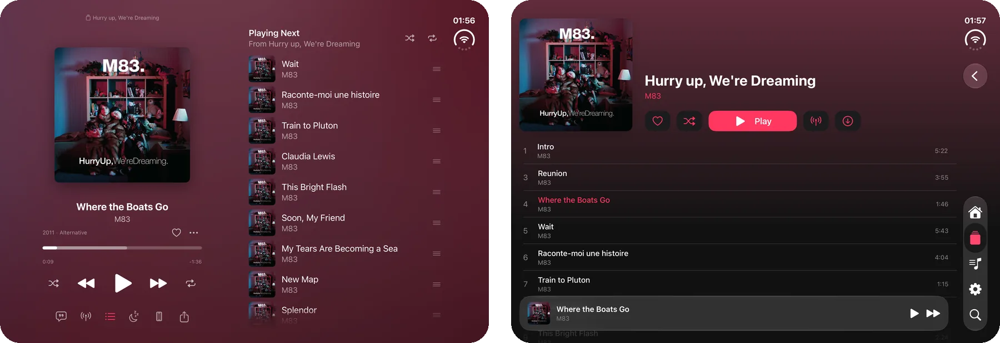

<div align="center">



# Aura

**Seu servidor de música, no seu iPhone, iPad, Apple Watch e Mac.** Um player nativo para Navidrome e Subsonic:
streaming sem perdas, letras que se acendem palavra por palavra, mixes feitos com o que você ouve de verdade e toda a sua biblioteca offline.

<a href="https://apps.apple.com/app/apple-store/id6818241470?pt=129146420&mt=8&ct=github"></a>&nbsp;&nbsp;
<a href="https://ko-fi.com/adrbn"></a>
<br><br>
<a href="https://github.com/adrbn/aura/releases/latest"></a>&nbsp;
<a href="https://github.com/adrbn/aura/releases/tag/mac-v1.6.4-build.519"></a>
<br>
<a href="#o-que-ele-faz"></a>&nbsp;
<a href="#compilar-a-partir-do-código"></a>
<br><br>
<picture>
  <source media="(prefers-color-scheme: light)" srcset="docs/assets/aura-hero-light.svg">
  
</picture>
<br><br>

[](#baixe-o-aura)
[](#baixe-o-aura)
[](#baixe-o-aura)
[](#baixe-o-aura)
[](https://www.navidrome.org/apps/)
[](#privacidade)
[](https://github.com/adrbn/aura/releases/latest)
[](LICENSE)

<sub><a href="https://apps.apple.com/app/apple-store/id6818241470?pt=129146420&mt=8&ct=github">Na App Store</a> como <b>Aura: Self-Hosted Music</b> · Gratuito e de código aberto · Use seu próprio servidor</sub>

[English](README.md) · [Français](README.fr.md) · [Español](README.es.md) · [Deutsch](README.de.md) · [Italiano](README.it.md) · Português (Brasil) · [日本語](README.ja.md) · [简体中文](README.zh-Hans.md) · [한국어](README.ko.md) · [Русский](README.ru.md)

</div>

---

O Aura toca a música do seu próprio servidor. Conecte-o ao Navidrome, ou a qualquer servidor que fale a API do Subsonic,
e sua biblioteca fica no seu iPhone, no seu iPad, no seu Apple Watch, no CarPlay e no seu Mac: em streaming na qualidade
original, com letras no tempo certo, mixes feitos com o que você realmente toca, um Radar dos lançamentos dos seus
artistas, e tudo o que você baixa continua lá mesmo sem sinal.

> **O Aura é um cliente, não um serviço de música.** Conecte-o a um servidor Navidrome ou compatível com Subsonic que
> seja seu ou ao qual você tenha acesso. Ele toca sua biblioteca; não hospeda, não fornece e não procura música para você.

## O que ele faz

<table>
  <tr>
    <td align="center" valign="top" width="33%"><br><b>Sem perdas, com um equalizador de verdade</b><br><sub>FLAC e ALAC continuam sem perdas, ou 128, 192 ou 320 kbps numa conexão lenta. Cinco bandas de 60 Hz a 14 kHz, uma única curva para arrastar, 15 presets, ReplayGain.</sub></td>
    <td align="center" valign="top" width="33%"><br><b>Letras no tempo certo</b><br><sub>Palavra por palavra quando seu servidor tem o tempo de cada palavra, linha por linha caso contrário. Primeiro do seu servidor, depois do <a href="https://lrclib.net">LRCLIB</a>. Toque numa linha para pular até ela.</sub></td>
    <td align="center" valign="top" width="33%"><br><b>Made For You</b><br><sub>Mixes por hora do dia, humor e gênero, cada um com sua capa. O Mix instantâneo começa uma rádio a partir de qualquer música ou artista. O Wrapped faz o balanço do seu ano no iPhone.</sub></td>
  </tr>
  <tr>
    <td align="center" valign="top"><br><b>Radar</b><br><sub>Os lançamentos do mês dos artistas que você mais ouve. O que seu servidor tem toca inteiro; o resto toca como prévias de 30 segundos.</sub></td>
    <td align="center" valign="top"><br><b>Tudo offline</b><br><sub>Baixe uma música, um álbum, uma playlist ou a biblioteca inteira, cada um na sua qualidade. Sem sinal, a biblioteca, a busca e a reprodução continuam funcionando.</sub></td>
    <td align="center" valign="top"><br><b>Apple Watch e CarPlay</b><br><sub>Tocando agora, letras, A seguir e a biblioteca no pulso, com a Digital Crown no volume. CarPlay na versão da App Store.</sub></td>
  </tr>
</table>

<sub>Marcado <b>1.6</b>: novo na 1.6, já na App Store.</sub>

**Ouvir**

- **Uma fila em que você vê o que vem**, no lugar da capa: tocar a seguir, adicionar ao final, arrastar para reordenar. Quando um álbum ou uma playlist termina, a reprodução automática continua com músicas parecidas.
- **Reprodução sem pausas** ou um crossfade de 3 a 12 segundos <sup>1.6</sup>, aleatório, repetir uma ou todas, e um timer de repouso que para depois de um tempo definido ou no fim da música.
- **Qualquer formato do seu servidor**: WMA, APE, WavPack, DSD e outros são convertidos em MP3 pelo seu servidor. Uma qualidade separada para dados celulares, e um cache de streaming do tamanho que você definir.
- **Made For You, do seu jeito**: cada mix ligado ou desligado, os gêneros usados pelos mixes por gênero, e 25, 50 ou 100 músicas por mix.
- **Tom**, um semitom por vez, como num toca-discos. **SharePlay** pelo FaceTime, todos ouvindo do mesmo servidor.

**Letras**

- **Prontas a tempo**: a letra da próxima música é buscada antes de ela começar. Para um dueto, um remix ou outra versão, o Aura verifica se ela corresponde à versão que está tocando.
- **Para você corrigir**: ajuste o tempo se seus fones Bluetooth atrasam, sincronize você mesmo a letra de uma música com um toque por linha, ou deixe o Aura sincronizá-la de ouvido: ele escuta a música no iPhone e posiciona cada linha e cada palavra, mesmo em letras que não tinham tempos.
- **Tradução**, opcional, abaixo de cada linha, pelo Gemini do Google com uma chave de API gratuita sua. Só a música em que você toca em traduzir é enviada: as linhas, o título e o artista.

**Sua biblioteca**

- **Uma só busca** em músicas, álbuns, artistas e playlists que perdoa erros de digitação, feita no iPhone sobre toda a sua biblioteca, com `artist:`, `album:`, `genre:` e `year:` a um toque. Cole o link de uma música de outro serviço para encontrá-la aqui, e filtre as listas de músicas pelo idioma da música.
- **Playlists do seu jeito**: em grade ou em lista, filtros, capas com suas fotos, pastas com nomes como `Pasta/Nome`, uma seção Sugestões e Adicionar músicas, Desfazer e Remover duplicatas, que mantém a primeira cópia de cada música. Salve qualquer rádio como playlist; as mudanças vão para o seu servidor.
- **Avaliações, scrobbling e edições de playlists** vão para o seu servidor, e esperam no iPhone enquanto você está offline, as favoritas também. Mantenha uma playlist baixada: as músicas novas dela são baixadas sozinhas.
- **Vários servidores**, cada um com um endereço opcional para a rede de casa e cabeçalhos personalizados, e várias pastas de música ao mesmo tempo.
- **Páginas na cor da capa**, capas animadas, álbuns com vários discos, tags de ordenação, e ordenações que ficam.

**Em volta do iPhone**

- **iPad** <sup>1.6</sup>: pensado para a tela maior, com a letra ou a fila ao lado da capa na horizontal, e o widget também.
- **Tela Bloqueada, Central de Controle, Dynamic Island e AirPlay**, e um widget Tocando agora para a Tela de Início.
- **Siri e Atalhos**: toque um artista, álbum, música, playlist ou gênero pelo nome, adicione à fila, curta, pule. **Links `aura://`** para Atalhos.
- **Seu iPhone e seu Mac** controlam um ao outro na mesma Wi-Fi: toque no Mac a partir do Tocando agora, e veja o que o outro está tocando num segundo miniplayer.
- **Links de compartilhamento** que abrem uma música em outros serviços.
- **Do seu jeito**: claro ou escuro, qualquer cor de destaque, abas e seções do Início na sua ordem, um relógio na horizontal e layouts para o iPhone Duo.
- **25 idiomas**: inglês, francês, italiano, espanhol, catalão, alemão, holandês, português (Portugal e Brasil), sueco, norueguês, dinamarquês, finlandês, polonês, tcheco, romeno, ucraniano, russo, grego, turco, tailandês, japonês, coreano e chinês (simplificado e tradicional).

## Em cada aparelho

**iPhone**

<p align="center">
  
</p>

**Apple Watch**: Tocando agora, letras, A seguir e a biblioteca no pulso, com a Digital Crown no volume.

<p align="center">
  
</p>

**CarPlay** (versão da App Store): Início com os mixes e o Radar, álbuns em grades de capas, suas playlists, todos os
artistas de A a Z, as estações de rádio online do seu servidor, uma aba Baixadas e suas playlists offline que tocam
sem conexão, e um botão Rádio que continua a música com sons parecidos.

**Mac** (prévia, macOS 26): feito com o mesmo código do app do iPhone. A biblioteca inteira numa janela com barra
lateral; A seguir como painel lateral que você reordena arrastando, com clique direito para Tocar a seguir, Iniciar
rádio, avaliar e baixar; letras em tela cheia; downloads, o equalizador e um player na barra de menus. Toque no seu
iPhone a partir do Mac, ou o contrário, na mesma Wi-Fi: controles, fila e volume passam de um para o outro, e seus
AirPods ficam com o aparelho que está tocando.

<p align="center">
  
  
</p>
<p align="center"><sub>As capturas do Mac usam o servidor de demonstração público do Navidrome.</sub></p>

**iPhone Duo**: aberto, o Tocando agora mantém o player à esquerda com a letra ou a fila ao lado.

<p align="center">
  
</p>

## Baixe o Aura

Tudo gratuito, sem conta e sem compras dentro do app.

| | App Store | IPA (sideload) | Mac (prévia) |
|---|---|---|---|
| Funciona em | iPhone, iPad, Apple Watch, CarPlay | iPhone, iPad, Apple Watch | Mac |
| Requer | iOS 26, iPadOS 26, watchOS 26 | iOS 26, iPadOS 26, watchOS 26, uma ferramenta de sideload | macOS 26, Apple silicon ou Intel |
| CarPlay | Sim | Não: assinar de novo remove a permissão de CarPlay da Apple | – |
| Get It (Soulseek pelo seu próprio [slskd](https://github.com/slskd/slskd)) | Não | Opcional, Ajustes → Developer Options | Opcional, Ajustes → Developer |
| Verificação de tempo das letras pela NetEase | Não | Sim | Sim |
| Download | [App Store](https://apps.apple.com/app/apple-store/id6818241470?pt=129146420&mt=8&ct=github) | [IPA mais recente](https://github.com/adrbn/aura/releases/latest) | [DMG para Mac](https://github.com/adrbn/aura/releases/download/mac-v1.6.4-build.519/Aura-mac-1.6.4-build.519.dmg) |

Todas as versões precisam de um servidor [Navidrome](https://www.navidrome.org), ou de qualquer servidor que fale a API
do Subsonic 1.16.1 (as extensões OpenSubsonic são usadas quando oferecidas). Ainda não tem servidor? Experimente a demo
pública do Navidrome: `https://demo.navidrome.org`, usuário `demo`, senha `demo`.

<details>
<summary><b>Instalar o IPA</b></summary>

1. Instale uma ferramenta de sideload no seu iPhone: [AltStore](https://altstore.io), [SideStore](https://sidestore.io) ou Feather.
2. Baixe `Aura-v<version>-build.<number>.ipa` da [versão mais recente](https://github.com/adrbn/aura/releases/latest). Cada versão informa seu checksum SHA-256.
3. Abra o IPA na sua ferramenta de sideload e instale-o.
4. Na primeira abertura o iOS bloqueia o app: vá em **Ajustes → Geral → VPN e Gerenciamento de Dispositivos** e confie no perfil do desenvolvedor.
5. Abra o Aura e digite o endereço do seu servidor, seu usuário e sua senha.

Instalar um IPA novo por cima de um sideload anterior mantém seus servidores, senhas, downloads e fixados. Com um Apple
ID gratuito, a assinatura expira depois de 7 dias e a ferramenta de sideload precisa renová-la; é um limite do iOS, não
do Aura.

</details>

<details>
<summary><b>Instalar o app para Mac</b></summary>

1. Baixe [`Aura-mac-1.6.4-build.519.dmg`](https://github.com/adrbn/aura/releases/download/mac-v1.6.4-build.519/Aura-mac-1.6.4-build.519.dmg) da [versão para Mac](https://github.com/adrbn/aura/releases/tag/mac-v1.6.4-build.519), que informa seu checksum SHA-256, e abra-o.
2. Arraste o **Aura** para **Aplicativos**.
3. Abra o Aura. O app é assinado com um Developer ID e notarizado pela Apple, então abre como qualquer outro app.
4. Digite o endereço do seu servidor, seu usuário e sua senha.

O app para Mac é uma prévia: o app do iPhone é o que é testado todos os dias.

</details>

<details>
<summary><b>O que fazem o Get It e a verificação da NetEase</b></summary>

O **Get It** busca o que falta na sua biblioteca: um lançamento do Radar, um resultado do Deezer em Buscar, as músicas
que faltam de um álbum que você tem só em parte (uma a uma, ou com Obter tudo), ou o coração numa prévia no Tocando
agora. O Aura encontra o lançamento no Soulseek pelo seu slskd, baixa e espera seu servidor adicioná-lo, mostrando cada
etapa na tela. Nada passa pelo servidor de outra pessoa. Baixe apenas músicas sobre as quais você tem direitos.

A **verificação da NetEase** pede ao catálogo da NetEase, por título, artista e duração, letras sincronizadas com a
gravação exata, porque as fontes de letras costumam guardar um remix com os tempos do original.

As versões de sideload também podem seguir uma watchlist do SoulSync a partir do Radar, e gravar no seu servidor as
letras que você sincroniza à mão como arquivos `.lrc` pelo File Browser.

</details>

## Compilar a partir do código

<details>
<summary><b>Clonar, assinar, escolher um scheme</b></summary>

```bash
git clone https://github.com/adrbn/aura
cd aura
open Aura/Aura.xcodeproj
```

- Xcode 26 ou mais recente (os arquivos para a App Store são feitos com o Xcode 27).
- Escolha seu próprio time em Signing & Capabilities, e defina a configuração de build `AURA_BUNDLE_BASE`, no nível do projeto, com um bundle identifier seu. Os targets do widget, do app do Watch e do Mac derivam o deles dele.
- Schemes e configurações:
  - **Aura**, com `Debug` e `Release`: a versão de sideload, com Get It e a verificação da NetEase.
  - **Aura-AppStore**, com `Release-AppStore`: compilada com a flag `APPSTORE_BUILD`, que deixa de fora os recursos exclusivos do sideload.
  - **Aura-mac**: o app para Mac, uma prévia; só o iPhone é testado diariamente.
- O CarPlay precisa da permissão `carplay-audio` da Apple no seu próprio time.
- `scripts/watch-screenshots.sh` desenha as telas do app do Watch num Mac, sem relógio nem simulador.

As fontes (Vavin e Archivo, ambas sob SIL OFL 1.1) estão no repositório, então um clone novo compila sem precisar
adicionar nada.

As imagens desta página são feitas por [`docs/assets/make_svgs.py`](docs/assets/make_svgs.py) (Python, só a biblioteca
padrão): `python3 docs/assets/make_svgs.py` gera de novo todos os SVGs a partir das capturas reais guardadas em tamanho
pequeno em `docs/assets/readme-src/`.

</details>

## Privacidade

O Aura não tem conta nem análises, e não envia nada ao desenvolvedor. As senhas dos servidores ficam guardadas nas Chaves
(Keychain). O app fala com o seu servidor e com os serviços públicos listados na
[política de privacidade](https://adrbn.github.io/aura-site/privacy.html), que diz exatamente o que cada um recebe.

## Como a IA foi usada

O Aura é um projeto de uma pessoa só, feito com o Claude Code, o assistente de programação da Anthropic, que escreveu a
maior parte do código a partir das minhas descrições. Eu decidi o que o Aura faz e como ele é, li as mudanças e testei as
versões no meu próprio iPhone, com a minha própria biblioteca. Cada mudança está no histórico de commits, com uma
mensagem que diz o que ela faz e por quê.

## Contribuir e apoiar

Bugs e pedidos de recursos: [issues](https://github.com/adrbn/aura/issues); quem lê é uma pessoa. Pull requests são
bem-vindos, e o [registro de mudanças](CHANGELOG.md) (em inglês) diz o que mudou e por quê. O Aura é gratuito, e vai
continuar assim. Se ele merecer um lugar na sua Tela de Início:

<a href="https://ko-fi.com/adrbn"></a>

Uma estrela no repositório também ajuda outras pessoas a encontrá-lo.

### Obrigado

Às pessoas cujos relatos e ideias deram forma ao Aura:

- [willvebert](https://github.com/willvebert): os botões e a navegação de volta no CarPlay, a busca pela Siri, os gêneros excluídos dos mixes
- [dominak3](https://github.com/dominak3): a troca automática de servidor, os botões personalizáveis do player, os downloads das Favoritas, o tcheco e muitos relatos de bugs
- [nClarke0101](https://github.com/nClarke0101): os cabeçalhos HTTP personalizados, os downloads no Apple Watch
- [DMcWetty](https://github.com/DMcWetty): várias pastas de música ao mesmo tempo
- [Dedeham](https://github.com/Dedeham): filtros de músicas que continuam quando você volta

E às pessoas cujos cafés no [Ko-fi](https://ko-fi.com/adrbn) mantêm o Aura vivo: Greg e DummyHead.

## Licença

[GPL-3.0](LICENSE) © 2026 adrbn. Você pode compartilhar e modificar o Aura sob a mesma licença; uma versão modificada que
você distribuir precisa continuar aberta sob GPL-3.0.

<details>
<summary><b>Créditos</b></summary>

- [LRCLIB](https://lrclib.net) para as letras, [MusicBrainz](https://musicbrainz.org) para os créditos das músicas, o catálogo público do [Deezer](https://www.deezer.com) para capas, fotos de artistas, o Radar, as prévias e os links de compartilhamento, e a API iTunes Search também para os links de compartilhamento.
- Opcionais, com sua própria chave: [Google Gemini](https://ai.google.dev) para a tradução das letras e [Last.fm](https://www.last.fm) para as estatísticas de audição.
- Fontes: [Archivo](https://github.com/Omnibus-Type/Archivo) e Vavin, ambas sob a SIL Open Font License 1.1.
- As imagens do iPhone, do Watch e do Duo são capturas reais do app tocando a biblioteca do desenvolvedor; as capturas do Mac usam o servidor de demonstração público do Navidrome.

</details>

<sub>O Aura não tem afiliação com Navidrome, Subsonic ou Apple. Todas as marcas pertencem aos seus respectivos donos.</sub>
