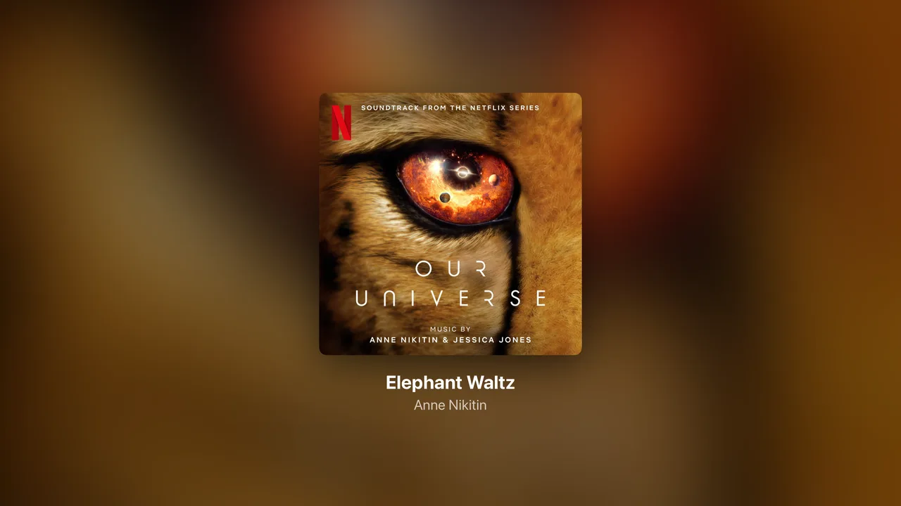

<div align="center">


# Aura

**Ваш музыкальный сервер на iPhone, iPad, Apple Watch, Mac и Apple TV.** Нативный плеер для Navidrome и Subsonic:
стриминг без потерь, тексты, которые загораются слово за словом, миксы из того, что вы действительно слушаете, и вся медиатека офлайн.

<a href="https://apps.apple.com/app/apple-store/id6818241470?pt=129146420&mt=8&ct=github"></a>&nbsp;&nbsp;
<a href="https://ko-fi.com/adrbn"></a>
<br><br>
<a href="https://github.com/adrbn/aura/releases/latest"></a>&nbsp;
<a href="https://github.com/adrbn/aura/releases/tag/mac-v1.8.0-build.620"></a>
<br>
<a href="#возможности"></a>&nbsp;
<a href="#сборка-из-исходников"></a>
<br><br>
<picture>
  <source media="(prefers-color-scheme: light)" srcset="docs/assets/aura-hero-light.svg">
  
</picture>
<br><br>

[](#где-взять-aura)
[](#где-взять-aura)
[](#где-взять-aura)
[](#где-взять-aura)
[](#где-взять-aura)
[](https://www.navidrome.org/apps/)
[](#конфиденциальность)
[](https://github.com/adrbn/aura/releases/latest)
[](LICENSE)

<sub><a href="https://apps.apple.com/app/apple-store/id6818241470?pt=129146420&mt=8&ct=github">В App Store</a> под названием <b>Aura: Self-Hosted Music</b> · Бесплатно и с открытым исходным кодом · Нужен свой сервер</sub>

[English](README.md) · [Français](README.fr.md) · [Español](README.es.md) · [Deutsch](README.de.md) · [Italiano](README.it.md) · [Português (Brasil)](README.pt-BR.md) · [日本語](README.ja.md) · [简体中文](README.zh-Hans.md) · [한국어](README.ko.md) · Русский

</div>

---

Aura воспроизводит музыку с вашего собственного сервера. Подключите её к Navidrome или к любому серверу с API Subsonic,
и ваша медиатека будет на iPhone, iPad, Apple Watch, в CarPlay, на Mac и на Apple TV: в исходном качестве, с текстами в такт,
миксами из того, что вы на самом деле слушаете, разделом Radar с новыми релизами ваших артистов, а всё загруженное остаётся с вами
даже без сети.

> **Aura — это клиент, а не музыкальный сервис.** Подключите её к серверу Navidrome или совместимому с Subsonic, который
> принадлежит вам или к которому у вас есть доступ. Она воспроизводит вашу медиатеку; она не хранит, не предоставляет и
> не ищет для вас музыку.

## Возможности

<table>
  <tr>
    <td align="center" valign="top" width="33%"><br><b>Без потерь, с настоящим эквалайзером</b><br><sub>FLAC и ALAC остаются без потерь, или 128, 192 и 320 кбит/с на медленной связи. Пять полос от 60 Гц до 14 кГц, одна кривая, которую можно тянуть, 15 пресетов, ReplayGain.</sub></td>
    <td align="center" valign="top" width="33%"><br><b>Тексты в такт</b><br><sub>Слово за словом, если у сервера есть разметка по словам, иначе строка за строкой. Сначала с вашего сервера, затем с <a href="https://lrclib.net">LRCLIB</a>. Коснитесь строки, чтобы перейти к ней.</sub></td>
    <td align="center" valign="top" width="33%"><br><b>Для вас</b><br><sub>Миксы по времени суток, настроению и жанру, у каждого своя обложка, и Nonstop, бесконечный микс из любимых, ближайших и ещё не слышанных песен. Мгновенный микс запускает радио от любой песни или артиста. Wrapped подводит итоги вашего года.</sub></td>
  </tr>
  <tr>
    <td align="center" valign="top"><br><b>Radar</b><br><sub>Релизы этого месяца от артистов, которых вы слушаете чаще всего. То, что есть на сервере, играет целиком; остальное — 30-секундными фрагментами.</sub></td>
    <td align="center" valign="top"><br><b>Всё офлайн</b><br><sub>Загрузите песню, альбом, плейлист или всю медиатеку, каждое в своём качестве. Без сети медиатека, поиск и воспроизведение продолжают работать.</sub></td>
    <td align="center" valign="top"><br><b>Apple Watch и CarPlay</b><br><sub>«Исполняется», тексты, «Далее» и медиатека на запястье, громкость на Digital Crown. CarPlay в версии из App Store.</sub></td>
  </tr>
</table>

**Прослушивание**

- **Очередь, в которой видно, что дальше**, на месте обложки: воспроизвести далее, добавить в конец, перетащить для смены порядка. Когда альбом или плейлист заканчивается, автовоспроизведение продолжает похожими песнями.
- **Воспроизведение без пауз** или кроссфейд от 1 до 12 секунд, перемешивание, повтор одной или всех, и таймер сна, который останавливает музыку через заданное время или в конце песни.
- **Любой формат с вашего сервера**: WMA, APE, WavPack, DSD и другие сервер перекодирует в MP3. Отдельное качество для сотовой сети и кэш стриминга до заданного вами размера.
- **«Для вас» по-вашему**: каждый микс включён или выключен, жанры для жанровых миксов, и 25, 50 или 100 песен в миксе.
- **Тональность** по полутону, как на проигрывателе. **SharePlay** через FaceTime, все слушают с одного сервера.

**Тексты**

- **Готовы вовремя**: текст следующей песни загружается до её начала. Для дуэта, ремикса или другой версии Aura проверяет, что текст соответствует играющей версии.
- **Можно исправить самому**: сдвиньте тайминг, если Bluetooth-наушники отстают, разметьте текст песни сами одним касанием на строку или позвольте Aura разметить его на слух: она слушает песню на iPhone и расставляет каждую строку и каждое слово, даже в текстах без разметки.
- **Перевод**, по желанию, под каждой строкой, через Gemini от Google с вашим собственным бесплатным ключом API. Отправляется только песня, для которой вы нажали «перевести»: её строки, название и артист.

**Ваша медиатека**

- **Единый поиск** по песням, альбомам, артистам и плейлистам, прощающий опечатки, выполняется на iPhone по всей медиатеке, с `artist:`, `album:`, `genre:` и `year:` в одно касание. Вставьте ссылку на песню из другого сервиса, чтобы найти её здесь, и фильтруйте списки песен по языку музыки.
- **Плейлисты по-вашему**: сеткой или списком, фильтры, обложки из ваших фото, папки с названиями вида `Папка/Название`, раздел «Рекомендации», а также «Добавить песни», «Отменить» и «Удалить дубли», которое оставляет первую копию каждой песни. Сохраните любое радио как плейлист; изменения уходят на ваш сервер.
- **Оценки, скробблинг и правки плейлистов** уходят на ваш сервер и ждут на iPhone, пока вы офлайн, избранное тоже. Держите плейлист загруженным: его новые песни загружаются сами.
- **Несколько серверов**, у каждого по желанию адрес для домашней сети и свои заголовки, и несколько папок с музыкой одновременно.
- **Страницы в цвете своей обложки**, анимированные обложки, многодисковые альбомы, теги сортировки и сортировки, которые сохраняются.

**Вокруг iPhone**

- **iPad**: раскладка для большого экрана, в горизонтальной ориентации текст или очередь рядом с обложкой, и виджет тоже.
- **Экран блокировки, Пункт управления, Dynamic Island и AirPlay**, а также виджет «Исполняется» для экрана «Домой».
- **Siri и Команды**: включите артиста, альбом, песню, плейлист или жанр по названию, добавьте в очередь, отметьте, пропустите. **Ссылки `aura://`** для Команд.
- **iPhone, Mac и Apple TV включают музыку друг на друге** в одной сети Wi-Fi: отправляйте музыку с одного на другое, управляйте с любого (управление, очередь, громкость) и смотрите, что играет на другом устройстве, во втором мини-плеере. AirPods остаются с тем, что играет.
- **Ссылки для отправки**, открывающие песню в других сервисах.
- **Под себя**: светлая или темная тема, любой цвет акцента, вкладки и разделы Главной в вашем порядке, часы в горизонтальной ориентации и раскладки для iPhone Duo.
- **25 языков**: английский, французский, итальянский, испанский, каталанский, немецкий, нидерландский, португальский (Португалия и Бразилия), шведский, норвежский, датский, финский, польский, чешский, румынский, украинский, русский, греческий, турецкий, тайский, японский, корейский и китайский (упрощенный и традиционный).

## На каждом устройстве

**iPhone**

<p align="center">
  
</p>

**Apple Watch**

<p align="center">
  
</p>

**CarPlay** (версия из App Store): Главная с миксами и Radar, альбомы сеткой обложек, ваши плейлисты, все артисты от
A до Z, интернет-радиостанции вашего сервера, вкладка «Загружено» и ваши офлайн-плейлисты, которые играют без
подключения, и кнопка «Радио», продолжающая песню похожей музыкой.

**Mac** (macOS 26): из того же кода, что и приложение для iPhone. Вся медиатека в одном окне с
боковой панелью; «Далее» как боковая панель, порядок в которой меняется перетаскиванием, с правым кликом для
«Воспроизвести далее», «Включить радио», оценки и загрузки; тексты на весь экран; радар, Wrapped, загрузки, эквалайзер и плеер в строке
меню.

<p align="center">
  
  
</p>
<p align="center"><sub>Снимки Mac сделаны на публичном демо-сервере Navidrome.</sub></p>

**Apple TV** (tvOS 26, в App Store): «Главная» с миксами, «Медиатека» с сортировкой и фильтрами, поиск, страницы альбомов и артистов и «Исполняется» на весь экран поверх размытой обложки, с текстом, который идёт вместе с песней. Через пять секунд без пульта элементы управления исчезают, и на экране остаются только обложка, песня и текст, который можно увеличить с телевизора, iPhone или Mac.

<p align="center">
  
  <br>
  
  
</p>

**iPhone Duo**: в раскрытом виде «Исполняется» держит плеер слева, а текст или очередь рядом.

<p align="center">
  
</p>

## Где взять Aura

Всё бесплатно, без учетной записи и без встроенных покупок.

| | App Store | IPA (сайдлоад) | Mac (предварительная версия) |
|---|---|---|---|
| Работает на | iPhone, iPad, Apple Watch, CarPlay, Apple TV | iPhone, iPad, Apple Watch | Mac |
| Требуется | iOS 26, iPadOS 26, watchOS 26, tvOS 26 | iOS 26, iPadOS 26, watchOS 26, инструмент для сайдлоада | macOS 26, Apple silicon или Intel |
| CarPlay | Да | Нет: переподпись лишает приложение разрешения CarPlay от Apple | – |
| Get It (Soulseek через ваш собственный [slskd](https://github.com/slskd/slskd)) | Нет | По желанию, Настройки → Developer Options | По желанию, Настройки → Developer |
| Проверка тайминга текстов через NetEase | Нет | Да | Да |
| Скачать | [App Store](https://apps.apple.com/app/apple-store/id6818241470?pt=129146420&mt=8&ct=github) | [Последний IPA](https://github.com/adrbn/aura/releases/latest) | [DMG для Mac](https://github.com/adrbn/aura/releases/download/mac-v1.8.0-build.620/Aura-mac-1.8.0-build.620.dmg) |

Любой версии нужен сервер [Navidrome](https://www.navidrome.org) или любой сервер с API Subsonic 1.16.1 (расширения
OpenSubsonic используются, если сервер их предлагает). Сервера еще нет? Попробуйте публичную демо-версию Navidrome:
`https://demo.navidrome.org`, пользователь `demo`, пароль `demo`.

<details>
<summary><b>Установка IPA</b></summary>

1. Установите на iPhone инструмент для сайдлоада: [AltStore](https://altstore.io), [SideStore](https://sidestore.io) или Feather.
2. Скачайте `Aura-v<version>-build.<number>.ipa` из [последнего релиза](https://github.com/adrbn/aura/releases/latest). В каждом релизе указана контрольная сумма SHA-256.
3. Откройте IPA в инструменте для сайдлоада и установите.
4. При первом запуске iOS блокирует приложение: откройте **Настройки → Основные → VPN и управление устройством** и доверьтесь профилю разработчика.
5. Откройте Aura и введите адрес сервера, имя пользователя и пароль.

Установка нового IPA поверх прежнего сохраняет ваши серверы, пароли, загрузки и закрепления. С бесплатным Apple ID
подпись истекает через 7 дней, и инструмент для сайдлоада должен ее обновить; это ограничение iOS, а не Aura.

</details>

<details>
<summary><b>Установка приложения для Mac</b></summary>

1. Скачайте [`Aura-mac-1.8.0-build.620.dmg`](https://github.com/adrbn/aura/releases/download/mac-v1.8.0-build.620/Aura-mac-1.8.0-build.620.dmg) из [релиза для Mac](https://github.com/adrbn/aura/releases/tag/mac-v1.8.0-build.620), где указана контрольная сумма SHA-256, и откройте его.
2. Перетащите **Aura** в **Программы**.
3. Откройте Aura. Приложение подписано Developer ID и заверено Apple, поэтому открывается как любое другое.
4. Введите адрес сервера, имя пользователя и пароль.

Приложение для Mac — предварительная версия: каждый день тестируется приложение для iPhone.

</details>

<details>
<summary><b>Что делают Get It и проверка NetEase</b></summary>

**Get It** добывает то, чего нет в вашей медиатеке: релиз из Radar, результат Deezer в Поиске, недостающие песни
альбома, который у вас есть лишь частично (по одной или кнопкой «Получить все»), или сердечко на фрагменте в
«Исполняется». Aura находит релиз в Soulseek через ваш slskd, загружает его и ждет, пока сервер его добавит, показывая
каждый шаг на экране. Ничего не проходит через чужой сервер. Загружайте только музыку, на которую у вас есть права.

**Проверка NetEase** запрашивает в каталоге NetEase по названию, артисту и длительности текст, размеченный под точную
запись, потому что источники текстов часто хранят ремикс с таймингом оригинала.

Версии для сайдлоада также могут следить за списком отслеживания SoulSync из Radar и записывать на сервер тексты,
размеченные вручную, в виде файлов `.lrc` через File Browser.

</details>

## Сборка из исходников

<details>
<summary><b>Клонировать, подписать, выбрать схему</b></summary>

```bash
git clone https://github.com/adrbn/aura
cd aura
open Aura/Aura.xcodeproj
```

- Xcode 26 или новее (архивы для App Store собираются в Xcode 27).
- Выберите свою команду в Signing & Capabilities и задайте настройке сборки `AURA_BUNDLE_BASE` на уровне проекта идентификатор бандла, который принадлежит вам. Цели виджета, приложения для часов и Mac выводят свои идентификаторы из него.
- Схемы и конфигурации:
  - **Aura**, с `Debug` и `Release`: версия для сайдлоада, с Get It и проверкой NetEase.
  - **Aura-AppStore**, с `Release-AppStore`: собирается с флагом `APPSTORE_BUILD`, который исключает функции только для сайдлоада.
  - **Aura-mac**: приложение для Mac.
  - **Aura-tv**: приложение для Apple TV.
- Для CarPlay нужно разрешение Apple `carplay-audio` для вашей команды.
- `scripts/watch-screenshots.sh` рисует экраны приложения для часов на Mac без часов и симулятора.

Шрифты (Vavin и Archivo, оба под SIL OFL 1.1) лежат в репозитории, поэтому свежий клон собирается без каких-либо
добавлений.

Иллюстрации на этой странице создает [`docs/assets/make_svgs.py`](docs/assets/make_svgs.py) (Python, только
стандартная библиотека): `python3 docs/assets/make_svgs.py` заново создает все SVG из настоящих снимков, хранящихся в
уменьшенном виде в `docs/assets/readme-src/`.

</details>

## Конфиденциальность

У Aura нет учетной записи и аналитики, и она ничего не отправляет разработчику. Пароли серверов хранятся в связке
ключей. Приложение общается с вашим сервером и с публичными сервисами, перечисленными в
[политике конфиденциальности](https://aura.adrbn.dev/privacy.html), где точно сказано, что получает каждый из них.

## Как использовался ИИ

Aura — проект одного человека, созданный с помощью Claude Code, ассистента по программированию от Anthropic, который
написал большую часть кода по моим описаниям. Я решал, что делает Aura и как она выглядит, читал изменения и тестировал
сборки на своем iPhone, слушая свою медиатеку. Каждое изменение есть в истории коммитов, с сообщением о том, что оно
делает и зачем.

## Участие и поддержка

Ошибки и пожелания: [issues](https://github.com/adrbn/aura/issues); их читает человек. Пул-реквесты приветствуются, а
[список изменений](CHANGELOG.md) (на английском) рассказывает, что изменилось и почему. Aura бесплатна и останется
бесплатной. Если она заслужила место на вашем экране «Домой»:

<a href="https://ko-fi.com/adrbn"></a>

Звезда репозиторию тоже помогает другим его найти.

### Спасибо

Людям, чьи сообщения и идеи сформировали Aura:

- [willvebert](https://github.com/willvebert): кнопки и навигация назад в CarPlay, поиск через Siri, исключение жанров из миксов
- [dominak3](https://github.com/dominak3): автоматическое переключение сервера, настраиваемые кнопки плеера, загрузка Избранного, мини-плеер, следующий за жестом, чешский язык и множество сообщений об ошибках
- [eibhei](https://github.com/eibhei): добавление играющей песни в избранное из виджета и с экрана блокировки
- [nClarke0101](https://github.com/nClarke0101): собственные HTTP-заголовки, загрузки на Apple Watch
- [DMcWetty](https://github.com/DMcWetty): несколько папок с музыкой одновременно
- [Dedeham](https://github.com/Dedeham): фильтры песен, которые сохраняются при возвращении

И людям, чей кофе на [Ko-fi](https://ko-fi.com/adrbn) поддерживает Aura: Greg и DummyHead.

## Лицензия

[GPL-3.0](LICENSE) © 2026 adrbn. Вы можете распространять и изменять Aura под той же лицензией; измененная версия,
которую вы распространяете, должна оставаться открытой под GPL-3.0.

<details>
<summary><b>Благодарности</b></summary>

- [LRCLIB](https://lrclib.net) за тексты, [MusicBrainz](https://musicbrainz.org) за сведения об авторах песен, публичный каталог [Deezer](https://www.deezer.com) за обложки, фото артистов, Radar, фрагменты и ссылки для отправки, и iTunes Search API тоже за ссылки для отправки.
- По желанию, с вашим собственным ключом: [Google Gemini](https://ai.google.dev) для перевода текстов и [Last.fm](https://www.last.fm) для статистики прослушиваний.
- Шрифты: [Archivo](https://github.com/Omnibus-Type/Archivo) и Vavin, оба под SIL Open Font License 1.1.
- Изображения iPhone, часов и Duo — настоящие снимки приложения с медиатекой разработчика; снимки Mac сделаны на публичном демо-сервере Navidrome.

</details>

<sub>Aura не связана с Navidrome, Subsonic или Apple. Все товарные знаки принадлежат их владельцам.</sub>
