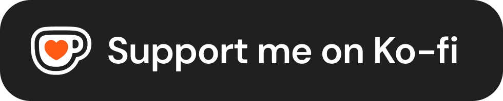
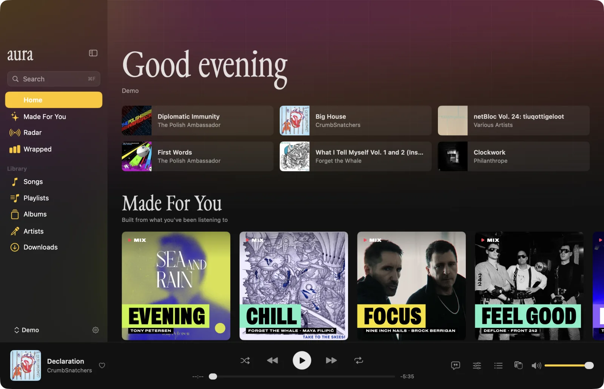

<div align="center">


# Aura

**你的音乐服务器，装进你的 iPhone、iPad、Apple Watch、Mac 和 Apple TV。** 一款为 Navidrome 和 Subsonic 打造的原生播放器：
无损串流，逐字点亮的歌词，根据你真实收听生成的混音，以及完整的离线资料库。

<a href="https://apps.apple.com/app/apple-store/id6818241470?pt=129146420&mt=8&ct=github"></a>&nbsp;&nbsp;
<a href="https://ko-fi.com/adrbn"></a>
<br><br>
<a href="https://github.com/adrbn/aura/releases/latest"></a>&nbsp;
<a href="https://github.com/adrbn/aura/releases/tag/mac-v1.8.0-build.620"></a>
<br>
<a href="#功能"></a>&nbsp;
<a href="#从源代码构建"></a>
<br><br>
<picture>
  <source media="(prefers-color-scheme: light)" srcset="docs/assets/aura-hero-light.svg">
  
</picture>
<br><br>

[](#获取-aura)
[](#获取-aura)
[](#获取-aura)
[](#获取-aura)
[](#获取-aura)
[](https://www.navidrome.org/apps/)
[](#隐私)
[](https://github.com/adrbn/aura/releases/latest)
[](LICENSE)

<sub><a href="https://apps.apple.com/app/apple-store/id6818241470?pt=129146420&mt=8&ct=github">App Store 上架</a>，名称为 <b>Aura: Self-Hosted Music</b> · 免费且开源 · 自带服务器</sub>

[English](README.md) · [Français](README.fr.md) · [Español](README.es.md) · [Deutsch](README.de.md) · [Italiano](README.it.md) · [Português (Brasil)](README.pt-BR.md) · [日本語](README.ja.md) · 简体中文 · [한국어](README.ko.md) · [Русский](README.ru.md)

</div>

---

Aura 播放你自己服务器上的音乐。把它连接到 Navidrome，或任何支持 Subsonic API 的服务器，你的资料库就会出现在
iPhone、iPad、Apple Watch、CarPlay、Mac 和 Apple TV 上：以原始音质串流，歌词随歌曲同步，混音来自你真正播放的内容，
Radar 列出你的艺人的新发行，下载过的一切在没有信号时依然可用。

> **Aura 是客户端，不是音乐服务。** 请将它连接到你拥有或有权访问的 Navidrome 或兼容 Subsonic 的服务器。
> 它播放你的资料库；它不托管、不提供、也不替你寻找音乐。

## 功能

<table>
  <tr>
    <td align="center" valign="top" width="33%"><br><b>无损，配真正的均衡器</b><br><sub>FLAC 和 ALAC 保持无损，网速慢时可选 128、192 或 320 kbps。从 60 Hz 到 14 kHz 的五个频段，一条可拖动的曲线，15 个预设，ReplayGain。</sub></td>
    <td align="center" valign="top" width="33%"><br><b>同步歌词</b><br><sub>服务器有逐字时间轴时逐字显示，否则逐行显示。先从你的服务器获取，再从 <a href="https://lrclib.net">LRCLIB</a> 获取。轻点一行即可跳转。</sub></td>
    <td align="center" valign="top" width="33%"><br><b>为你推荐</b><br><sub>按时段、心情和风格生成的混音，各有自己的封面，还有 Nonstop，一个把喜欢的、附近的和没听过的歌曲连绵不断混在一起的混音。即时混音可以从任何歌曲或艺人开始一个电台。音乐回顾统计你的一年。</sub></td>
  </tr>
  <tr>
    <td align="center" valign="top"><br><b>Radar</b><br><sub>你最常听的艺人本月的新发行。服务器上有的完整播放，其余以 30 秒试听播放。</sub></td>
    <td align="center" valign="top"><br><b>全部离线</b><br><sub>下载一首歌、一张专辑、一个播放列表或整个资料库，各自使用自己的音质。没有信号时，资料库、搜索和播放照常工作。</sub></td>
    <td align="center" valign="top"><br><b>Apple Watch 和 CarPlay</b><br><sub>正在播放、歌词、待播和资料库都在手腕上，用 Digital Crown 调节音量。CarPlay 在 App Store 版本中提供。</sub></td>
  </tr>
</table>

**收听**

- **一份能看到后续内容的待播清单**，代替封面显示：接着播放、添加到末尾、拖动排序。专辑或播放列表结束后，自动播放会接上相似的歌曲。
- **无缝播放**或 1 到 12 秒的淡入淡出，随机播放，单曲或全部重复，以及在设定时间后或歌曲结束时停止的睡眠定时。
- **服务器上的任何格式**：WMA、APE、WavPack、DSD 等由你的服务器转换为 MP3。蜂窝网络可单独设置音质，串流缓存大小由你决定。
- **为你推荐，随你设置**：每个混音可单独开关，风格混音使用哪些风格，每个混音 25、50 或 100 首歌。
- **音调**，像唱机一样一次调一个半音。通过 FaceTime 使用 **SharePlay**，所有人从同一台服务器串流。

**歌词**

- **按时准备好**：下一首歌的歌词会在它开始前获取。对于对唱、混音版或其他版本，Aura 会检查歌词是否与正在播放的版本一致。
- **自己动手修正**：蓝牙耳机有延迟时可以平移时间轴，每行轻点一次即可为歌曲歌词自行打轴，或者让 Aura 用耳朵打轴：它在 iPhone 上听歌，放好每一行和每个字，即使原本没有时间轴的歌词也可以。
- **翻译**，可选，显示在每行下方，由 Google 的 Gemini 使用你自己的免费 API 密钥完成。只会发送你点了翻译的那首歌：它的歌词、标题和艺人。

**你的资料库**

- **一个搜索**覆盖歌曲、专辑、艺人和播放列表，容忍拼写错误，在 iPhone 上对整个资料库执行，`artist:`、`album:`、`genre:` 和 `year:` 一点即用。粘贴其他服务的歌曲链接即可在这里找到它，还可以按音乐的语言筛选歌曲列表。
- **随你安排的播放列表**：网格或列表、筛选、用你的照片做封面、以 `文件夹/名称` 命名的文件夹、推荐区域，以及添加歌曲、撤销和移除重复项（保留每首歌的第一份）。任何电台都能存为播放列表；更改会同步到你的服务器。
- **评分、Scrobble 和播放列表编辑**会发送到你的服务器，离线时先保存在 iPhone 上，喜爱也一样。保持一个播放列表处于已下载状态：其中的新歌会自动下载。
- **多台服务器**，每台都可选设置家庭网络地址和自定义请求头，还能同时使用多个音乐文件夹。
- **随封面变色的页面**，动态封面，多碟专辑，排序标签，以及保持不变的排序方式。

**iPhone 周边**

- **iPad**：为大屏幕设计，横屏时歌词或待播清单显示在封面旁边，也支持小组件。
- **锁定屏幕、控制中心、灵动岛和 AirPlay**，以及主屏幕上的正在播放小组件。
- **Siri 和快捷指令**：按名称播放艺人、专辑、歌曲、播放列表或风格，加入待播、喜爱、跳过。还有供快捷指令使用的 **`aura://` 链接**。
- **iPhone、Mac 和 Apple TV 可以互相播放**，只要在同一 Wi-Fi 下：把音乐从一台发送到另一台，在任何一台上控制（播放控制、待播清单、音量），并在第二个迷你播放器中看到另一台设备在播放什么。你的 AirPods 留在正在播放的设备上。
- **分享链接**，可在其他服务中打开一首歌。
- **随你布置**：浅色或深色，任意强调色，标签页和主页区域按你的顺序排列，横屏时钟，以及 iPhone Duo 布局。
- **25 种语言**：英语、法语、意大利语、西班牙语、加泰罗尼亚语、德语、荷兰语、葡萄牙语（葡萄牙和巴西）、瑞典语、挪威语、丹麦语、芬兰语、波兰语、捷克语、罗马尼亚语、乌克兰语、俄语、希腊语、土耳其语、泰语、日语、韩语和中文（简体和繁体）。

## 每台设备

**iPhone**

<p align="center">
  
</p>

**Apple Watch**

<p align="center">
  
</p>

**CarPlay**（App Store 版本）：带混音和 Radar 的主页，以封面网格显示的专辑，你的播放列表，从 A 到 Z 的所有艺人，
服务器上的网络电台，已下载标签页和无需连接即可播放的离线播放列表，以及一个按当前歌曲继续播放相似音乐的电台按钮。

**Mac**（macOS 26）：与 iPhone 应用同一套代码。整个资料库在一个带边栏的窗口中；待播是一个可拖动排序的侧边面板，
右键可接着播放、开始电台、评分和下载；全屏歌词；雷达、音乐回顾、下载、均衡器和菜单栏播放器。

<p align="center">
  
  
</p>
<p align="center"><sub>Mac 截图使用的是 Navidrome 的公开演示服务器。</sub></p>

**Apple TV**（tvOS 26，已登陆 App Store）：带混音的首页、可排序和筛选的资料库、搜索、专辑和艺人页面，以及铺在模糊封面上的全屏正在播放，歌词随歌曲滚动。五秒不碰遥控器，控制按钮就会淡出，屏幕上只留下封面、歌曲和歌词，歌词可以在电视、iPhone 或 Mac 上调大。

<p align="center">
  
  <br>
  
  
</p>

**iPhone Duo**：展开时，正在播放把播放器放在左侧，旁边显示歌词或待播清单。

<p align="center">
  
</p>

## 获取 Aura

全部免费，无需账户，没有 App 内购买。

| | App Store | IPA（侧载） | Mac（预览版） |
|---|---|---|---|
| 运行于 | iPhone、iPad、Apple Watch、CarPlay、Apple TV | iPhone、iPad、Apple Watch | Mac |
| 需要 | iOS 26、iPadOS 26、watchOS 26、tvOS 26 | iOS 26、iPadOS 26、watchOS 26，一个侧载工具 | macOS 26，Apple 芯片或 Intel |
| CarPlay | 有 | 无：重新签名会丢失 Apple 的 CarPlay 授权 | – |
| Get It（通过你自己的 [slskd](https://github.com/slskd/slskd) 使用 Soulseek） | 无 | 需手动开启，设置 → Developer Options | 需手动开启，设置 → Developer |
| NetEase 歌词时间轴检查 | 无 | 有 | 有 |
| 下载 | [App Store](https://apps.apple.com/app/apple-store/id6818241470?pt=129146420&mt=8&ct=github) | [最新 IPA](https://github.com/adrbn/aura/releases/latest) | [Mac DMG](https://github.com/adrbn/aura/releases/download/mac-v1.8.0-build.620/Aura-mac-1.8.0-build.620.dmg) |

每个版本都需要一台 [Navidrome](https://www.navidrome.org) 服务器，或任何支持 Subsonic API 1.16.1 的服务器
（服务器提供 OpenSubsonic 扩展时会使用）。还没有服务器？可以试试 Navidrome 的公开演示：
`https://demo.navidrome.org`，用户名 `demo`，密码 `demo`。

<details>
<summary><b>安装 IPA</b></summary>

1. 在 iPhone 上安装一个侧载工具：[AltStore](https://altstore.io)、[SideStore](https://sidestore.io) 或 Feather。
2. 从[最新发布](https://github.com/adrbn/aura/releases/latest)下载 `Aura-v<version>-build.<number>.ipa`。每个发布都列出了 SHA-256 校验和。
3. 在侧载工具中打开 IPA 并安装。
4. 首次启动时 iOS 会阻止该应用：前往 **设置 → 通用 → VPN与设备管理**，信任开发者描述文件。
5. 打开 Aura，输入服务器地址、用户名和密码。

在之前侧载的版本上安装新的 IPA，会保留你的服务器、密码、下载和固定项。使用免费 Apple 账户时，签名 7 天后过期，
需要侧载工具来续签；这是 iOS 的限制，不是 Aura 的。

</details>

<details>
<summary><b>安装 Mac 应用</b></summary>

1. 从 [Mac 版发布](https://github.com/adrbn/aura/releases/tag/mac-v1.8.0-build.620)（列有 SHA-256 校验和）下载 [`Aura-mac-1.8.0-build.620.dmg`](https://github.com/adrbn/aura/releases/download/mac-v1.8.0-build.620/Aura-mac-1.8.0-build.620.dmg) 并打开。
2. 把 **Aura** 拖到 **应用程序**。
3. 打开 Aura。应用使用 Developer ID 签名并经过 Apple 公证，所以和其他应用一样可以直接打开。
4. 输入服务器地址、用户名和密码。

Mac 应用是预览版：每天测试的是 iPhone 应用。

</details>

<details>
<summary><b>Get It 和 NetEase 检查是做什么的</b></summary>

**Get It** 会获取资料库中缺少的内容：Radar 中的新发行、搜索里的 Deezer 结果、你只有部分歌曲的专辑中缺少的歌曲
（逐首获取，或用全部获取），或者正在播放中试听曲目上的红心。Aura 通过你的 slskd 在 Soulseek 上找到这个发行，
下载它，并等待你的服务器将其加入，每一步都显示在屏幕上。任何内容都不经过他人的服务器。请只下载你有权拥有的音乐。

**NetEase 检查**会按标题、艺人和时长，向 NetEase 的曲库请求与该录音完全对应的时间轴歌词，
因为歌词来源经常把混音版归到原版的时间轴下。

侧载版本还可以从 Radar 跟随 SoulSync 关注列表，并通过 File Browser 把你手动打轴的歌词以 `.lrc` 文件写入服务器。

</details>

## 从源代码构建

<details>
<summary><b>克隆、签名、选择 scheme</b></summary>

```bash
git clone https://github.com/adrbn/aura
cd aura
open Aura/Aura.xcodeproj
```

- Xcode 26 或更高版本（App Store 归档使用 Xcode 27 制作）。
- 在 Signing & Capabilities 中选择你自己的团队，并在项目级别把构建设置 `AURA_BUNDLE_BASE` 设为你拥有的 bundle identifier。小组件、手表应用和 Mac 目标会由此派生各自的标识符。
- Scheme 和配置：
  - **Aura**，含 `Debug` 和 `Release`：侧载版本，包含 Get It 和 NetEase 检查。
  - **Aura-AppStore**，含 `Release-AppStore`：使用 `APPSTORE_BUILD` 标志构建，编译时去掉仅限侧载的功能。
  - **Aura-mac**：Mac 应用。
  - **Aura-tv**：Apple TV 应用。
- CarPlay 需要在你自己的团队中获得 Apple 的 `carplay-audio` 授权。
- `scripts/watch-screenshots.sh` 可在没有手表和模拟器的 Mac 上绘制手表应用的页面。

字体（Vavin 和 Archivo，均采用 SIL OFL 1.1）已包含在仓库中，因此全新克隆无需添加任何东西即可构建。

本页的图片由 [`docs/assets/make_svgs.py`](docs/assets/make_svgs.py)（Python，仅用标准库）生成：
`python3 docs/assets/make_svgs.py` 会根据保存在 `docs/assets/readme-src/` 中的缩小版真实截图重新生成所有 SVG。

</details>

## 隐私

Aura 没有账户，没有分析统计，也不向开发者发送任何内容。服务器密码保存在钥匙串中。
它只与你的服务器以及[隐私政策](https://aura.adrbn.dev/privacy.html)中列出的公共服务通信，
隐私政策准确说明了每项服务会收到什么。

## AI 的使用方式

Aura 是一个人的项目，借助 Anthropic 的编程助手 Claude Code 构建，大部分代码由它根据我的描述编写。
Aura 做什么、长什么样由我决定，我阅读每一处更改，并在自己的 iPhone 上播放自己的资料库来测试各个版本。
每一处更改都在提交历史中，附有说明其内容和原因的信息。

## 参与与支持

错误和功能请求：[issues](https://github.com/adrbn/aura/issues)；会有真人阅读。欢迎提交 pull request，
[更新日志](CHANGELOG.md)（英文）说明了改了什么以及为什么。Aura 免费，并将一直免费。如果它值得在你的主屏幕上占一个位置：

<a href="https://ko-fi.com/adrbn"></a>

给仓库点一颗星，也能帮助更多人找到它。

### 致谢

感谢那些用反馈和想法塑造了 Aura 的人：

- [willvebert](https://github.com/willvebert)：CarPlay 的按钮和返回导航、Siri 搜索、混音中的风格排除
- [dominak3](https://github.com/dominak3)：自动切换服务器、可自定义的播放器按钮、喜爱歌曲下载、跟随手指滑动的迷你播放器、捷克语，以及大量错误报告
- [eibhei](https://github.com/eibhei)：在小组件和锁定屏幕上收藏正在播放的歌曲
- [nClarke0101](https://github.com/nClarke0101)：自定义 HTTP 请求头、下载到 Apple Watch
- [DMcWetty](https://github.com/DMcWetty)：同时使用多个音乐文件夹
- [Dedeham](https://github.com/Dedeham)：返回时仍然保留的歌曲筛选

也感谢在 [Ko-fi](https://ko-fi.com/adrbn) 上请咖啡、让 Aura 持续下去的 Greg 和 DummyHead。

## 许可证

[GPL-3.0](LICENSE) © 2026 adrbn。你可以在相同许可证下分享和修改 Aura；你分发的修改版本必须在 GPL-3.0 下保持开源。

<details>
<summary><b>鸣谢</b></summary>

- 歌词来自 [LRCLIB](https://lrclib.net)，歌曲制作人员信息来自 [MusicBrainz](https://musicbrainz.org)，封面、艺人照片、Radar、试听和分享链接来自 [Deezer](https://www.deezer.com) 的公开曲库，分享链接也使用 iTunes Search API。
- 可选，需要你自己的密钥：[Google Gemini](https://ai.google.dev) 用于歌词翻译，[Last.fm](https://www.last.fm) 用于收听统计。
- 字体：[Archivo](https://github.com/Omnibus-Type/Archivo) 和 Vavin，均采用 SIL Open Font License 1.1。
- iPhone、手表和 Duo 的图片是应用播放开发者自己资料库时的真实截图；Mac 截图使用的是 Navidrome 的公开演示服务器。

</details>

<sub>Aura 与 Navidrome、Subsonic 或 Apple 无隶属关系。所有商标归各自所有者所有。</sub>
